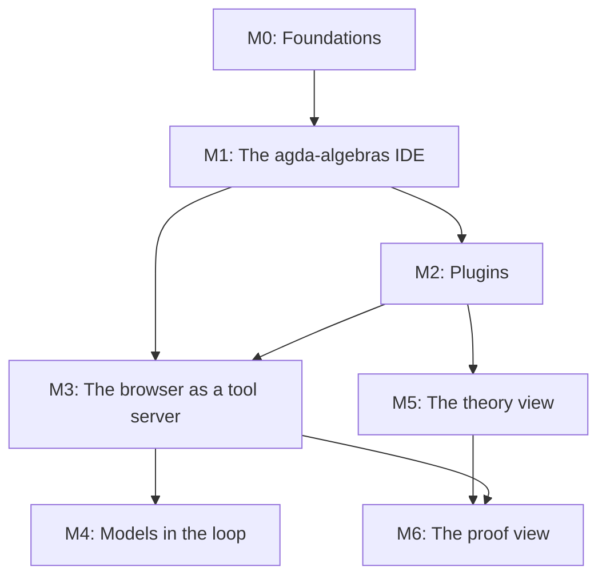

<!--
File: docs/GITHUB_PROJECT.md

The living project plan for agda-native-ide, in the format of the
williamdemeo/github-project template.

This file is partially generated by that template's engine (`make update`).
Manual prose (everything outside the marked regions: the summary, the
milestone descriptions, the exit criteria, the dependency graph) is
hand-edited.  Issue listings between

    BEGIN GENERATED: milestone-N
    ...
    END GENERATED: milestone-N

markers are regenerated from GitHub state by `make update`; edits inside
those regions are overwritten on the next update.  Structure lives here;
state (issue numbers, open/closed, assignees) lives on GitHub.

Two grammar tokens below are the engine's, not prose: the em-dash in each
`### Milestone N — Title` heading, which the parser requires, and the
`**Labels:**` line of each issue.
-->

# agda-native-ide: GitHub Project Roadmap

**Project Title**:  agda-native-ide, an Agda IDE in the browser with proof-assist and corpus-search plugins

**Repository**:  `formalverification/agda-native-ide`

---

## Summary

An Agda IDE that runs in a browser tab, with no server: the type-checker is
loaded by default, and everything else is a plugin (libraries, corpora,
models, tools).  A reader opens a library in an Explorer, writes in a
`Main.agda` buffer, and reads Agda's goals and errors in an info pane, the
way <https://plfa.isotopy.xyz/> already lets them do for PLFA.  A model can
work in the same tab through the tool contract `agda-mcp` defines, judged by
Agda and never by itself.  Later, a development can be seen as a diagram,
generated from the checked source.

The plan follows the proposal in agda-native-air's
[`docs/notes/browser-ide-proposal.md`][proposal], with one change of order:
the first deliverable is the library IDE that the agda-algebras site needs
(its "Playground" link opens this IDE in a new tab), because it is what a
reader can use now, and every later milestone is built on it.

Two facts make the project cheaper than it sounds.

+  A complete browser Agda IDE already exists and is MIT-licensed:
   [`plfa-playground`][plfa-playground] (Svelte, CodeMirror 6, and the Agda
   Language Server compiled to WASI, built from pinned sources).  This
   project forks it rather than starting over.
+  agda-algebras [PR 585][pr-585] built and measured the other half: the
   plain `agda-opt.wasm` checker driven through Agda's interaction protocol
   in a browser, with no cross-origin isolation, archives proved under the
   shipped compiler, and a review that found the traps.  Its numbers and its
   code seed the second lane and the library archives.

[proposal]: https://github.com/formalverification/agda-native-air/blob/main/docs/notes/browser-ide-proposal.md
[plfa-playground]: https://github.com/SeungheonOh/plfa-playground
[pr-585]: https://github.com/ualib/agda-algebras/pull/585

---

## Labels

The `milestone-N-*` labels are load-bearing: the engine attaches them, and
`make update` uses them to place each issue in its milestone's region.  The
others are topic labels.

- `milestone-0-foundations` (0075ca): Milestone 0, the forked runtime building, tested and deployed.
- `milestone-1-library-ide` (1d76db): Milestone 1, the agda-algebras IDE.
- `milestone-2-plugins` (5319e7): Milestone 2, libraries and resources as plugins.
- `milestone-3-tool-server` (0e8a16): Milestone 3, the browser as a tool server.
- `milestone-4-models` (d93f0b): Milestone 4, models in the loop.
- `milestone-5-theory-view` (c5def5): Milestone 5, the theory view.
- `milestone-6-proof-view` (bfd4f2): Milestone 6, the proof view.
- `runtime` (0052cc): The compiler, its workers, WASI, and the virtual filesystem.
- `ui` (1d76db): The editor, the Explorer, the info pane, and the layout.
- `libraries` (5319e7): Library archives, closure indices, and interfaces.
- `plugins` (5319e7): The plugin manifest, loader, and consent gate.
- `tool-server` (0e8a16): The client-side tool contract.
- `models` (d93f0b): Model providers, keys, sessions, and bridges.
- `diagrams` (c5def5): The theory and proof views.
- `hosting` (fbca04): Deployment, response headers, domains, and caching.
- `build` (fbca04): Nix, npm, and continuous integration.
- `provenance` (e4e669): Licenses, pins, notices, and the upstream fork.
- `measurement` (1d76db): Benchmarks and measurements recorded with their runs.
- `security` (b60205): Secrets, isolation, and what leaves the tab.
- `adr` (ededed): A decision that gets an ADR.
- `cross-repo` (ededed): Work that lands in another repository.
- `documentation` (0075ca): Improvements or additions to documentation
- `bug` (d73a4a): Something isn't working
- `enhancement` (a2eeef): New feature or request
- `good first issue` (7057ff): Good for newcomers

---

## Milestones

### Milestone 0 — Foundations

**Description**:

Turn this template copy into a project that builds, tests and deploys the
forked runtime, before changing what it does.  The fork comes in with its
history and attribution; the build is reproducible under Nix; the compiler
and the standard library are pinned by hash, never committed blind; CI
drives a real check in a headless browser; and the site is served with the
cross-origin isolation the language server needs.  ADR 0001 records the
runtime decision and the second lane.

**Exit criterion**:

A commit on `main` deploys the unmodified fork to the chosen host, where
`crossOriginIsolated` is true on a first visit in a fresh browser profile;
`nix build` reproduces the site from a clean clone; CI builds it, runs the
unit tests, and checks `Main.agda` in headless Chromium.

---

### Milestone 1 — The agda-algebras IDE

**Description**:

The first thing a reader uses.  The agda-algebras site's "Playground" link
opens this IDE in a new tab: an Explorer listing every agda-algebras module,
a `Main.agda` buffer over the standard library and agda-algebras, and the
Agda info pane.  Most of the work is generalizing the fork from PLFA's
hard-coded two-level Explorer to a library tree, and building the library's
archives: per-closure, verified against Agda's own dependency graph, and
proved under the shipped compiler, because an interface Agda does not
accept is silently checked again.

**Exit criterion**:

From agda-algebras.universalalgebra.org, "Playground" opens the IDE in a new
tab; the Explorer lists all of the library's modules; a `Main.agda` that
imports `Setoid.Varieties.HSP` checks with only `Main` type-checked from
source; give, refine and case split work on it; and every download is
stated, in bytes, before it starts.

---

### Milestone 2 — Plugins

**Description**:

Everything but the type-checker becomes a plugin: a manifest that says what
it is (library, corpus, model, tool), what it is pinned to (the Agda
version, the commit, the digests), what it mounts, what it registers, and
what it costs.  A consent gate installs one, saying how many bytes from
which origin.  The fork's PLFA manifest and its `mountDriveArchives()` hook
are the template.  Projects of several files with their own `.agda-lib`
arrive here too.

**Exit criterion**:

The standard library and agda-algebras are installed as plugins through the
consent gate; a third library is added by a manifest alone, with no code
change; and a two-module user project checks.

---

### Milestone 3 — The browser as a tool server

**Description**:

`agda-mcp`'s tools, answered in the page, under agda-native-air ADR 0002's
contract: a verdict is an exit code and never a reading of diagnostics text,
every answer names the tree it checked, and a lane answer carries no
verdict.  The language server is the interaction lane; the plain
`agda-opt.wasm` is the second artifact, the batch lane whose exit code is the
verdict of record.  The library's sources are mounted, so a full-text search
answers what agda-native-air's measurements say a model wants from a
library: the text, beside the verdict.

**Exit criterion**:

Every tool in the proposal's table is answered client-side or marked
unsupported with its reason; the archived agent sessions replay through the
browser surface with zero disagreements on committed candidates.

---

### Milestone 4 — Models in the loop

**Description**:

A model works in the IDE through ordinary tool calling against the Milestone
3 surface.  The default is a frontier model on the user's own key, behind a
consent gate that says what leaves the tab and when; the key lives on its
own origin, out of reach of the page and its plugins.  A local model is a
plugin labeled unmeasured until it is measured.  The rule does not change:
the model's claims are never the verdict; Agda's are.

**Exit criterion**:

A frontier model, on the user's key behind the gate, proves a benchmark
obligation through the browser surface; the session is archived and renders
in the replay format of agda-native-air's demo page; and no script on the
IDE's origin can read the key.

---

### Milestone 5 — The theory view

**Description**:

A development drawn as a graph of definitions, from the corpus alone, with
no Agda running: nodes are definitions, and each edge says where it came
from (exact body references, approximate type dependencies, or Agda's module
load order).  The proposal ranks this the cheapest step with the best
payoff, so it may start whenever someone is free; it depends only on the
corpus.

**Exit criterion**:

The agda-algebras definition graph renders in the IDE with every edge
labeled by its provenance, and a node opens its source in the editor.

---

### Milestone 6 — The proof view

**Description**:

One proof drawn as a derivation, generated from the checked term with the
judgment at each node, holes as open leaves; then edited through Agda's own
commands at a leaf.  It needs a proof-term export that does not exist yet
(agda-native-air's extractor exports types as ASTs and bodies only as text),
and its elision rules are settled read-only on agda-native-air's 55
benchmark golds before any editing.  One mode, two registers: solid for
checked structure, dashed for hole interiors; nothing appears that is not
in the source.

**Exit criterion**:

A benchmark gold renders as a readable derivation under the settled elision
rules, and refine and give at an open leaf re-check the file and redraw the
diagram from the result.

---

### Milestone dependencies

Hand-authored; `make update` never touches it.

M5 needs only a corpus plugin from M2, and its drawing needs no Agda; it can
start early.  M6 needs M3's commands for editing and an export from
agda-native-air (its issue [M6-1] is cross-repo).

---

## Issues

Each issue below carries its labels and a body ready for GitHub.  On the
first populate, the `[MN-k]` ID in each heading becomes the issue title's
prefix, the join key that keeps re-runs idempotent, and the new issue number
is written back into the heading.

## Milestone 0 — Foundations

<!-- BEGIN GENERATED: milestone-0 -->

### Issue M0-1: Detach the template's engine and write the project's working rules (#1)

**Labels:** `documentation`, `milestone-0-foundations`, `build`

This repository was created from williamdemeo/github-project and still carries a copy of its engine.  Run `make init`, which deletes the copy and installs a consumer flake taking the engine as a pinned input, then `nix flake lock`.  Replace the template's README and CLAUDE.md with this project's: what it is, where its plan and decisions live, the build, and the house rules a session working here must follow.

#### Acceptance criteria

+  `make lint` passes through the consumer flake; `scripts/gh_project_populate.py` is gone.
+  README states the project's purpose and status, and links the plan, the ADRs, and the proposal.
+  CLAUDE.md names the build and test commands and the project's rules.

---

### Issue M0-2: Fork plfa-playground into this repository, history and attribution intact (#2)

**Labels:** `milestone-0-foundations`, `runtime`, `provenance`

Bring in [`plfa-playground`][plfa] at `ae0aa84` (2026-08-31), the runtime this project builds on, unchanged.  Its LICENSE is MIT, Copyright 2026 Andy Pan; its NOTICE records the lineage (agda-web/als-demo, agda-web/agda-language-server, agda-web/agda, agda/agda-stdlib) and the PLFA chapters it embeds under CC BY 4.0.

Decide how, in the ADR of [M0-7]: a history merge keeps upstream's commits and makes later syncs a merge, but upstream commits the 33 MB compiler, its 10 MB gzip and the standard-library archive, so every one of those blobs enters this repository for good; a snapshot import with a provenance record (the upstream commit and each file's hash) does not.  Either way the binaries are then removed from the tree and pinned by hash instead ([M0-4]).

#### Acceptance criteria

+  The fork builds and runs unchanged (`npm ci && npm run build`), and checks `Main.agda` in a browser.
+  LICENSE and NOTICE carry upstream's copyright and lineage; the font licenses (JuliaMono) are included.
+  An `upstream` remote and the sync procedure are documented.

[plfa]: https://github.com/SeungheonOh/plfa-playground

#### Findings, 2026-10-04

+  **The fork builds and passes as it stands**: `npm ci`, `npm run build`, `npm test` and `npm run check` all pass with the flake's node 22.22.2.  Served with the isolation headers on localhost, it was ready in 1.15 s and finished its first check at 2.58 s; the first visit made 25 requests for 15,630,936 bytes, and a warm reload made none.
+  **Binaries**: upstream commits about 48.6 MB under `static/` (the 33 MB compiler, its 10 MB gzip, the archives and the fonts).
+  **Audit**: `npm audit` reports 5 high and 3 low findings; `devalue` is bundled into the page, and the rest (`cookie` through SvelteKit, `undici`, `sharp`, `miniflare`, `wrangler`) are build-time only.  Dropping the Cloudflare tooling (`wrangler`, `workerd`, `sharp`) removes most of them, and both LGPL packages.
+  **Licenses** of the bundled npm packages are permissive (MIT for most, ISC for `@lucide/svelte`, Apache-2.0 for `comlink`, whose text must ship; `jszip` is MIT or GPL-3.0, so choose MIT).

---

### Issue M0-3: A reproducible build under Nix (#3)

**Labels:** `milestone-0-foundations`, `build`

A dev shell with the pinned node, and a `packages.site` output that builds the static site from `package-lock.json` with fixed-output dependencies (for example `buildNpmPackage` with a pinned `npmDepsHash`), so a clean clone builds the same site with no network beyond fixed-output fetches.  Make targets: `dev`, `build`, `test`, `check`.

#### Acceptance criteria

+  `nix build .#site` from a clean clone succeeds, twice, with the same output hash.
+  `nix develop --command make test` runs upstream's unit tests.

#### Findings, 2026-10-04

+  **The build is `vite build`** (SvelteKit's static adapter, prerendered, no server rendering) plus one post-step that gzips the compiler and deletes the raw copy; every Agda asset is a committed file copied through verbatim.
+  **Generate what upstream maintains by hand**: the `?cache=` tokens, the compiler's byte length hard-coded in the controller, and the IndexedDB cache namespace.  Derive them from content hashes and real sizes at build time, or a rebuilt asset is served stale behind a 14,400 s cache.
+  **Trim**: the main chunk is 1,144 kB (362 kB gzipped), and carries `zod`, `marked` and CodeMirror's markdown, HTML, JavaScript and CSS modes, which only the PLFA reader needs.

---

### Issue M0-4: Pin the compiler and the standard library by hash, with a rebuild recipe (#4)

**Labels:** `milestone-0-foundations`, `runtime`, `build`, `provenance`

Upstream commits its compiler, `als-2.8ext.wasm` (32,996,332 bytes, SHA-256 `53c62b0ad569a9d123f744b192c13780c494ade0cddef4daaa00db41ecd7f7a1` per its `compiler/README.md`), built from agda-web/agda-language-server `e65419f8`, agda-web/agda `e2f8c694` and ghc-wasm-meta `c3f44696` (the 9.10 flavour).  Pin it, and the standard-library archive, as fixed-output derivations fetched by URL and hash, never committed here, and record the provenance in one table.  Port `compiler/build-agda-wasm.sh` into a flake app that rebuilds the compiler from those pins, and record whether the rebuild is byte-identical, whichever way it comes out.

#### Acceptance criteria

+  The build fails on a hash mismatch.
+  The provenance table names every pinned artifact, its source, its hash and its license.
+  The rebuild was attempted and its outcome is recorded.

#### Findings, 2026-10-04

+  **The exact binary is not a release asset anywhere**.  No wasm release asset of agda-web/agda-language-server, agda/agda-language-server or agda-web/agda-wasm-dist has its digest; agda-web/als-demo and plfa-playground publish no releases, and als-demo's own copy is a different nightly build.  It exists only in plfa-playground's git tree, and re-gzipped on plfa.isotopy.xyz.
+  **A flake can pin it today**.  `fetchurl` of `https://raw.githubusercontent.com/SeungheonOh/plfa-playground/8a03ddaf95a81232fe8467063ff373ca53e5837e/static/als-2.8ext.wasm` with `sha256-U8YrCtVpqdEj90SxksE3gMSUreDN3vTaqgDbQezX96E=` succeeded (`nix store prefetch-file`), and the committed file's SHA-256 matches the upstream README.  It is a single source in a personal repository, so add a mirror this organization controls (a release asset here) under the same hash, and prove the failover.
+  **What the pins are**.  ALS `e65419f8` is the head of agda-web/agda-language-server's branch `wasm-only-raw-responses` (2025-10-22); Agda `e2f8c694` is agda-web's wasm32 patch on a base two packaging commits short of the `v2.8.0` tag.  The nearest release asset (agda-web's `nightly-20260407`, which als-demo uses) differs by one commit that changes response handling, so it is not a drop-in replacement.
+  **The recipe is not hermetic**.  `build-agda-wasm.sh` runs `cabal update` with no `index-state` and fetches sources and a Hackage tarball at build time.  Make the from-source rebuild an optional CI job that pins `index-state` first, not the flake's default path.
+  **Licenses** the published notice must carry are in [#48].

[#48]: https://github.com/formalverification/agda-native-ide/issues/48

---

### Issue M0-5: CI: build, unit tests, type checks, and a real check in headless Chromium (#5)

**Labels:** `milestone-0-foundations`, `build`, `measurement`

One workflow on every pull request: the Nix build, upstream's vitest and svelte-check, and a browser job that serves the built site with `Cross-Origin-Opener-Policy: same-origin` and `Cross-Origin-Embedder-Policy: require-corp`, waits for "Agda ready", checks `Main.agda`, gives at a goal, and asserts the goal count and `crossOriginIsolated`.  Upstream's Playwright benchmark harness is the starting point.

#### Acceptance criteria

+  The browser job fails when the check path is broken (shown by a deliberately broken build).
+  Its timings are uploaded as an artifact.

#### Findings, 2026-10-04

+  **The browser job is the only way to test the language server**: it cannot be driven under wasmtime (it cannot make stdin nonblocking there, and answers only at end of input).
+  **What to assert**: the count of `Checking` lines in the running info (one, for `Main`, when the shipped interfaces are accepted) and a deliberate type error reported at its position.  The count is the only signal that separates acceptance from silent recompilation.
+  **A working harness exists**: a small node server that sends the isolation headers and a CDP driver that waits for readiness and counts checks were used for these measurements; they are a starting point alongside upstream's Playwright benchmark.

---

### Issue M0-6: Choose the host and deploy with cross-origin isolation (#6)

**Labels:** `milestone-0-foundations`, `hosting`, `adr`

The language server's workers share memory, so the page needs `SharedArrayBuffer`, so every route must be served with COOP `same-origin` and COEP `require-corp`, or the fork's service-worker fallback (`static/coi-serviceworker.js`) must add them, at the cost of one reload on a first visit.  The options are a host that sets headers (upstream deploys to Cloudflare from `static/_headers`), or GitHub Pages with the service worker.

Measured 2026-10-04: formalverification.io's DNS is on Cloudflare and its site is served by GitHub Pages directly; agda-algebras.universalalgebra.org is proxied by Cloudflare in front of GitHub Pages; plfa.isotopy.xyz sends both headers from Cloudflare.  Decide the host and the domain (for example `ide.formalverification.io`), a cache policy (hashed, immutable assets; the compiler and the archives versioned by hash), and the deploy workflow.

#### Acceptance criteria

+  A commit on `main` deploys.
+  `curl -sI` shows both headers on the page and its assets, or the service-worker path is documented and tested.
+  `crossOriginIsolated` is true on a first visit in a fresh browser profile.
+  The compiler and the archives are cached at the edge (Cloudflare caches `.gz` and `.zip` by default, and not `.wasm` or `.json`).
+  If the app is served under a path rather than at a domain's root, every fetch goes through the configured base path (the fork fetches its PLFA data by root-absolute URLs and sets no base path).

#### Findings, 2026-10-04

+  **GitHub Pages works with the fork's service worker, given a guard**.  Served with no isolation headers, coi-serviceworker v0.1.7 (MIT), scoped to the app's directory, isolated the page, its URL workers and its blob workers after one self-reload on a first visit (and one more after a hard reload), in headless Chromium 153.  But its reload can start before the worker activates, leaving the page neither controlled nor isolated, and it never retries: 1 of 12 fresh visits on loopback, 0 of 12 with 150 ms of added latency, 3 of 8 in trials of the real app.  A guard gave 30 of 30: an inline script before the worker's script saves `sessionStorage.coiReloadedBySelf`, and one after it reloads at most once per tab when that load was the worker's own reload and the page is still not isolated once `navigator.serviceWorker.ready` resolves.
+  **A host that sends the headers avoids the reload and the race**.  Upstream's Cloudflare deployment sends COOP, COEP and CORP from `static/_headers`, so its worker never registers.  formalverification.io's DNS is already on Cloudflare, so a Cloudflare Pages project on a subdomain, or a response-header rule on a proxied path, is open to whoever holds the account.
+  **`require-corp` breaks nothing the fork loads**.  All 25 requests of a first load of plfa.isotopy.xyz were same-origin: 14.68 MB, 10.36 MB of it the compiler's gzip.
+  **Compression**.  GitHub Pages serves `.gz` as `application/gzip` with no `Content-Encoding`, and `.wasm` as `application/wasm`, gzipped on the fly when asked; the fork's fetch handles both, through the service worker too (the same SHA-256 after inflation).
+  **Caching**.  GitHub Pages fixes `max-age=600`, and Cloudflare's browser TTL was 14400 s on assets, so upstream's `_headers` cache rules cannot apply there: version every archive by content hash in its name or query.
+  **Limits of the service-worker path**.  It needs service workers and a secure context; where they are disabled, the page cannot start ([#8]).  Only Chromium was driven: open the deployed page in Firefox and Safari before relying on it.

[#8]: https://github.com/formalverification/agda-native-ide/issues/8

#### More findings, 2026-10-04

+  **A second, independent fix of the service worker's race**, `window.coi.doReload = () => navigator.serviceWorker.ready.then(() => location.reload())` set before `coi-serviceworker.js` loads, gave 20 of 20 first visits isolated where the unpatched worker left 4 of 15 on a blank page.
+  **No base path is needed**: SvelteKit's default relative paths compute the base from the page's location at run time, so the build works under any path once the four root-absolute `/plfa/...` fetches go through `asset()` or `base`.
+  **On a shared origin**, namespace the localStorage keys, the IndexedDB database name and the worker's sessionStorage keys, which are origin-wide.
+  **HTML is cached for 600 s**, so a visitor holding a stale `index.html` just after a deploy may ask for code chunks the deploy replaced (inferred from the headers, not tested).

---

### Issue M0-7: ADR 0001, the runtime: what is forked, what is kept, and the second lane (#7)

**Labels:** `documentation`, `milestone-0-foundations`, `runtime`, `adr`

Record the runtime decision in the ADR form agda-native-air uses (decision, evidence, status, a decision log), with the companion explanation in a separate note.

+  **The fork**: plfa-playground for its language-server lane, its two-worker architecture, its give rule (an edit inside one goal goes through `Cmd_give`; anything else is a full `Cmd_load`), and its archive format; how it is imported ([M0-2]).
+  **The second lane**: the plain `agda-opt.wasm` for the verdict of record, as the proposal's § 1 asks.  agda-algebras [PR 585][pr-585] measured that the same checker answers every goal command through `--interaction-json` with no isolation (headless Chromium 153, 2026-10-04), and a JavaScript Promise Integration probe kept one process alive across commands without isolation (1.45 s per reload, 45 to 55 ms per goal query on a 244-module closure, Chromium only).  Record what that means for the isolation requirement and for browsers without it.
+  **What is not adopted yet**, and why.

#### Acceptance criteria

+  `docs/adr/0001-runtime.md` exists, links the proposal, and every claim in it carries its evidence.

[pr-585]: https://github.com/ualib/agda-algebras/pull/585

---

### Issue M0-8: Say so when the page is not cross-origin isolated (#8)

**Labels:** `bug`, `milestone-0-foundations`, `runtime`

The fork has a friendly message for a page that is not cross-origin isolated, but it creates its shared buffers while the page's script initializes, before that check, and `SharedArrayBuffer` is undefined on such a page (measured in Chromium, 2026-10-04), so the message is probably never reached.  Move the allocation after the check, so that a host without the headers, or a browser without the feature, gets a sentence instead of a dead page.

#### Acceptance criteria

+  Served without the headers and without the service worker, the page shows the message, and a headless test checks it.

#### Findings, 2026-10-04

Confirmed twice: without the isolation headers, the fork's service-worker fallback left 3 of 8 and 4 of 15 fresh first visits on a page that threw before its explanatory message could render, because the shared buffers are allocated when the page component is created.  A manual reload recovered.

---

### Issue M0-9: A complete notice for everything the page ships (#48)

**Labels:** `milestone-0-foundations`, `provenance`

What the fork ships carries more licenses than its NOTICE names (measured 2026-10-04):

+  **The compiler binaries statically link GHC's runtime and boot libraries**, under the Glasgow Haskell Compiler License (BSD-3 style, which requires the notice with a binary redistribution), **and GMP**, under LGPL-3.0-or-later or GPL-2.0-or-later: `strings` finds GMP's assertions and `ghc-bignum`'s wrappers in `als-2.8ext.wasm`, and in the `agda-opt.wasm` of the second lane.  About 60 Hackage packages are linked too.  The language server is MIT and Agda MIT-style.
+  **The fork's LICENSE names Andy Pan** (the copyright it inherits from agda-web/als-demo), **while every commit is Seungheon Oh's**; credit both.
+  **The standard-library archive omits the standard library's LICENCE**, and JuliaMono (OFL-1.1) carries its notice only in the fonts' metadata.

The same GHC and GMP gap is in agda-algebras PR 585's published notice.

#### Acceptance criteria

+  NOTICE names every shipped artifact with its license text, and a copy is published beside the assets.
+  GMP's relinking condition is met by pointing at the pinned sources and the build recipe, or the judgment that it is met otherwise is recorded.
+  The linked Hackage packages are listed from the build plan, or the reason they cannot be yet is recorded.

---

### Issue M0-10: Ship builtin interfaces that Agda 2.8 accepts (#49)

**Labels:** `bug`, `milestone-0-foundations`, `runtime`

The fork's `static/agda-data.zip` (Agda's `lib/prim`) carries interfaces in Agda 2.7.0.1's format: all 37 have header version 202406290, where Agda 2.8.0 writes and reads 202507030.  So every fresh profile's first check type-checks five builtin modules again (measured 2026-10-04: 6 `Checking` lines instead of 1).  The rejection does not cascade, since the standard library's and agda-algebras' interfaces are still accepted, but it costs every first visit.  Ship the 2.8 interfaces from the native data directory (`lib/prim/_build/2.8.0/agda`), built by the same procedure as the libraries' ([M1-4]).

#### Acceptance criteria

+  A fresh profile's first check of a `Main.agda` that imports only builtins type-checks only `Main`.

<!-- END GENERATED: milestone-0 -->

## Milestone 1 — The agda-algebras IDE

<!-- BEGIN GENERATED: milestone-1 -->

### Issue M1-1: A library Explorer: every module, as a tree, from a manifest (#9)

**Labels:** `milestone-1-library-ide`, `ui`

The fork's Explorer is hard-coded to two levels: a PLAYGROUND section with `Main.agda`, and PLFA's three parts and their chapters, read from `/plfa/manifest.json`.  Replace it with a tree generated from a library manifest: directories as folders, modules as files, for every module of agda-algebras' `src/`, collapsible and filterable by name.  The PLAYGROUND section keeps the scratch files.

The shape, measured 2026-10-04: 344 modules in 64 folders, at most four folders deep, 408 rows fully expanded, so no virtualization is needed.  63 of the 64 folders sit beside a module of the same name (`Setoid/` beside `Setoid.lagda.md`); show each such pair as one row, whose chevron toggles and whose label opens the module (`Legacy/` is the exception).  A flat manifest of module, path and title is 4.7 KB gzipped.  The fork also disables file rows while Agda is busy, and hides the Explorer at 800 px and below; neither suits a library browser.

#### Acceptance criteria

+  Every module is listed, in directory order, from a manifest the build writes.
+  A filter finds a module by any part of its dotted name.
+  The tree uses ARIA tree roles, can be navigated with the arrow keys, remembers what is expanded, and reveals the open file.
+  The tree stays usable while a check runs.

---

### Issue M1-2: Open library modules read-only, and copy one into the playground (#10)

**Labels:** `milestone-1-library-ide`, `ui`

The fork makes every file editable and autosaves everything, and it swaps one editor document between files, so undo crosses files: measured on the live site 2026-10-04, Ctrl-Z after opening a chapter put `Main.agda`'s text into the chapter, and the autosave stored it there.  Keep one editor state per open file instead, switched as a whole.

A library module opens read-only, since it is the checked library and its interface is what other files import, and is loaded so that hover, infer and normalize work in its scope.  Actions: copy it (or a selection) into an editable scratch file; insert `open import` for it into `Main.agda`; open its page on the agda-algebras site, which already renders it ([M1-11]).

#### Acceptance criteria

+  A library tab cannot be edited, and says so.
+  Undo never crosses files.
+  "Copy to playground" makes an editable file that checks, and the goal commands work on it.

---

### Issue M1-3: The playground project: Main.agda over the standard library and agda-algebras (#11)

**Labels:** `milestone-1-library-ide`, `libraries`

A scratch project whose `.agda-lib` depends on `standard-library-2.3` and `agda-algebras`, with the library's flags (`-WnoUnsupportedIndexedMatch`).  The default `Main.agda` carries the library's own options line, `{-# OPTIONS --cubical-compatible --exact-split --safe #-}`, so that a postulate or a `TERMINATING` pragma is refused as the library would refuse it (PR 585's review found that an exercise without it reported a postulated "proof" as checked), and opens one goal.  Keep its imports light, so the first check is quick: `Overture.Basic` alone is 7.1 MB in three fetches under [M1-4]'s packing, and heavier imports load on demand ([M1-6]).

#### Acceptance criteria

+  A first visit shows `Main.agda` with one open goal, and checking it reports that goal with its context.
+  `open import Setoid.Algebras.Basic` resolves.
+  A postulate in `Main.agda` is refused.

#### Findings, 2026-10-04

+  **A layout that worked** for `open import Overture.Basic`: agda-algebras at `/agda-algebras` (its `.agda-lib`, `src/`, and `_build/2.8.0/agda/src/`); the standard library's interfaces under `/stdlib/_build/2.8.0/agda/src/`; the builtins' under `/lib/prim/_build/2.8.0/agda/`; a root library for `/Main.agda` (`depend: standard-library agda-algebras`) in place of the fork's `/plfa.agda-lib`; and a libraries file naming both libraries' `.agda-lib` files.  agda-algebras' `depend: standard-library-2.3` resolves, since the fork's standard library is named exactly that.
+  **`mountDriveArchives()` alone cannot add a library**: it extracts archives at `/`, but the libraries and defaults files are written once, hard-coded, when the drive worker starts.  Generalize the drive's start message to a list of libraries (archive, `.agda-lib` path, name) and write those files from it.
+  **Prefer an explicit root library** over listing libraries in `defaults`: which flags apply to a file covered only by `defaults` was not verified.

---

### Issue M1-4: Per-closure library archives, indexed by Agda's own dependency graph (#12)

**Labels:** `milestone-1-library-ide`, `libraries`, `build`

Build agda-algebras' and the standard library's sources and interfaces with the flake's native Agda 2.8.0 from a pinned agda-algebras commit, laid out as the fork mounts them (sources under each library root, interfaces under `_build/2.8.0/agda/`), with an index taken from the node set `agda --dependency-graph` writes, never from the corpus's module graph, which under-counts imports (the proposal's "What is hard").  Agda's graph is transitively reduced, but reachability in it is exact.

What there is to ship, measured 2026-10-04 from a fresh native build of the whole library (1 min 42 s, 1.84 GB peak): 607 modules (344 of agda-algebras, 251 of the standard library's 1,153, and 12 builtins), whose interfaces are 113,999,732 bytes raw and 96,346,359 gzipped; the sources are 670,837 bytes as one tar.gz.  An interface is already gzip-compressed inside, so packing saves about 15%.

The packing the measurement recommends: the standard library in nine dependency tiers (each module in the tier of the first agda-algebras subdirectory that needs it; the largest 13.4 MB), one compressed interface per agda-algebras module, and all sources in one archive loaded eagerly (it also fills the Explorer).  A `Main.agda` importing `Overture.Basic`, `Setoid.Algebras.Basic` and `Setoid.Varieties.HSP` then fetches 99 files, 54.6 MB, against an exact floor of 54.3 MB; with the compiler, about 66.5 MB on a first visit, 4.3 times the fork's first PLFA chapter (15.6 MB).  Three more findings bind the build:

+  **Compress, and name artifacts `.gz` or `.zip`**.  Cloudflare caches those at its edge and does not cache `.wasm`, `.json` or unknown extensions such as `.agdai` by default; the fork's stored ZIPs cost 15 to 17% more over the wire.
+  **Build with one fixed procedure, in CI**.  65 interfaces (Legacy, `Examples.Structures` and the modules importing them) are not reproducible: they store deprecation warnings that contain absolute source paths, and how many depends on build order.  The other 281 were byte-identical across builds in different directories.
+  **Stay under GitHub's per-file limits** if the deploy is a git push (a warning at 50 MiB, a block at 100 MiB): one archive of everything (96.4 MB) would not.

#### Acceptance criteria

+  The archives and the index regenerate from the pinned commit with one command, in CI.
+  For each root, a cold check that mounts only what the index names type-checks only the root.
+  The total and per-root sizes are recorded with the run.

#### Findings, 2026-10-04

+  **Native interfaces reproduce the fork's**: the flake's native Agda rebuilt upstream's PLFA interfaces identical entry for entry (by CRC), and the browser accepted them.
+  **Do not use the fork's closure index as is**: it is a regular expression over source text, which misses `open import` inside parameterized or nested modules and has no literate handling beyond fenced blocks.  A missed import shows up as a silently slow check.
+  **Ship an interface for everything that can be imported**: modules the browser checks from source are not reused across reloads (`Data.Nat.Base` took 27.4 s, then 22.5 s again after a reload).

---

### Issue M1-5: Prove that the shipped compiler accepts the shipped interfaces (#13)

**Labels:** `milestone-1-library-ide`, `runtime`, `libraries`, `measurement`

Agda accepts an interface only when it was built by the same Agda under the same options, and a mismatch is silent: the module is type-checked again, and the page is merely slow.  So acceptance is measured, not assumed: the build checks every root under the shipped compiler with only its archives mounted and fails unless exactly one module was type-checked.  Count the `Checking` lines unanchored, since Agda indents nested ones (an anchored count reads 1 for every run; this cost PR 585 a defect).

PR 585 proved this for `agda-opt.wasm` (native interfaces accepted unchanged; 1.89 to 1.92 s against 1.90 to 1.94 s for wasm-built ones).  The language server embeds its own build of Agda (agda-web/agda `e2f8c694`), which needs its own proof.

#### Acceptance criteria

+  A build step, run in CI, checks every root under the shipped compiler and fails unless each checks exactly one module.
+  A deliberately stale interface makes it fail.

#### Findings, 2026-10-04

+  **The language server accepts natively built interfaces**.  Its Agda reports "Agda v2.8.0 Language Server v6 (WebAssembly build RAW)", and both it and the flake's native Agda 2.8.0 use interface version 202507030; agda-web/agda `e2f8c694` is one commit ahead of `v2.8.0` (nonblocking stdin on wasm32, a lock file, packaging) and two behind (CI and the test suite), with no change to serialization.
+  **Measured in headless Chromium 153** against a locally built, instrumented copy of the fork: a `Main` importing `Overture.Basic` reported one `Checking` line (13.6 to 18.5 s), where the sources-only control checked all 66 modules (92.2 s); a `Main` importing `Setoid.Varieties.HSP` (313 interfaces, 92 of agda-algebras) again checked only `Main`.  A deliberate type error came back with the right position and message, so the page elaborates against the shipped interfaces rather than skipping work.  The library's own `make check` output was accepted as it stood once placed in the browser's layout.
+  **Agda 2.8 compares** the interface version, the source hash, the pragma options (library flags and the file's own options) and the imports' hashes; absolute paths are not compared, so interfaces built at a host path are accepted at the guest's root.
+  **The gate must run in a browser**.  The language server cannot be driven under wasmtime: it fails to make stdin nonblocking there and answers only at end of input.
+  **What remains slow** is the drive, not Agda: [#50].  The fork's builtin interfaces are the one set rejected: [#49].

[#49]: https://github.com/formalverification/agda-native-ide/issues/49
[#50]: https://github.com/formalverification/agda-native-ide/issues/50

---

### Issue M1-6: Mount what the imports need, and say how much before fetching it (#14)

**Labels:** `milestone-1-library-ide`, `ui`, `libraries`

Mount only the closures `Main.agda`'s imports need.  When an import needs archives not yet present, compute them from the index, state the bytes, and fetch on consent; keep them in IndexedDB keyed by the archive's hash.  The fork's cache namespace is a hand-edited string that names the PLFA commit; derive it from the pins instead.  State sizes in one unit everywhere (a KB is 1,024 bytes).

#### Acceptance criteria

+  Adding `open import Setoid.Varieties.HSP` asks once, with the right size.
+  A second visit mounts from the cache with no network request for the archives.
+  An archive whose hash changed is fetched again and the old copy is evicted.

#### Findings, 2026-10-04

The fork restores IndexedDB records over the shipped files at the same paths, so a reader's edit to a library file persists across deploys until the cache namespace changes, and is then dropped silently, while the old database (possibly tens of MB of interfaces built in the browser) is never deleted.  Delete databases whose namespace is stale on startup, and keep library modules read-only ([#10]).

[#10]: https://github.com/formalverification/agda-native-ide/issues/10

---

### Issue M1-7: Open the IDE from the agda-algebras site, in a new tab (#15)

**Labels:** `milestone-1-library-ide`, `cross-repo`

In ualib/agda-algebras: the navigation's "Playground" entry links to this IDE and opens it in a new tab (MkDocs Material has no per-entry target, so a small script sets it), pinned to the library version the site documents, with deep links that open a module (for example `?open=Setoid/Varieties/HSP.lagda.md`).  Settle there what becomes of [PR 585][pr-585]'s in-page playground (issue [#577][i577]); its link-hook change stands on its own.

#### Acceptance criteria

+  On the agda-algebras site, "Playground" opens the IDE in a new tab.
+  A deep link opens the named module.

[pr-585]: https://github.com/ualib/agda-algebras/pull/585 [i577]: https://github.com/ualib/agda-algebras/issues/577

---

### Issue M1-8: Port PR 585's three exercises as example files (#16)

**Labels:** `good first issue`, `milestone-1-library-ide`, `libraries`

`graft` and `_✦_` from `Overture.Terms.Interpretation`, and `⊙-is-hom` from `Setoid.Homomorphisms.Properties`, with the hints PR 585 verified through its page.  Keep its review's fixes: the library's options line, and `_≈_` in scope in the homomorphism exercise so its goal prints as an equation.

#### Acceptance criteria

+  Each exercise is completed through the IDE with the hints it prints.

---

### Issue M1-9: A dark theme (#17)

**Labels:** `milestone-1-library-ide`, `ui`

The fork is light only, and on a dark system it draws Agda's dark token palette on a white editor (measured 2026-10-04); the agda-algebras site defaults to a dark palette, so a reader arriving from it gets a jarring switch.  Turn the page's 88 literal colors into tokens, and add a dark set that follows the system preference and can be switched.

#### Acceptance criteria

+  Both themes meet WCAG AA contrast for text and highlighting.
+  The choice persists across visits.

---

### Issue M1-10: A browser benchmark over agda-algebras (#18)

**Labels:** `milestone-1-library-ide`, `measurement`

Adapt the fork's PLFA benchmark (every chapter, real edits, warm and cold) to a fixed set of agda-algebras roots: the time to mount, the first check, a warm reload after an edit, and a goal command, archived with the commit and the machine.  Every number the documentation states comes from one of these runs.

#### Acceptance criteria

+  One command runs the benchmark and writes a report.
+  The documentation's figures cite a committed report.

---

### Issue M1-11: Retire the reader pane; link each module to its documentation page (#19)

**Labels:** `milestone-1-library-ide`, `ui`

The fork renders a PLFA chapter's prose beside its source, with `marked` and PLFA's kramdown conventions.  agda-algebras' conventions would render badly there (measured 2026-10-04: 1,901 kramdown attribute spans in 137 modules would show as literal text, `$` math in 40, and reference links that depend on the site's shared link file would break), and the agda-algebras site already renders every module, with semantic highlighting, at its dotted path.  So remove the reader pane, its scroll sync and the `marked` dependency, and give each library module a link to its page.

#### Acceptance criteria

+  The reader pane and its code are gone.
+  Every library module links to its page on the agda-algebras site, at the version the IDE mounts.

---

### Issue M1-12: Retire the fork's PLFA-specific code and content (#20)

**Labels:** `milestone-1-library-ide`, `provenance`

The fork carries PLFA throughout: about 750 lines of the page component, the whole of `browser-source.js` (position-compatible import aliases for PLFA paths), PLFA tests, four build scripts (645 lines), and 9.8 MB of chapters and interface archives under `static/plfa/`, under CC BY 4.0.  Remove them from the default build, keeping what [M2-3] needs to bring PLFA back as a plugin, and keep the NOTICE accurate about what is still shipped.

#### Acceptance criteria

+  The default build ships no PLFA content, and NOTICE says so.
+  The PLFA build scripts are archived or adapted for [M2-3], not lost.

---

### Issue M1-13: The commands for browsing a library (#21)

**Labels:** `enhancement`, `milestone-1-library-ide`, `ui`

The fork's toolbar has Type, Context, Give, Refine, Case split, Infer and Normalize, and its response handler reads seven kinds of answer.  The commands that matter most for browsing a library are missing: module contents (`Cmd_show_module_contents_toplevel`, C-c C-o), search about (`Cmd_search_about_toplevel`, C-c C-z) and why in scope (`Cmd_why_in_scope_toplevel`, C-c C-w).  Add them, with result cards for their answers.

#### Acceptance criteria

+  Each command answers in the info pane, on a library module and on `Main.agda`.

---

### Issue M1-14: The Explorer and the commands on a phone (#22)

**Labels:** `milestone-1-library-ide`, `ui`

At 800 px and below the fork hides the Explorer, so a phone cannot change files, and at 1,000 px its command strip already clips its last buttons (measured 2026-10-04).  Show the Explorer as a drawer on small screens, and let the command strip wrap or scroll.

#### Acceptance criteria

+  At 390 px, a module can be opened from the Explorer and every command reached, with no sideways scroll of the page.

---

### Issue M1-15: Narrow agda-algebras' umbrella imports, to shrink every closure (#23)

**Labels:** `milestone-1-library-ide`, `libraries`, `cross-repo`

In ualib/agda-algebras.  Every top-level group but `Order` pulls in at least 22 MB (gzipped) of standard-library interfaces, because modules import umbrella modules: `Setoid.Algebras.Basic` imports the whole `Overture` (which reaches `Overture.Cayley`, and with it `Data.Nat.Properties`, `Data.Fin.Properties` and `Data.Bool.Properties`) for six names from three submodules.  Importing the submodules instead would cut that module's standard-library closure from 25 MB to about 7 MB (an estimate from the dependency graph, measured 2026-10-04, not a rebuild); about 120 files import `Overture` this way.

#### Acceptance criteria

+  An agda-algebras issue tracks the change, and the closure sizes before and after are measured with [M1-4]'s pipeline.

---

### Issue M1-16: Index the virtual drive's file lookups (#50)

**Labels:** `milestone-1-library-ide`, `runtime`, `measurement`

The dominant cost of a check in the fork is not Agda but its in-memory filesystem (`@runno/wasi` 0.10.0): every file-status lookup scans every key on the drive and builds a regular expression per key, and Agda makes about 130 lookups per imported module.  Measured 2026-10-04 in headless Chromium 153, with interfaces Agda accepted (one `Checking` line):

+  `Main` importing `Overture.Basic`: 13.6 to 18.5 s per check; with a 40-line index (a set of paths and a map of directories, answering lookups directly), 1.8 to 3.7 s, with the same answers.
+  `Main` importing `Setoid.Varieties.HSP` (313 interfaces): 79 to 104 s; with the index, 11 to 22 s.
+  The same work (7,371 lookups on a warm reload) took 8.4 s with 1,361 files on the drive, 25.2 s with 3,361 and 34.6 s with 5,361: 80 to 99% of it drive time.  agda-algebras puts roughly 2,500 to 3,500 files there.

Index the drive (maintained on create, unlink, rename and archive extraction), mount only the standard-library sources the closures need rather than all 1,153, and avoid `include: .` at `/`, where every module is probed again.

#### Acceptance criteria

+  The per-lookup cost no longer grows with the number of files on the drive (a scaling run shows it).
+  A warm check of `Main` importing `Setoid.Varieties.HSP` is recorded by [M1-10]'s benchmark, before and after.

<!-- END GENERATED: milestone-1 -->

## Milestone 2 — Plugins

<!-- BEGIN GENERATED: milestone-2 -->

### Issue M2-1: The plugin manifest and its loader (#24)

**Labels:** `milestone-2-plugins`, `plugins`, `adr`

A plugin is a manifest and its archives (the proposal's § 5): its kind (library, corpus, model, tool); its pins (the Agda version, the source commit, the digests); what it mounts (archives, with the verified closure index of [M1-4]); what it registers (tools, search indices); and what it costs, in bytes.  Generalize the fork's PLFA manifest and its `mountDriveArchives()` hook, validate manifests with a schema, and record the design in an ADR.

#### Acceptance criteria

+  The standard library and agda-algebras are expressed as plugins and load through the loader.
+  An invalid manifest is refused with a message naming the field.

---

### Issue M2-2: The install consent gate (#25)

**Labels:** `milestone-2-plugins`, `ui`, `plugins`, `security`

Installing a plugin says what it is, from which origin, and how many bytes, and fetches nothing before the reader agrees.  Consent is remembered per plugin and version.

#### Acceptance criteria

+  A headless test counts zero requests for a plugin's archives before consent.

---

### Issue M2-3: A third library added by its manifest alone (#26)

**Labels:** `milestone-2-plugins`, `libraries`, `plugins`

Prove the plugin model on a library nobody wrote code for: PLFA, already packaged by the fork, re-expressed as a plugin, or another library built by the [M1-4] pipeline.

#### Acceptance criteria

+  The library installs, appears in the Explorer, and checks, with no change outside its manifest and archives.

---

### Issue M2-4: Versioned caches and storage controls (#27)

**Labels:** `milestone-2-plugins`, `ui`, `plugins`

Caches keyed by each plugin's pins; a panel that shows the storage each plugin uses and clears it; eviction when a pin changes.

#### Acceptance criteria

+  Changing a plugin's pin evicts its old cache.
+  Clearing a plugin frees its storage, shown before and after.

---

### Issue M2-5: User projects of several files with their own .agda-lib (#28)

**Labels:** `milestone-2-plugins`, `runtime`, `ui`

Multi-file projects in the virtual filesystem (the proposal's "What is hard"): files and folders under PLAYGROUND, an `.agda-lib` for the project, imports between its modules, and a project exported and imported as a ZIP.

#### Acceptance criteria

+  A two-module project checks, and survives a ZIP round trip.

<!-- END GENERATED: milestone-2 -->

## Milestone 3 — The browser as a tool server

<!-- BEGIN GENERATED: milestone-3 -->

### Issue M3-1: The tool surface: agda-mcp's contract, in the page (#29)

**Labels:** `milestone-3-tool-server`, `tool-server`, `adr`

Implement the proposal's table: `get_goal`, `type_of`, `normalize`, `resolve_name`, `exports_of`, `fill_hole`, `check_file`, `get_diagnostics`, `search_by_name`, `search_by_type`, `search_in_scope`, `get_dependencies`, `definition_of`, with `check_project` unsupported until projects are ([M2-5]).  The contract is agda-native-air [ADR 0002][adr0002]'s: a verdict is an exit code and never a reading of diagnostics text; every answer names the tree it checked; a lane answer carries no verdict.  Expose the tools with JSON schemas, for model tool calling.

#### Acceptance criteria

+  Every tool in the table answers or refuses with its reason, and each has a test.

[adr0002]: https://github.com/formalverification/agda-native-air/blob/main/docs/adr/0002-agda-mcp.md

---

### Issue M3-2: The batch lane: agda-opt.wasm for the verdict of record (#30)

**Labels:** `milestone-3-tool-server`, `runtime`

Ship `agda-opt.wasm` from agda-web/agda-wasm-dist `v2.8.0-ghc9.10.3-r0` (31,524,760 bytes; 9,703,518 gzipped) as the second artifact, pinned by hash.  Port agda-algebras PR 585's worker: its WASI host (the 24 imports the checker declares), its tar reader, and its interaction-protocol reader, with their node test suites.  The batch exit code is the verdict (42 for a type error or an open hole).

#### Acceptance criteria

+  `check_file` takes its verdict from the batch lane.
+  The ported suites pass, and each was shown to fail against a mutated copy of the code it covers.

---

### Issue M3-3: Replay archived agent sessions through the browser surface (#31)

**Labels:** `milestone-3-tool-server`, `measurement`

As agda-native-air [#163][a163] checked the persistent lane against the batch verdict (80 distinct obligation and candidate pairs, zero disagreements on committed candidates), replay the archived `fill_hole` calls through the browser's tools and compare every answer.

#### Acceptance criteria

+  Zero disagreements on committed candidates; any deliberate case that differs is explained on this issue.

[a163]: https://github.com/formalverification/agda-native-air/issues/163

---

### Issue M3-4: Corpus plugins and their searches (#32)

**Labels:** `milestone-3-tool-server`, `plugins`, `tool-server`

Mount agda-native-air's published corpora (agda-algebras, 13,123 rows; the standard library, 55,576 rows) as corpus plugins, and answer `search_by_name`, `search_by_type` and `get_dependencies` over them, with the heuristic caveats the corpus cards state.

#### Acceptance criteria

+  Each search answers over the mounted corpus, and its latency and the corpus's download size are recorded.

---

### Issue M3-5: Full-text search over the mounted sources (#33)

**Labels:** `milestone-3-tool-server`, `ui`, `tool-server`

agda-native-air [#162][a162] measured that a model reading a library's source constructs proofs where one querying names cites lemmas (with a shell, it solved 50 of 55 and restated none; with the server alone, 47 and 6).  The sources are mounted here, so a search over them is cheap: a search panel for people, and a tool for models.

#### Acceptance criteria

+  A regular-expression search over every mounted source answers, and a result opens at its line.

[a162]: https://github.com/formalverification/agda-native-air/issues/162

---

### Issue M3-6: search_in_scope, the three steps the native tool takes (#34)

**Labels:** `milestone-3-tool-server`, `tool-server`

The corpus query, then the file's import surface, then `Cmd_infer` on the lane to type each accepted rendering in that scope: the corpus alone answers neither what the file can name nor what Agda says its type is.

#### Acceptance criteria

+  On a sample of files and queries, the answers agree with native `agda-mcp`'s.

<!-- END GENERATED: milestone-3 -->

## Milestone 4 — Models in the loop

<!-- BEGIN GENERATED: milestone-4 -->

### Issue M4-1: Key isolation and the consent gate: the threat model (#35)

**Labels:** `milestone-4-models`, `models`, `security`, `adr`

The key is a secret in a page that also loads plugins.  A provider frame on its own origin holds it and forwards requests and answers; plugins run in sandboxed frames or workers with no path to it; the gate says, in a reader's words, what leaves the tab, when, and to whom.  Record the threat (a script on the IDE's origin reading or reusing the key) and the design in an ADR.

#### Acceptance criteria

+  A test plugin that tries to read the key fails, and the test is in CI.

---

### Issue M4-2: A frontier model on the user's key, working through the tool surface (#36)

**Labels:** `milestone-4-models`, `tool-server`, `models`

Ordinary tool calling against [M3-1]'s surface.  A suggestion is a candidate: it goes through `Cmd_give` or the batch lane, and the page shows Agda's verdict, never the model's claim.

#### Acceptance criteria

+  A benchmark obligation is proved this way, end to end, in the IDE.

---

### Issue M4-3: Sessions archived and rendered in the replay format (#37)

**Labels:** `milestone-4-models`, `ui`, `models`

Render a session as agda-native-air's demo page does ([#85][a85]): the model's words, its calls and the answers in full, with the judge's verdict beside them.  Export a session as an archive that the replay renders.

#### Acceptance criteria

+  A session exported from the IDE renders in the replay format, and its numbers come from the archive.

[a85]: https://github.com/formalverification/agda-native-air/issues/85

---

### Issue M4-4: An external agent attached over a local bridge (#38)

**Labels:** `milestone-4-models`, `tool-server`, `models`

A Claude Code session (or any agent) attaches to the IDE over a local bridge, and the page is its tool server.

#### Acceptance criteria

+  An external agent lists and calls the page's tools, and a give it makes shows in the editor.

---

### Issue M4-5: A local model plugin, labeled unmeasured (#39)

**Labels:** `milestone-4-models`, `plugins`, `models`

A model that runs in the browser, as a plugin, labeled unmeasured until the local-model measurements in agda-native-air's Milestone 4 say otherwise.

#### Acceptance criteria

+  The plugin loads, proposes candidates at a goal, and the page labels it unmeasured.

<!-- END GENERATED: milestone-4 -->

## Milestone 5 — The theory view

<!-- BEGIN GENERATED: milestone-5 -->

### Issue M5-1: The precedents: Paperproof, the Incredible Proof Machine, and others (#40)

**Labels:** `documentation`, `milestone-5-theory-view`, `diagrams`

Study, before designing: Paperproof (Lean 4 proofs as trees), the Incredible Proof Machine (natural deduction built graphically in a browser), jsCoq, and Isabelle's Isar for what a readable large proof looks like as text.  A short note on what to take from each.

#### Acceptance criteria

+  `docs/notes/diagram-precedents.md` exists and each section ends with what to adopt and what to avoid.

---

### Issue M5-2: The agda-algebras definition graph, each edge labeled by its provenance (#41)

**Labels:** `milestone-5-theory-view`, `diagrams`

Nodes are definitions; edges are "uses", of three provenances the view labels: exact (body references read from internal terms), approximate (the corpus's `dependencies`, from the printed type), and module edges from `agda --dependency-graph` (a load order, not the import relation).  The published corpora carry only the approximate edges; the exact ones need a corpus cut that carries `bodyRefs` (agda-native-air [#15][a15]).

#### Acceptance criteria

+  The graph renders from a corpus plugin, every edge's provenance is visible, and the view says which kinds the corpus lacks.

[a15]: https://github.com/formalverification/agda-native-air/issues/15

---

### Issue M5-3: From a node to its source, and back (#42)

**Labels:** `milestone-5-theory-view`, `ui`, `diagrams`

A node opens its definition in the editor; the definition under the cursor is highlighted in the graph.

#### Acceptance criteria

+  Both directions work for every node of the agda-algebras graph.

<!-- END GENERATED: milestone-5 -->

## Milestone 6 — The proof view

<!-- BEGIN GENERATED: milestone-6 -->

### Issue M6-1: The proof-term export, in agda-native-air (#43)

**Labels:** `milestone-6-proof-view`, `diagrams`, `cross-repo`

The proof view's prerequisite, which lands in agda-native-air: the clause bodies exported through the encoder the type already uses (`typeAst`), and a typing pass that records the judgment at each node.  Without it, the judgments exist only at open leaves, where the interaction protocol reports a goal.

#### Acceptance criteria

+  An agda-native-air issue tracks the export, and the export covers the 55 benchmark golds.

---

### Issue M6-2: One checked gold as a derivation, read-only; the elision rules (#44)

**Labels:** `milestone-6-proof-view`, `diagrams`

Render one gold's term as a derivation tree with the judgment at each node and holes as open leaves.  Settle elision (which nodes to hide) and folding (which subtrees collapse to a lemma leaf) on the 55 golds, read-only, before any editing; a lemma leaf links to its node in the theory view and shows its body on demand.

#### Acceptance criteria

+  The elision and folding rules are written down, and every gold renders under them.

---

### Issue M6-3: One mode, two registers: checked structure solid, hole interiors dashed (#45)

**Labels:** `milestone-6-proof-view`, `diagrams`

No free-drawing mode.  A hole is a sketch of a term and its interior is a sketch of intent, and the diagram draws both from the file: solid for checked structure, dashed for what is inside a hole.  No node or edge appears that is not in the source.

#### Acceptance criteria

+  A scaffold of declarations with hole bodies renders as a plan, with each hole's intended uses dashed.

---

### Issue M6-4: Editing at a leaf: refine and give, then case split (#46)

**Labels:** `milestone-6-proof-view`, `tool-server`, `diagrams`

At an open leaf, applying a lemma is `Cmd_refine` (its new leaves are new holes), closing is `Cmd_give`, and branching is `Cmd_make_case`.  Every edit is a real command against the checker, and the diagram redraws from the re-checked term.

#### Acceptance criteria

+  Refine and give at a leaf re-check the file and redraw the diagram; then case split does.

<!-- END GENERATED: milestone-6 -->

## Unplanned work

Issues filed directly on GitHub, with no `[MN-k]` prefix in the title, are
mirrored here by `make update`, grouped by milestone.

<!-- BEGIN GENERATED: unplanned -->

_(no organically-filed issues — every issue on GitHub carries a `[MN-k]` planning prefix)_
<!-- END GENERATED: unplanned -->

---

## How to use this file

1.  Edit the plan above (keep the structure) and run `make lint`.
2.  `make populate-dry` to preview, then `make populate` to create the
    labels, milestones and issues on GitHub.  Re-running is safe.
3.  Then run one plain `make update` and commit it: it normalizes the
    generated regions.  From then on, work the issues on GitHub and run
    `make update` whenever this file should reflect them.
