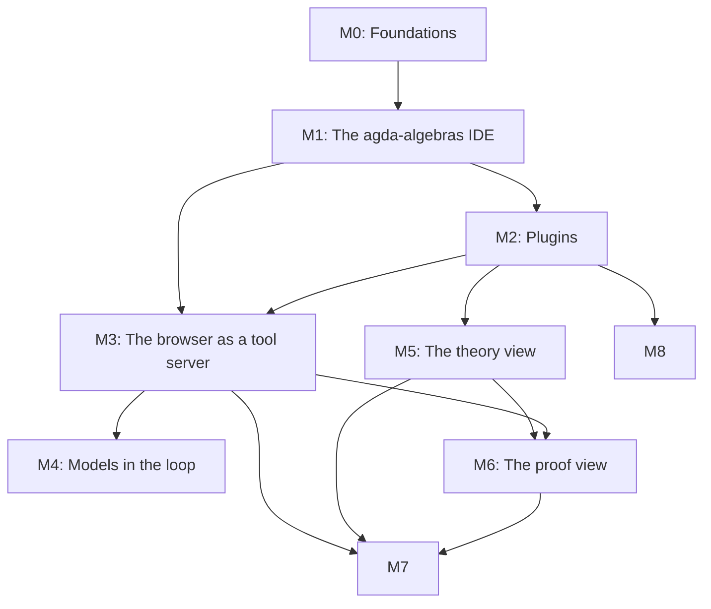

<!--
File: docs/GITHUB_PROJECT.md

The living project plan for agda-native-ide, in the format of the
williamdemeo/github-project template.

This file is partially generated by that template's engine (`make update`).
Manual prose (everything outside the marked regions: the summary, the
milestone descriptions, the exit criteria, the dependency graph) is
hand-edited.  Issue listings between

    BEGIN GENERATED: milestone-N
    ...
    END GENERATED: milestone-N

markers are regenerated from GitHub state by `make update`; edits inside
those regions are overwritten on the next update.  Structure lives here;
state (issue numbers, open/closed, assignees) lives on GitHub.

Two grammar tokens below are the engine's, not prose: the em-dash in each
`### Milestone N — Title` heading, which the parser requires, and the
`**Labels:**` line of each issue.
-->

# agda-native-ide: GitHub Project Roadmap

**Project Title**:  agda-native-ide, an Agda workbench for the browser, VS Code and Emacs, with proof-assist and corpus-search plugins

**Repository**:  `formalverification/agda-native-ide`

---

## Summary

An Agda workbench on three platforms, sharing one core, on Agda 2.9.0.

+  **In a browser tab, with no server**, it is the playground a documentation
   site links to: the type-checker (Agda compiled to WebAssembly) is loaded
   by default and everything else is a plugin (libraries, corpora, models,
   tools).  A reader opens a library in an Explorer, writes in a `Main.agda`
   buffer, and reads Agda's goals and errors in an info pane, the way
   <https://plfa.isotopy.xyz/> already lets them do for PLFA.  It is the only
   platform that reaches a reader who has installed nothing.
+  **In VS Code**, a companion extension beside agda-mode-vscode gives an
   author the same views and the same tool contract over a native Agda on
   their own checkout, with git, a terminal, and the agents they already run.
   Native Agda loads a large agda-algebras closure in a fifth of the time the
   page takes, and agents reach Agda there today through `agda-mcp`.
+  **In Emacs**, agda2-mode's commands are exposed to agents and the corpus
   is searched from a picker.  Nothing more is built there: Emacs cannot draw
   the diagrams, and it cannot reach a web reader.

The core the three share is four TypeScript packages: the engine client
(Agda's interaction protocol behind one interface, over a wasm worker or a
native process), the tool surface (`agda-mcp`'s contract, under which a
model's claims are never the verdict and Agda's are), the two views (a
development as a graph of definitions, and a proof as a derivation,
generated from the checked source), and the plugin manifest.

The plan follows the proposal carried from agda-native-air as
[`docs/notes/browser-ide-proposal.md`][proposal], with two changes.  The
first deliverable is the library IDE that the agda-algebras site needs (its
"Playground" link opens this IDE in a new tab), because it is what a reader
can use now, and every later milestone is built on it.  And since
2026-10-05 the plan targets all three platforms on Agda 2.9.0, the decision
a platform brief of that date argued and ADR 0002 ([M0-15]) records: the
browser is the only platform that reaches a reader who installs nothing,
VS Code is the better one for an author with a checkout, and the three new
things the proposal adds are platform-neutral if they are built as packages.

Three facts make the project cheaper than it sounds.

+  A complete browser Agda IDE already exists and is MIT-licensed:
   [`plfa-playground`][plfa-playground] (Svelte, CodeMirror 6, and the Agda
   Language Server compiled to WASI, built from pinned sources).  This
   project forks it rather than starting over.
+  agda-algebras [PR 585][pr-585] built and measured the other half: the
   plain `agda-opt.wasm` checker driven through Agda's interaction protocol
   in a browser, with no cross-origin isolation, archives proved under the
   shipped compiler, and a review that found the traps.  Its numbers and its
   code seed the second lane and the library archives.
+  Agda 2.9.0 is the first version whose wasm build needs no patch:
   agda/agda builds for wasm32-wasi in its own CI since December 2025.
   And the language server's reactor build (September 2026) needs no
   shared memory for its input and output; with the drive moved into the
   server's worker, the page needs none at all, so the cross-origin
   isolation the fork is designed around is a transitional cost.  The editor half exists too: agda-mode-vscode (77
   commands, a server it downloads itself, a web build that type-checks PLFA
   in vscode.dev) and agda2-mode, and `agda-mcp` already serves the agents
   that speak MCP.  Agda 2.9.0 is unreleased as of 2026-10-05 (master and a
   nightly prerelease); the runtime tracks a pinned nightly and moves to the
   release when it lands ([M0-13]).

[proposal]: notes/browser-ide-proposal.md
[plfa-playground]: https://github.com/SeungheonOh/plfa-playground
[pr-585]: https://github.com/ualib/agda-algebras/pull/585

---

## Labels

The `milestone-N-*` labels are load-bearing: the engine attaches them, and
`make update` uses them to place each issue in its milestone's region.  The
others are topic labels.

- `milestone-0-foundations` (0075ca): Milestone 0, the forked runtime building, tested and deployed.
- `milestone-1-library-ide` (1d76db): Milestone 1, the agda-algebras IDE.
- `milestone-2-plugins` (5319e7): Milestone 2, libraries and resources as plugins.
- `milestone-3-tool-server` (0e8a16): Milestone 3, the browser as a tool server.
- `milestone-4-models` (d93f0b): Milestone 4, models in the loop.
- `milestone-5-theory-view` (c5def5): Milestone 5, the theory view.
- `milestone-6-proof-view` (bfd4f2): Milestone 6, the proof view.
- `milestone-7-vscode` (1f5fb4): Milestone 7, the VS Code companion.
- `milestone-8-emacs` (7a3da6): Milestone 8, Emacs.
- `runtime` (0052cc): The compiler, its workers, WASI, and the virtual filesystem.
- `ui` (1d76db): The editor, the Explorer, the info pane, and the layout.
- `libraries` (5319e7): Library archives, closure indices, and interfaces.
- `plugins` (5319e7): The plugin manifest, loader, and consent gate.
- `tool-server` (0e8a16): The client-side tool contract.
- `models` (d93f0b): Model providers, keys, sessions, and bridges.
- `diagrams` (c5def5): The theory and proof views.
- `hosting` (fbca04): Deployment, response headers, domains, and caching.
- `build` (fbca04): Nix, npm, and continuous integration.
- `provenance` (e4e669): Licenses, pins, notices, and the upstream fork.
- `measurement` (1d76db): Benchmarks and measurements recorded with their runs.
- `security` (b60205): Secrets, isolation, and what leaves the tab.
- `adr` (ededed): A decision that gets an ADR.
- `cross-repo` (ededed): Work that lands in another repository.
- `core` (237a4c): The shared packages: engine client, tool surface, views, manifest.
- `vscode` (1f5fb4): The VS Code companion extension and its web build.
- `emacs` (7a3da6): agda2-mode and the Emacs packages.
- `documentation` (0075ca): Improvements or additions to documentation
- `bug` (d73a4a): Something isn't working
- `enhancement` (a2eeef): New feature or request
- `good first issue` (7057ff): Good for newcomers

---

## Milestones

### Milestone 0 — Foundations

**Description**:

Turn this template copy into a project that builds, tests and deploys the
forked runtime, before changing what it does.  The fork comes in as a
recorded snapshot, with its attribution; the build is reproducible under
Nix; the compiler and the standard library are pinned by hash, never
committed blind; CI drives a real check in a headless browser; and the site
is served with the cross-origin isolation the language server needs.  ADR
0001 records the runtime decision and the second lane.  Revised 2026-10-05:
the compiler becomes this project's own build of Agda 2.9.0 and its
language server from Agda's own wasm flake, with no patched fork ([M0-13]);
the language server's reactor build, with the drive moved into its worker,
removes the isolation requirement ([M0-14]); and ADR 0002 records the
three-platform decision ([M0-15]).

**Exit criterion**:

A commit on `main` deploys the fork, on the pinned Agda 2.9.0 compiler, to
the chosen host, where a first visit in a fresh browser profile checks
`Main.agda` (with `crossOriginIsolated` true until the reactor build and the
in-worker drive make isolation unnecessary); `nix build` reproduces the site and the compiler
from a clean clone; CI builds it, runs the unit tests, and checks
`Main.agda` in headless Chromium; ADR 0001 and ADR 0002 are accepted.

---

### Milestone 1 — The agda-algebras IDE

**Description**:

The first thing a reader uses.  The agda-algebras site's "Playground" link
opens this IDE in a new tab: an Explorer listing every agda-algebras module,
a `Main.agda` buffer over the standard library and agda-algebras, and the
Agda info pane.  Most of the work is generalizing the fork from PLFA's
hard-coded two-level Explorer to a library tree, and building the library's
archives: per-closure, verified against Agda's own dependency graph, and
proved under the shipped compiler, because an interface Agda does not
accept is silently checked again.  The archives are built by the same Agda
2.9.0 the IDE ships, so agda-algebras and its standard library must check
under 2.9.0 first ([M1-17]).

**Exit criterion**:

From agda-algebras.universalalgebra.org, "Playground" opens the IDE in a new
tab; the Explorer lists all of the library's modules; a `Main.agda` that
imports `Setoid.Varieties.HSP` checks, under the shipped Agda 2.9.0, with
only `Main` type-checked from source; give, refine and case split work on
it; and every download is stated, in bytes, before it starts.

---

### Milestone 2 — Plugins

**Description**:

Everything but the type-checker becomes a plugin: a manifest that says what
it is (library, corpus, model, tool), what it is pinned to (the Agda
version, the commit, the digests), what it mounts, what it registers, and
what it costs.  A consent gate installs one, saying how many bytes from
which origin.  The fork's PLFA manifest and its `mountDriveArchives()` hook
are the template.  Projects of several files with their own `.agda-lib`
arrive here too.  The manifest is a shared-core format: the VS Code
companion reads the same manifests from disk and the Emacs picker the same
corpus index, so a plugin is written once ([M3-7]).

**Exit criterion**:

The standard library and agda-algebras are installed as plugins through the
consent gate; a third library is added by a manifest alone, with no code
change; a two-module user project checks; and the manifest's schema lives in
a package every host imports.

---

### Milestone 3 — The tool surface, in the page and in the editor

**Description**:

`agda-mcp`'s tools under agda-native-air ADR 0002's contract (a verdict is
an exit code and never a reading of diagnostics text, every answer names
the tree it checked, and a lane answer carries no verdict), as a shared
TypeScript package over an engine interface with two implementations: the
wasm lanes in the page's workers (the language server as the interaction
lane; the plain Agda checker as the batch lane whose exit code is the
verdict of record) and native processes in the editor.  The page hosts it
first, because the sources and the corpora are already mounted there and a
full-text search answers what agda-native-air's measurements say a model
wants from a library: the text, beside the verdict.  The editor hosts the
same package in Milestone 7.

**Exit criterion**:

Every tool in the proposal's table is answered by the shared package in the
page or marked unsupported with its reason; the archived agent sessions
replay through the page's surface with zero disagreements on committed
candidates; and the package's engine interface has a native implementation
that passes the same tests.

---

### Milestone 4 — Agents in the browser

**Description**:

The browser's share of the agent work.  Agents are MCP clients, and a page
cannot be an MCP server, so the first path is a local bridge process
through which an external agent (a Claude Code session) uses the page as
its tool server.  The in-page model on the user's own key, behind a consent
gate that says what leaves the tab and when, with the key held on its own
origin out of reach of the page and its plugins, comes last and is a
demonstration for readers.  A local model is a plugin labeled unmeasured
until it is measured.  The editor's agents need none of this: in VS Code
and Emacs they reach the same contract through `agda-mcp` (Milestones 7 and
8).  The rule does not change: the model's claims are never the verdict;
Agda's are.

**Exit criterion**:

An external agent attached over the bridge proves a benchmark obligation
through the page's surface, and the session is archived and renders in the
replay format of agda-native-air's demo page; the in-page model does the
same behind the gate; and no script on the IDE's origin can read the key.

---

### Milestone 5 — The theory view

**Description**:

A development drawn as a graph of definitions, from the corpus alone, with
no Agda running: nodes are definitions, and each edge says where it came
from (exact body references, approximate type dependencies, or Agda's module
load order).  The proposal ranks this the cheapest step with the best
payoff, so it may start whenever someone is free; it depends only on the
corpus.  The view is a component of the shared core, drawn in the page
first and in the VS Code companion's webview unchanged; only its host
interface (open this definition, highlight that node) differs.

**Exit criterion**:

The agda-algebras definition graph renders in the IDE with every edge
labeled by its provenance, a node opens its source in the editor, and the
same component renders in the VS Code companion's webview.

---

### Milestone 6 — The proof view

**Description**:

One proof drawn as a derivation, generated from the checked term with the
judgment at each node, holes as open leaves; then edited through Agda's own
commands at a leaf.  It needs a proof-term export that does not exist yet
(agda-native-air's extractor exports types as ASTs and bodies only as text),
and its elision rules are settled read-only on agda-native-air's 55
benchmark golds before any editing.  One mode, two registers: solid for
checked structure, dashed for hole interiors; nothing appears that is not
in the source.  Like the theory view, it is a component of the shared core,
and its edits go through whichever engine its host has.

**Exit criterion**:

A benchmark gold renders as a readable derivation under the settled elision
rules, in the page and in the VS Code companion's webview, and refine and
give at an open leaf re-check the file and redraw the diagram from the
result.

---

### Milestone 7 — The VS Code companion

**Description**:

A TypeScript extension beside agda-mode-vscode, which already gives VS Code
the editor half (77 commands, the input method, a language server it
downloads itself, and a web build), in the shape Paperproof takes beside
the Lean extension: a webview hosting the shared views, the shared tool
surface over a native engine (an `agda --interaction-json` lane and a batch
`agda`, as child processes), the tool contract registered for the agents
that are already there (an MCP server definition for Claude Code, Cline and
Copilot; LM tools for Copilot's agent mode), and corpus and full-text
search over the open workspace.  The author gets native speed on their own
checkout, with git, a terminal and their agents; the companion drives the
mode through its commands until upstream exports a client.  The web build,
the companion in VS Code for the Web with the WASM engine, is verified, not
promised: no agent runs there today.

**Exit criterion**:

Installed beside agda-mode-vscode on a desktop VS Code with an agda-algebras
checkout, the companion shows the theory view and the proof view in a
webview for the open module; refine and give at a leaf edit the real file;
Claude Code proves a benchmark obligation through the MCP server definition
the companion contributes, and the session is archived in the replay
format; and the extension is published on the Marketplace and Open VSX.

---

### Milestone 8 — Emacs

**Description**:

agda2-mode is the reference implementation and where most Agda is still
written, and it cannot draw the diagrams or reach a web reader; so this
milestone builds only what Emacs is good for and measures the rest.  The
agent half: agda2-mode's commands (load, goals, give, refine, case split)
registered as tools with claude-code-ide.el's MCP server, so a Claude Code
session beside Emacs works at the buffer's goals; and `agda-mcp` reached
from inside Emacs through gptel or ellama.  The search half: the corpus
index as a `completing-read` picker.  The views: a measured experiment with
a static SVG and image-map hot-spots, kept only if it is useful.

**Exit criterion**:

From an Emacs with agda2-mode on an agda-algebras checkout, a Claude Code
session lists and calls the goal tools and a give it makes appears in the
buffer; the picker finds a definition by name or type and opens it; every
setup is tested in `emacs --batch` with the project's harness; and the view
experiment's result is recorded, whichever way it comes out.

---

### Milestone dependencies

Hand-authored; `make update` never touches it.



M5 needs only a corpus plugin from M2, and its drawing needs no Agda; it can
start early.  M6 needs M3's commands for editing and an export from
agda-native-air (its issue [M6-1] is cross-repo).  M7 needs M3's shared
package and takes each view as it lands; its first issues (the companion's
skeleton, the native engine, the agents' registrations) need neither view.
M8 needs only the corpus plugin and `agda-mcp`, which exists, so it can
start whenever someone is free.

---

## Issues

Each issue below carries its labels and a body ready for GitHub.  On the
first populate, the `[MN-k]` ID in each heading becomes the issue title's
prefix, the join key that keeps re-runs idempotent, and the new issue number
is written back into the heading.

## Milestone 0 — Foundations

<!-- BEGIN GENERATED: milestone-0 -->

### Issue M0-1: Detach the template's engine and write the project's working rules (#1, closed)

**Labels:** `documentation`, `milestone-0-foundations`, `build`

This repository was created from williamdemeo/github-project and still carries a copy of its engine.  Run `make init`, which deletes the copy and installs a consumer flake taking the engine as a pinned input, then `nix flake lock`.  Replace the template's README and CLAUDE.md with this project's: what it is, where its plan and decisions live, the build, and the house rules a session working here must follow.

#### Acceptance criteria

+  `make lint` passes through the consumer flake; `scripts/gh_project_populate.py` is gone.
+  README states the project's purpose and status, and links the plan, the ADRs, and the proposal.
+  CLAUDE.md names the build and test commands and the project's rules.

---

### Issue M0-2: Fork plfa-playground into this repository, as a recorded snapshot with its attribution (#2, closed)

**Labels:** `milestone-0-foundations`, `runtime`, `provenance`

Bring in [`plfa-playground`][plfa] at `ae0aa84` (2026-08-31), the runtime this project builds on, unchanged.  Its LICENSE is MIT, Copyright 2026 Andy Pan; its NOTICE records the lineage (agda-web/als-demo, agda-web/agda-language-server, agda-web/agda, agda/agda-stdlib) and the PLFA chapters it embeds under CC BY 4.0.

Decide how, in the ADR of [M0-7]: a history merge keeps upstream's commits and makes later syncs a merge, but upstream commits the 33 MB compiler, its 10 MB gzip and the standard-library archive, so every one of those blobs enters this repository for good; a snapshot import with a provenance record (the upstream commit and each file's hash) does not.  Either way the binaries are then removed from the tree and pinned by hash instead ([M0-4]).

#### Acceptance criteria

+  The fork builds and runs unchanged (`npm ci && npm run build`), and checks `Main.agda` in a browser.
+  LICENSE and NOTICE carry upstream's copyright and lineage; the font licenses (JuliaMono) are included.
+  An `upstream` remote and the sync procedure are documented.

[plfa]: https://github.com/SeungheonOh/plfa-playground

#### Findings, 2026-10-04

+  **The fork builds and passes as it stands**: `npm ci`, `npm run build`, `npm test` and `npm run check` all pass with the flake's node 22.22.2.  Served with the isolation headers on localhost, it was ready in 1.15 s and finished its first check at 2.58 s; the first visit made 25 requests for 15,630,936 bytes, and a warm reload made none.
+  **Binaries**: at `ae0aa84c`, `static/` holds 60,183,062 bytes, 59,422,474 of them in 37 binary files (the 33 MB compiler, its 10 MB gzip, the archives and the fonts); across upstream's four commits the distinct binary blobs total about 171 MB raw (172 MB with the text files under `static/`), three compiler builds among them (`git ls-tree -r -l`, 2026-10-04; an earlier version of this finding said 48.6 MB, which does not reproduce).
+  **Audit**: `npm audit` reports 5 high and 3 low findings; `devalue` is bundled into the page, and the rest (`cookie` through SvelteKit, `undici`, `sharp`, `miniflare`, `wrangler`) are build-time only.  Dropping the Cloudflare tooling (`wrangler`, `workerd`, `sharp`) removes most of them, and both LGPL packages.
+  **Licenses** of the bundled npm packages are permissive (MIT for most, ISC for `@lucide/svelte`, Apache-2.0 for `comlink`, whose text must ship; `jszip` is MIT or GPL-3.0, so choose MIT).

---

### Issue M0-3: A reproducible build under Nix (#3, closed)

**Labels:** `milestone-0-foundations`, `build`

A dev shell with the pinned node, and a `packages.site` output that builds the static site from `package-lock.json` with fixed-output dependencies (for example `buildNpmPackage` with a pinned `npmDepsHash`), so a clean clone builds the same site with no network beyond fixed-output fetches.  Make targets: `dev`, `build`, `test`, `check`.

#### Acceptance criteria

+  `nix build .#site` from a clean clone succeeds, twice, with the same output hash.
+  `nix develop --command make test` runs upstream's unit tests.

#### Findings, 2026-10-04

+  **The build is `vite build`** (SvelteKit's static adapter, prerendered, no server rendering) plus one post-step that gzips the compiler and deletes the raw copy; every Agda asset is a committed file copied through verbatim.
+  **Generate what upstream maintains by hand**: the `?cache=` tokens, the compiler's byte length hard-coded in the controller, and the IndexedDB cache namespace.  Derive them from content hashes and real sizes at build time, or a rebuilt asset is served stale behind a 14,400 s cache.
+  **Trim**: the main chunk is 1,144 kB (362 kB gzipped), and carries `zod`, `marked` and CodeMirror's markdown, HTML, JavaScript and CSS modes, which only the PLFA reader needs.


#### More findings, 2026-10-05

+  **The built site has no raw compiler, so a browser without `DecompressionStream` cannot start Agda.**  `scripts/prepare-cloudflare-assets.mjs` deletes `build/als-2.8ext.wasm` after gzipping it, but `fetchWASMAndData` falls back to that raw file when `DecompressionStream` is missing or the `.gz` request fails; the request is then a 404 (on upstream's live site, the page's own HTML labelled `application/wasm`), the controller swallows the failure (`controller.svelte.ts:283-290`), and the page says "Agda ready" with no goals and never checks, with no error shown.  Measured 2026-10-05 in headless Chrome 153 with `DecompressionStream` removed from the page: no check after 60 s; with the raw file put back in `build/`, two goals in 1.20 s.  Of the build's declared targets (`vite.config.js`: Chrome 89, Edge 89, Firefox 89, Safari 15), Firefox before 113 and Safari before 16.4 lack `DecompressionStream` (MDN's compatibility data).  Decide here whether the built site ships the raw file as well (33 MB more per deploy; upstream deletes it for Cloudflare's per-file limit) or drops the branch and says so on the page ([M0-8] is the same kind of gap).  Found in [#52]'s review.

[#52]: https://github.com/formalverification/agda-native-ide/pull/52

---

### Issue M0-4: Pin the compiler and the standard library by hash, with a rebuild recipe (#4)

**Labels:** `milestone-0-foundations`, `runtime`, `build`, `provenance`

Upstream commits its compiler, `als-2.8ext.wasm` (32,996,332 bytes, SHA-256 `53c62b0ad569a9d123f744b192c13780c494ade0cddef4daaa00db41ecd7f7a1` per its `compiler/README.md`), built from agda-web/agda-language-server `e65419f8`, agda-web/agda `e2f8c694` and ghc-wasm-meta `c3f44696` (the 9.10 flavour).  Pin it, and the standard-library archive, as fixed-output derivations fetched by URL and hash, never committed here, and record the provenance in one table.  Port `compiler/build-agda-wasm.sh` into a flake app that rebuilds the compiler from those pins, and record whether the rebuild is byte-identical, whichever way it comes out.

#### Acceptance criteria

+  The build fails on a hash mismatch.
+  The provenance table names every pinned artifact, its source, its hash and its license.
+  The rebuild was attempted and its outcome is recorded.

#### Findings, 2026-10-04

+  **The exact binary is not a release asset anywhere**.  No wasm release asset of agda-web/agda-language-server, agda/agda-language-server or agda-web/agda-wasm-dist has its digest; agda-web/als-demo and plfa-playground publish no releases, and als-demo's own copy is a different nightly build.  It exists only in plfa-playground's git tree, and re-gzipped on plfa.isotopy.xyz.
+  **A flake can pin it today**.  `fetchurl` of `https://raw.githubusercontent.com/SeungheonOh/plfa-playground/8a03ddaf95a81232fe8467063ff373ca53e5837e/static/als-2.8ext.wasm` with `sha256-U8YrCtVpqdEj90SxksE3gMSUreDN3vTaqgDbQezX96E=` succeeded (`nix store prefetch-file`), and the committed file's SHA-256 matches the upstream README.  It is a single source in a personal repository, so add a mirror this organization controls (a release asset here) under the same hash, and prove the failover.
+  **What the pins are**.  ALS `e65419f8` is the head of agda-web/agda-language-server's branch `wasm-only-raw-responses` (2025-10-22); Agda `e2f8c694` is agda-web's wasm32 patch on a base two packaging commits short of the `v2.8.0` tag.  The nearest release asset (agda-web's `nightly-20260407`, which als-demo uses) differs by one commit that changes response handling, so it is not a drop-in replacement.
+  **The recipe is not hermetic**.  `build-agda-wasm.sh` runs `cabal update` with no `index-state` and fetches sources and a Hackage tarball at build time.  Make the from-source rebuild an optional CI job that pins `index-state` first, not the flake's default path.
+  **Licenses** the published notice must carry are in [#48].

[#48]: https://github.com/formalverification/agda-native-ide/issues/48

#### Revision, 2026-10-05: three platforms, Agda 2.9.0

The compiler to pin becomes this project's own build of Agda 2.9.0 and its language server ([M0-13]), published as a release of this organization: the mirror this issue asks for is then the primary source, and the agda-web binary a historical pin kept until the new compiler passes [M1-5]'s gate.  The rebuild recipe this issue asks for is [M0-13]'s flake package; record its outcome here as planned.

---

### Issue M0-5: CI: build, unit tests, type checks, and a real check in headless Chromium (#5, closed)

**Labels:** `milestone-0-foundations`, `build`, `measurement`

One workflow on every pull request: the Nix build, upstream's vitest and svelte-check, and a browser job that serves the built site with `Cross-Origin-Opener-Policy: same-origin` and `Cross-Origin-Embedder-Policy: require-corp`, waits for "Agda ready", checks `Main.agda`, gives at a goal, and asserts the goal count and `crossOriginIsolated`.  Upstream's Playwright benchmark harness is the starting point.

#### Acceptance criteria

+  The browser job fails when the check path is broken (shown by a deliberately broken build).
+  Its timings are uploaded as an artifact.

#### Findings, 2026-10-04

+  **The browser job is the only way to test the language server**: it cannot be driven under wasmtime (it cannot make stdin nonblocking there, and answers only at end of input).
+  **What to assert**: the count of `Checking` lines in the running info (one, for `Main`, when the shipped interfaces are accepted) and a deliberate type error reported at its position.  The count is the only signal that separates acceptance from silent recompilation.
+  **A working harness exists**: a small node server that sends the isolation headers and a CDP driver that waits for readiness and counts checks were used for these measurements; they are a starting point alongside upstream's Playwright benchmark.

---

### Issue M0-6: Choose the host and deploy; cross-origin isolation only until the reactor build lands (#6)

**Labels:** `milestone-0-foundations`, `hosting`, `adr`

The language server's workers share memory, so the page needs `SharedArrayBuffer`, so every route must be served with COOP `same-origin` and COEP `require-corp`, or the fork's service-worker fallback (`static/coi-serviceworker.js`) must add them, at the cost of one reload on a first visit.  The options are a host that sets headers (upstream deploys to Cloudflare from `static/_headers`), or GitHub Pages with the service worker.

Measured 2026-10-04: formalverification.io's DNS is on Cloudflare and its site is served by GitHub Pages directly; agda-algebras.universalalgebra.org is proxied by Cloudflare in front of GitHub Pages; plfa.isotopy.xyz sends both headers from Cloudflare.  Decide the host and the domain (for example `ide.formalverification.io`), a cache policy (hashed, immutable assets; the compiler and the archives versioned by hash), and the deploy workflow.

#### Acceptance criteria

+  A commit on `main` deploys.
+  `curl -sI` shows both headers on the page and its assets, or the service-worker path is documented and tested.
+  `crossOriginIsolated` is true on a first visit in a fresh browser profile.
+  The compiler and the archives are cached at the edge (Cloudflare caches `.gz` and `.zip` by default, and not `.wasm` or `.json`).
+  If the app is served under a path rather than at a domain's root, every fetch goes through the configured base path (the fork fetches its PLFA data by root-absolute URLs and sets no base path).

#### Findings, 2026-10-04

+  **GitHub Pages works with the fork's service worker, given a guard**.  Served with no isolation headers, coi-serviceworker v0.1.7 (MIT), scoped to the app's directory, isolated the page, its URL workers and its blob workers after one self-reload on a first visit (and one more after a hard reload), in headless Chromium 153.  But its reload can start before the worker activates, leaving the page neither controlled nor isolated, and it never retries: 1 of 12 fresh visits on loopback, 0 of 12 with 150 ms of added latency, 3 of 8 in trials of the real app.  A guard gave 30 of 30: an inline script before the worker's script saves `sessionStorage.coiReloadedBySelf`, and one after it reloads at most once per tab when that load was the worker's own reload and the page is still not isolated once `navigator.serviceWorker.ready` resolves.
+  **A host that sends the headers avoids the reload and the race**.  Upstream's Cloudflare deployment sends COOP, COEP and CORP from `static/_headers`, so its worker never registers.  formalverification.io's DNS is already on Cloudflare, so a Cloudflare Pages project on a subdomain, or a response-header rule on a proxied path, is open to whoever holds the account.
+  **`require-corp` breaks nothing the fork loads**.  All 25 requests of a first load of plfa.isotopy.xyz were same-origin: 14.68 MB, 10.36 MB of it the compiler's gzip.
+  **Compression**.  GitHub Pages serves `.gz` as `application/gzip` with no `Content-Encoding`, and `.wasm` as `application/wasm`, gzipped on the fly when asked; the fork's fetch handles both, through the service worker too (the same SHA-256 after inflation).
+  **Caching**.  GitHub Pages fixes `max-age=600`, and Cloudflare's browser TTL was 14400 s on assets, so upstream's `_headers` cache rules cannot apply there: version every archive by content hash in its name or query.
+  **Limits of the service-worker path**.  It needs service workers and a secure context; where they are disabled, the page cannot start ([#8]).  Only Chromium was driven: open the deployed page in Firefox and Safari before relying on it.

[#8]: https://github.com/formalverification/agda-native-ide/issues/8


#### More findings, 2026-10-04

+  **A second, independent fix of the service worker's race**, `window.coi.doReload = () => navigator.serviceWorker.ready.then(() => location.reload())` set before `coi-serviceworker.js` loads, gave 20 of 20 first visits isolated where the unpatched worker left 4 of 15 on a blank page.
+  **No base path is needed**: SvelteKit's default relative paths compute the base from the page's location at run time, so the build works under any path once the four root-absolute `/plfa/...` fetches go through `asset()` or `base`.
+  **On a shared origin**, namespace the localStorage keys, the IndexedDB database name and the worker's sessionStorage keys, which are origin-wide.
+  **HTML is cached for 600 s**, so a visitor holding a stale `index.html` just after a deploy may ask for code chunks the deploy replaced (inferred from the headers, not tested).

#### Revision, 2026-10-05: three platforms, Agda 2.9.0

The language server's reactor build, with the drive moved into its worker ([M0-14]), removes the shared memory that requires isolation, so the host need not send the headers once it lands (corrected the same day: the reactor alone removes only the input and output rings, and the drive's proxy shares memory too); until then the choice stands as written, and the service-worker guard this issue measured remains the fallback.  Decide the host for the long run (any static host; GitHub Pages only once the repository is public, since the organization's free plan serves Pages from public repositories alone, as the comment of 2026-10-04 found), and record the headers as a transitional requirement in the ADR.


#### Findings, 2026-10-08: the host needs no headers

[#59]'s pull request removes the page's need for cross-origin isolation: the language server's reactor build runs in one worker with the drive, so the page allocates no `SharedArrayBuffer`.  It removes the isolation headers from `static/_headers` (its cache rules stay), `coi-serviceworker.js` with its script tag, and the page's and the worker's checks of `crossOriginIsolated`.  What that changes here is the following:

+  **Any static host qualifies**: the built page needs no headers, no service worker and no reload on a first visit.  Measured 2026-10-08: the browser check passes served without the headers (`crossOriginIsolated` false) and with them (true), in headless Chromium 149 and in Firefox 157, and CI's browser job runs it both ways.  A host that sends the headers anyway, as Cloudflare Pages with upstream's `_headers` would have, does no harm.
+  **GitHub Pages qualifies too, once the repository is public**: the organization's free plan serves Pages only from public repositories (this issue's comment of 2026-10-04), so while the repository is private, a host that deploys from Actions by direct upload (Cloudflare Pages, for one) remains the way to publish it.
+  **No visitor holds the service worker**: no deployment ever served it, so nothing needs unregistering.
+  **Criteria that no longer apply**: the second and third criteria above (`curl -sI` shows both headers, or the service-worker path is tested; `crossOriginIsolated` true on a first visit) were the isolation requirement's.  The first (a commit on `main` deploys), the fourth (edge caching of the compiler and the archives) and the fifth (every fetch through the base path) still stand.
+  **Caching is unchanged**: the compiler's gzip and the archives carry content-derived `?cache=` tokens, and the reactor's glue, `als-reactor-2.9.0.js` (5,044 bytes), carries one too.

The choice of host stays William's.

[#59]: https://github.com/formalverification/agda-native-ide/issues/59

---

### Issue M0-7: ADR 0001, the runtime: what is forked, what is kept, and the second lane (#7, closed)

**Labels:** `documentation`, `milestone-0-foundations`, `runtime`, `adr`

Record the runtime decision in the ADR form agda-native-air uses (decision, evidence, status, a decision log), with the companion explanation in a separate note.

+  **The fork**: plfa-playground for its language-server lane, its two-worker architecture, its give rule (an edit inside one goal goes through `Cmd_give`; anything else is a full `Cmd_load`), and its archive format; how it is imported ([M0-2]).
+  **The second lane**: the plain `agda-opt.wasm` for the verdict of record, as the proposal's § 1 asks.  agda-algebras [PR 585][pr-585] measured that the same checker answers every goal command through `--interaction-json` with no isolation (headless Chromium 153, 2026-10-04), and a JavaScript Promise Integration probe kept one process alive across commands without isolation (1.45 s per reload, 45 to 55 ms per goal query on a 244-module closure, Chromium only).  Record what that means for the isolation requirement and for browsers without it.
+  **What is not adopted yet**, and why.

#### Acceptance criteria

+  `docs/adr/0001-runtime.md` exists, links the proposal, and every claim in it carries its evidence.

[pr-585]: https://github.com/ualib/agda-algebras/pull/585

---

### Issue M0-8: Say so when the page cannot run in this browser (#8, closed)

**Labels:** `bug`, `milestone-0-foundations`, `runtime`

The fork has a friendly message for a page that is not cross-origin isolated, but it creates its shared buffers while the page's script initializes, before that check, and `SharedArrayBuffer` is undefined on such a page (measured in Chromium, 2026-10-04), so the message is probably never reached.  Move the allocation after the check, so that a host without the headers, or a browser without the feature, gets a sentence instead of a dead page.

#### Acceptance criteria

+  Served without the headers and without the service worker, the page shows the message, and a headless test checks it.

#### Findings, 2026-10-04

Confirmed twice: without the isolation headers, the fork's service-worker fallback left 3 of 8 and 4 of 15 fresh first visits on a page that threw before its explanatory message could render, because the shared buffers are allocated when the page component is created.  A manual reload recovered.

#### Revision, 2026-10-05: three platforms, Agda 2.9.0

Still needed while the stdio build ships; moot after [M0-14].  Keep the message, and retire it with the shared buffers.

#### Revision, 2026-10-07: a notice, not a workaround

William's decision of 2026-10-07, for this issue's second failure (proposed in its comment of 2026-10-05) and for any failure of the kind: the project does not support a browser that is hard to support.  It says so instead, with a notice in the page when the page cannot run there, and a disclaimer in the documentation that names the browsers the page is tested in.  So the second failure is folded in, and its fix is a message, never a workaround: no polyfill for `DecompressionStream`, and no fallback to the raw compiler, which has been dead since [#3]'s decision (ADR 0001's decision 15).

Once [#59] lands, the page needs no isolation, so the isolation message goes with the shared buffers, and this issue becomes the page's account of a browser it cannot run in.  [#59]'s kickoff folds this issue into its pull request, since both change the page's startup.

Revised acceptance criteria, in place of the one above:

+  The page checks what it needs before it starts (module workers, WebAssembly, `DecompressionStream`), and a browser without one of them gets a message naming what is missing and the browsers the page is tested in; a headless test checks it with `DecompressionStream` removed.
+  When the compiler's request or its decompression fails, the page shows the failure instead of "Agda ready"; a headless test checks it with the request failing.
+  The README names the browsers the page is tested in and says that others are not supported.

[#3]: https://github.com/formalverification/agda-native-ide/issues/3
[#59]: https://github.com/formalverification/agda-native-ide/issues/59

---

### Issue M0-9: A complete notice for everything the page ships (#48, closed)

**Labels:** `milestone-0-foundations`, `provenance`

What the fork ships carries more licenses than its NOTICE names (measured 2026-10-04):

+  **The compiler binaries statically link GHC's runtime and boot libraries**, under the Glasgow Haskell Compiler License (BSD-3 style, which requires the notice with a binary redistribution), **and GMP**, under LGPL-3.0-or-later or GPL-2.0-or-later: `strings` finds GMP's assertions and `ghc-bignum`'s wrappers in `als-2.8ext.wasm`, and in the `agda-opt.wasm` of the second lane.  About 60 Hackage packages are linked too.  The language server is MIT and Agda MIT-style.
+  **The fork's LICENSE names Andy Pan** (the copyright it inherits from agda-web/als-demo), **while every commit is Seungheon Oh's**; credit both.
+  **JuliaMono (OFL-1.1) carries its notice only in the fonts' metadata**, and the favicon (the official Agda mark, `favicon.svg` and `favicon.png`) has terms nobody has checked yet.

(Corrected 2026-10-04: an earlier version of this issue said the standard-library archive omits the library's LICENCE.  It does not: it carries `agda-stdlib-2.3/LICENCE`, as `unzip -l` shows; one probe's search missed the uppercase name.)

The same GHC and GMP gap is in agda-algebras PR 585's published notice.

#### Acceptance criteria

+  NOTICE names every shipped artifact with its license text, and a copy is published beside the assets.
+  GMP's relinking condition is met by pointing at the pinned sources and the build recipe, or the judgment that it is met otherwise is recorded.
+  The linked Hackage packages are listed from the build plan, or the reason they cannot be yet is recorded.

---

### Issue M0-10: Ship builtin interfaces the shipped Agda accepts (#49, closed)

**Labels:** `bug`, `milestone-0-foundations`, `runtime`

The fork's `static/agda-data.zip` (Agda's `lib/prim`) carries interfaces in Agda 2.7.0.1's format: all 37 have header version 202406290, where Agda 2.8.0 writes and reads 202507030.  So every fresh profile's first check type-checks the builtins it imports again (measured 2026-10-04: 6 `Checking` lines instead of 1 for a `Main` importing `Overture.Basic`, and 4 for the fork's default `Main.agda`: `Main`, `Agda.Builtin.Nat`, `Agda.Builtin.Bool` and `Agda.Builtin.Equality`).  The rejection does not cascade, since the standard library's and agda-algebras' interfaces are still accepted, but it costs every first visit.  Ship the 2.8 `lib/prim` from the native data directory, built by the same procedure as the libraries' ([M1-4]): the whole directory (sources, `agda-builtins.agda-lib` and `_build/2.8.0/agda/`), never the interfaces alone.  The fork's builtin sources are 2.7.0.1's, and three differ from 2.8.0's (`Agda/Builtin/String.agda`, `Reflection.agda` and `Cubical/Sub.agda`; 2.8.0 also has no `Agda.Builtin.Cubical.Id`), so a 2.8 interface beside a 2.7 source fails its source-hash check and is silently checked again, with everything that imports it.

#### Acceptance criteria

+  A fresh profile's first check of a `Main.agda` that imports only builtins type-checks only `Main`.

#### Revision, 2026-10-05: three platforms, Agda 2.9.0

The compiler moves to Agda 2.9.0 ([M0-13]); the builtins are then 2.9.0's `lib/prim`, built by the same Agda, under `_build/2.9.0/agda/`.  The acceptance criterion stands as written, for whichever Agda the page ships.


#### Findings, 2026-10-07: under 2.9.0 the builtins must be built by a wasm32 Agda

[#58]'s build found that Agda 2.9.0's interfaces depend on the word size of the Agda that wrote them (that issue's body has the measurement and the cause, agda/agda PR 8065's serializer).  For this issue's archive it means the following:

+  **`agdaDataInput`'s `agda` must be a wasm32 Agda, not only the server's Agda to the commit**.  Built by `mkAgdaData` with the nightly's static x86-64 binary (the input [#58]'s findings of 2026-10-06 ran it on), all 41 interfaces are rejected by [#58]'s wasm32 `agda` at the same commit: a module importing three builtins type-checks four modules instead of one.  Built with the wasm32 `agda` itself, run under wasmtime, they are accepted (one module).
+  **`mkAgdaData` works unchanged with it**: a package whose `bin/agda` runs [#58]'s `agda.wasm` under nixpkgs' wasmtime 48.0.1 (`wasmtime run --dir /::/ --env HOME=... --env PWD=... --env Agda_datadir=... agda.wasm "$@"`) builds the archive in the Nix sandbox: "Agda 2.9.0, 39 modules checked, 41 interfaces", 50 s wall clock on a loaded machine, 580,637 bytes at root `lib/prim`, interfaces under `_build/2.9.0/agda/` (mounted at `/`, Agda finds the project root as the page's drive does).  The nightly's archive is 601,790 bytes; the 16-byte hash prefixes are equal, the payloads are not.
+  **[#58]'s pull request makes it the flake's input** (`agdaWasm` and `agdaDataInput` in `flake.nix`): `nix build .#agda-data` gives 580,637 bytes, SHA-256 `b250cb2154c15efb882139c6698b5b4c3514a3fb1e361bbde58f58a2eed943c0`, the same bytes from the pinned `agda.wasm` as from the exploratory build, and `--rebuild` finds no difference.  The page's server accepts it: the browser check's first check of the default `Main.agda` type-checks `Main` alone, as `EXPECTED_CHECKING` requires.
+  **Every builtin is accepted in the page** (2026-10-07, 16:48 MDT, headless Chromium 149): the browser check, run unchanged on two copies of [#58]'s built site whose default `Main` also imports every 2.9.0 builtin, passes with `Main` alone checked.  One copy imports the 33 other plain builtins, with `--rewriting --sized-types --guardedness --erasure --erased-matches=restricted --erased-funext --erased-propext --erased-quotients` (the five `Agda.Builtin.Erased` modules need the last four); the other imports the 6 cubical ones, with `--cubical`.  So this issue's criterion holds under 2.9.0 for all 41 builtins, and the hang [#59]'s spike saw with natively built builtins does not occur.
+  **`root` stays `lib/prim`**: [#58]'s server is built without `use-xdg-data-home` (its phase 1 and 2 findings), so its data directory is `Agda_datadir` itself, `/` in the page.
+  **2.8.0 is not affected**: its serializer (`Data.Binary`) writes a fixed width, which is why the nixpkgs Agda 2.8.0 that builds today's archive is accepted by the fork's wasm server.

[#58]: https://github.com/formalverification/agda-native-ide/issues/58
[#59]: https://github.com/formalverification/agda-native-ide/issues/59

---

### Issue M0-11: Review the licenses before the repository goes public (#53)

**Labels:** `milestone-0-foundations`, `provenance`

The notice [M0-9] ships names every artifact and carries every license text that could be read at its source, but four questions were deferred on 2026-10-05, while the repository is private, so that they would not hold up the runtime's import ([M0-2]).  Settle them before the repository or the site goes public.

+  **GMP.**  The compiler links GMP 6.3.0, offered under LGPL-3.0-or-later or GPL-2.0-or-later.  `NOTICE` § 3.4 distributes it under the LGPL and meets the relinking condition by pointing at the pinned sources and the build recipe; ADR 0001 § 4 records that as a judgment, not counsel's.  Confirm it or change the terms, and put GMP's source tarball in [M0-4]'s mirror.
+  **The Haskell packages the binary does not confirm.**  24 of the 150 packages in `NOTICE` § 3.5 rest on the solved build plan alone; [M0-4]'s rebuild, with `index-state` pinned, would confirm them.
+  **libffi-wasm.**  Whether the binary carries its code is unconfirmed.
+  **nonempty-vector 0.2.4** ships an empty `LICENSE`, in its Hackage tarball and in its repository alike; the notice supplies the BSD-3-Clause text its cabal file declares, in `LICENSE.supplied`.  Decide whether that stands.

#### Acceptance criteria

+  Each question above is answered in `NOTICE` or ADR 0001, with the decision recorded.
+  ADR 0001 § 4's status lists no open license question.

---

### Issue M0-12: Carry the browser IDE proposal into this repository (#56, closed)

**Labels:** `documentation`, `milestone-0-foundations`, `provenance`

The design this project follows is agda-native-air's `docs/notes/browser-ide-proposal.md`, and every reference here (the README, `CLAUDE.md`, ADR 0001, this plan's preamble) points at it in the other repository.  A record that lives in another repository's history is not part of this one: a reader of this repository alone cannot read the design, and a later edit there would change what these documents cite.  Carry the proposal into `docs/notes/browser-ide-proposal.md`, verbatim apart from a header naming its source file and commit, with its relative links into agda-native-air rewritten as absolute links, and point every reference at the local copy.  (William, 2026-10-05: "I'm not sure why that document is not already part of the agda-native-ide repository; it should be.")

#### Acceptance criteria

+  `docs/notes/browser-ide-proposal.md` exists, byte for byte the source text apart from the header and the rewritten link definitions, and the header names the source file and commit.
+  The README, `CLAUDE.md`, ADR 0001 and this plan's preamble link the local copy.

---

### Issue M0-13: Agda 2.9.0 as the compiler: pin a nightly, build Agda and the language server for wasm32-wasi from Agda's own flake, and move to the release (#58, closed)

**Labels:** `milestone-0-foundations`, `runtime`, `build`, `provenance`, `adr`

The fork's compiler is a patched Agda 2.8.0 (agda-web/agda `e2f8c694`) with a patched language server, built by a recipe that is not hermetic ([M0-4]'s findings).  Agda itself builds for wasm32-wasi since agda/agda PR 8205 (merged 2025-12-07): a flake with the GHC wasm toolchain, and a CI workflow that runs the Succeed and Fail suites under wasmtime weekly.  None of that is in the 2.8.0.x releases, so Agda 2.9.0 is the first version whose wasm build needs no patch.  As of 2026-10-05 it is unreleased (master declares 2.9.0 and a `nightly` prerelease exists), and the language server has no 2.9.0 build (its releases cover 2.8.0, 2.7.0.1 and 2.6.4.3).

Make this project's compiler its own build: pin an agda/agda commit (a nightly, then the 2.9.0 release when it lands), build `agda` for wasm32-wasi from Agda's own flake, and build the language server against that Agda (its cabal file names Agda versions, so a 2.9.0 target may need a patch until upstream adds one; record it as such).  Publish both binaries as a release of this organization, pinned by hash in the flake ([M0-4]'s mirror), and record in ADR 0001 the move, the pins, and anything 2.9.0 changed in Agda's interaction protocol or interface format.  The standard library and agda-algebras must check under the pinned Agda first ([M1-17]); the builtin interfaces are rebuilt by it ([M0-10]).

Risk to record: a nightly moves and a pin does not.  Keep the move to the release a one-line change, and keep the 2.8.0 compiler buildable until the 2.9.0 one has passed [M1-5]'s acceptance gate.

#### Acceptance criteria

+  `compiler/build-agda-2.9.0.sh`, in the dev shell that pins its toolchain (`nix develop .#compiler`), builds Agda's wasm and the language server's wasm from the pinned commits with no agda-web patch; an optional CI job runs it and fails unless the bytes match the hashes the repository records; and `nix build .#compiler` fetches them by those hashes.  (Reworded 2026-10-07 from "`nix build .#compiler` produces Agda's wasm and the language server's wasm from the pinned commits with no agda-web patch, and records their hashes": the build is a script and a CI job rather than a derivation, as phase 3's findings explain.)
+  The browser check in CI passes with the new compiler, and `--version` reports 2.9.0.
+  ADR 0001 records the pins, the recipe, and the plan for the release pin.

#### Findings, 2026-10-05

+  **The pin**.  Agda's master declares 2.9.0, and its `nightly` prerelease is commit `da66a8c75f11d10699a6b38b261efdf244b66f2a` (2026-10-05), with a static x86-64 Linux binary, `Agda-da66a8c-linux.tar.xz` (SHA-256 `fd58ff5cc94c910a129d7fe083e0cd9d8e93b277bf89d2155a040ddc3c91ce7d`; flags optimise-heavily, use-xdg-data-home, version-with-git-hash).  It embeds its data files and writes the builtins on first use under `$Agda_datadir/2.9.0/lib/prim`, their interfaces under `_build/2.9.0/agda/`.  The nightly tag moves, so pin the commit; a copy of the binary is kept outside git, beside the repository, in `platform-brief-2026-10-05/agda-nightly-da66a8c/`.
+  **Agda's own wasm build passes; what failed was around it** (corrected the same day: this bullet first said the wasm build had not run since 2026-09-06, from one run read as four).  Its workflow (`.github/workflows/wasm.yml`, weekly and on commits tagged `[wasm]`) built the wasm `agda` successfully in the runs of 2026-09-13, 09-20 and 09-27 (21 to 27 minutes each, the last at `49cafe9973`), and each run then failed in seconds at "Build Agda (native)", the native build its test suites need: `Error: [Cabal-9080] '--exact-configuration' was given, but the following flags were not specified`, agda/agda#8756, open since 2026-09-16.  The run of 2026-10-04 failed earlier, at "Setup Cabal", because the flake did not evaluate (`fs.empty` at `flake.nix:43`); agda/agda#8809, merged 2026-10-05, fixed that, and the nightly is three commits after it.  So a native failure is not a wasm failure; the last commit whose wasm build passed is `49cafe9973f443cd7fcc4ae4dcacf6901c17e0cb`, and the last full pass `28cbf0e697b23411779b72b6f0357dc995a2fcc2` (2026-09-06).
+  **The language server does not support 2.9.0 yet**.  Its `package.yaml` pins Agda exactly per flag (`Agda-2-6-4`, `Agda-2-7-0`, `Agda-2-8-0`), and its wasm build (`BUILDING_WASM.md`; `cabal.project.wasm32`, index-state 2026-02-16, `lsp == 2.7.0.1`; ghc-wasm-meta `c3f44696`, flavour 9.10) takes Agda from the submodule `wasm-submodules/agda`, agda-web/agda's `agda-web/release-v2.8.0`.  No flag, branch, issue or pull request targets 2.9, and its source has 59 `MIN_VERSION_Agda` conditionals in 12 files of `src/` and `app/` (corrected the same day from "12 places"), including both entry points; its `versionString` says "Agda v2.8.0" for every Agda from 2.8.0 on.  Expect patches, and record each one.
+  **The fork's transport reads raw JSON responses** (`ResponseJSONRaw`): its server is agda-web's `wasm-only-raw-responses` branch (`e65419f8`), which removed the response converter.  Upstream's server has a `--raw` option (its PR 40); check the page against it.
+  **Size**.  The server's v8 wasm release assets are 85 to 92 MB, against 29 to 33 MB for the builds the fork and agda-mode-vscode ship (inferred: before `wasm-opt`, which upstream's PR 37 adds, "approx. 1/3").


#### Findings, 2026-10-06: the builtins' archive and what this issue changes in it

[#49]'s pull request, [#79], builds `static/agda-data.zip` in the flake (`nix build .#agda-data`, `mkAgdaData` in `flake.nix`) from one named input, `agdaDataInput`, which is `{ agda; root; }`: today the pinned nixpkgs' Agda 2.8.0 and `"lib/prim"`.  This issue's move changes that attribute and the texts listed below, and nothing in the derivation:

+  **`agda` must be the Agda the language server embeds, to the commit**, built so that it runs in the Nix sandbox (the nightly's static binary runs there as it is).  Agda accepts an interface only from the version that wrote it, and only for the source it was built from; and the server rewrites every builtin source from its own embedded copy before it starts.  The page runs `als --setup` before every server start, and `--setup` writes every embedded data file unconditionally (`dumpDataDir` in `src/setup/Agda/Setup.hs`, the same at `v2.8.0` and at `da66a8c`).  Measured 2026-10-06 in [#79]: an archive holding the fork's 2.7.0.1 sources beside 2.8.0 interfaces type-checked only `Main` in the page, for two `Main`s that between them import all 36 builtins, while native Agda 2.8.0, which reads the archive's own sources, checked 9 and 4 builtins again.
+  **`root` comes from the shipped server's `use-xdg-data-home` flag**, never from the input Agda's own layout.  Today's server is built without it and reads `/lib/prim` (`Agda_datadir` is `/` in `src/lib/worker/als.ts`).  A server built with it reads `/<versionWithCommitInfo>/lib/prim` (`mkDataDir`), so `root` becomes that path; the nightly is built with the flag, so ask the server you ship, not the nightly.
+  **The derivation runs on the nightly** (`da66a8c`, the static binary kept beside the repository, wrapped as a package with `bin/agda`; 2026-10-06): `--numeric-version` says 2.9.0, Agda builds `_build/2.9.0/agda/`, which the derivation checks against that version, and the archive holds 41 interfaces, where 2.8.0's holds 36: 2.9.0 adds `Agda.Builtin.Erased.Box-cong`, `.Erased`, `.Funext`, `.Propext` and `.Quotient`.  At root `lib/prim` it is 601,790 bytes, at `2.9.0/lib/prim` 602,786, and `--rebuild` finds no difference.  `agda --version` says "Agda version 2.9.0" with no commit, although the build carries `version-with-git-hash`.
+  **The interface format changed**: 2.9.0 stores the interface version, 202610030 (`currentInterfaceVersion = 20261003 * 10 + 0` in `src/full/Agda/TypeChecking/Serialise.hs` at `da66a8c`), little-endian in bytes 16 to 23 of the header (`6e 95 13 0c 00 00 00 00`), where 2.8.0 stores 202507030 big-endian (`00 00 00 00 0c 12 03 16`), and the payload after the 24-byte header is zstd (magic `28 b5 2f fd`) where 2.8.0's is gzip (`1f 8b`).  A tool that reads the version from the header must read 2.9.0's byte order, and [#12]'s figure that compressing an interface again saves about 15% was taken on gzip payloads.
+  **Texts to change with the input**: `licenses/agda-builtins.txt` (Agda's `LICENSE` at the new tag; its text changed between v2.7.0.1 and v2.8.0), section 4 of `NOTICE` and the builtins' section of `docs/provenance.md`, which state the version; and the two acceptance `Main`s in [#79]'s description, which import every builtin of 2.8.0 and would need the five `Agda.Builtin.Erased` modules.

[#12]: https://github.com/formalverification/agda-native-ide/issues/12
[#49]: https://github.com/formalverification/agda-native-ide/issues/49
[#79]: https://github.com/formalverification/agda-native-ide/pull/79


#### Findings, 2026-10-07, phase 1: Agda 2.9.0 for wasm32-wasi at the pin

+  **The pin stays `da66a8c75f11d10699a6b38b261efdf244b66f2a`** (the nightly of 2026-10-05).  No 2.9.0 release exists (agda/agda's latest is v2.8.0.2, 2026-09-13); the wasm build at the pin passes (below); [#61]'s standard-library matrix was run on the same commit; and the nightly tag, which moved on 2026-10-07 to `8430299e`, adds only two fixes this build does not need (agda/agda#8808 and agda/agda#8811).  Moving the pin would cost [#61]'s matrix and buy nothing.
+  **Where and how it was built**: a clone of agda/agda at the pin, in Agda's own flake's dev shell (`nix develop`, 5 min 16 s to enter cold), whose toolchain is ghc-wasm-meta `58260711` (Agda's `flake.lock`): wasm32-wasi-ghc 9.10.3.20260731 (bindist `20260731T193144`), wasm32-wasi-cabal 3.14.2.0, wasmtime 47.0.2, and from Agda's nixpkgs (`871b9fd2`) the native alex 3.5.4.0 and happy 2.1.7.  `wasm-opt` is not in that shell; it came from the same ghc-wasm-meta's `binaryen` (version_131).  The same store paths come from ghc-wasm-meta's flake directly at that commit, so this repository can pin the identical toolchain with one flake input.
+  **The command**, with agda-wasm-dist's flags less `use-xdg-data-home` (no `-fdebug`, and the index pinned): `wasm32-wasi-cabal update hackage.haskell.org,2026-10-05T16:41:29Z`, then `wasm32-wasi-cabal build --index-state=2026-10-05T16:41:29Z -O2 --enable-split-sections exe:agda`, then `wasm-opt -Oz`.  The index state is the pin's commit time.  `optimise-heavily` is on (Agda's default).  The build took 19 min 23 s wall clock (26 min 27 s of CPU) from an empty cabal store, from 01:24 to 01:43 MDT on this workstation (20 cores, 64 GB, Linux 7.0.0-31-generic), at a 1-minute load average of 2.40 when it started and up to 9.6 during it, since other builds of mine ran beside it; it is a build time, not a measurement to compare.  The linked module is 107,483,009 bytes (SHA-256 `c941cbe2bb0968b23633e9bb4c9bab408c7a83df8eacf959bc2a0c9f097bd55b`); `wasm-opt -Oz` (binaryen version_131, 42 s) makes it 34,277,999 bytes (SHA-256 `57f9a67327ec56c2130d680416032a4396eb455cb49930be5a2fc9f773342da1`), 10,635,417 gzipped at level 9, where agda-wasm-dist's 2.8.0 `agda-opt.wasm` is 31,524,760 and 9,703,518.  These hashes are of this exploratory build; phase 3's recipe builds the pinned ones (the binary records its build path, below).
+  **alex and happy**: cabal builds alex 3.5.4.2 and happy 2.2 for wasm32 (Agda's `build-tool-depends`) as `alex.wasm` and `happy.wasm`, which nothing can run; the native `alex` and `happy` on PATH generate Agda's lexer and parser (checked: the generated `Parser.hs` is byte-identical to `happy -agc` 2.1.7's output, and `Lexer.hs` to `alex -g` 3.5.4.0's but for the path in its `LINE` pragma).  So the native tools are part of the pin.
+  **The data directory: built without `use-xdg-data-home`**, so that the data directory is `$Agda_datadir` itself, where the page puts the builtins today (`Agda_datadir` is `/` in `src/lib/worker/als.ts`, and `agda-data.zip`'s root is `lib/prim`): nothing in the page's layout, the drive or `agdaDataInput`'s root changes.  With the flag the data directory would be `$Agda_datadir/2.9.0`, as the nightly's is.  The server follows the same choice (phase 2).
+  **The binary records one build path**: its data directory, under the cabal directory (`.../share/wasm32-wasi-ghc-9.10.3.20260731-inplace/Agda-2.9.0`), the default `Agda_datadir` overrides.  So two builds give the same bytes only from the same path, and phase 3's recipe builds at a fixed one.
+  **The smoke test**, under wasmtime 47.0.2 with the measuring skill's setup (the scratch tree mounted at its own path, a throwaway `HOME` and `Agda_datadir`): `--version` says "Agda version 2.9.0", built with the flag `optimise-heavily`; `--print-agda-data-dir` is `$Agda_datadir` itself; `--setup` writes the data files there, `lib/prim` among them (41 builtin sources); a module importing `Agda.Builtin.Nat`, `.Bool` and `.Equality` exits 0 with four `Checking` lines from source and one on a second run with the interfaces present; a module with `wrong : zero ≡ suc zero; wrong = refl` exits 42 with 2.9.0's wording, `The terms` / `  0` / `and` / `  1` / `are not equal at type Nat` / `when checking that the expression refl has type zero ≡ 1`.  The interfaces' header carries version 202610030 little-endian (`6e 95 13 0c 00 00 00 00`) and a zstd payload (`28 b5 2f fd`), as [#49]'s findings say.
+  **Agda's own suites pass under it**.  They need the native `agda-tests`, which `make install-bin` (the workflow's native step) does not build at the pin (agda/agda#8756); the workaround that issue suggests does: `cabal build -fdebug exe:agda exe:agda-tests` in Agda's dev shell, with the index pinned (a separate build directory and cabal directory).  Then, as the workflow runs them (`AGDA_BIN=test/run-agda-wasm.sh`, `AGDA_WASM` the `wasm-opt`'d module above, `AGDA_NO_EXEC=true`, `-j8 --hide-successes`), from 01:59 MDT: `make succeed`, all 2,016 tests passed (389 s); `make fail`, all 1,853 passed (221 s); `make common` passed; `make bugs`, 14 of 15 passed.  The failure, `Issue8182`, sets `-v tc.generalize:10` and `-v tc.rec:40` in its own `OPTIONS` pragmas and its golden value holds that debugging output, which a build without Agda's `debug` flag (this one, as agda-wasm-dist's) does not print; the runner skips debug-dependent tests by their `.flags` files, and this one has none.  The rest of its output, the expected internal error, matches.  The workflow's own runs use `-fdebug`.

#### Findings, 2026-10-07, phase 2: the language server against Agda 2.9.0

+  **The source**: agda/agda-language-server at tag `v8` (`0f77a209243185cb8e36a11bfc7b6ab47f5125b4`, 2026-09-22) rather than master, which is six commits past it (CI changes, and a fix to how a native release bundle finds its data directory), none of them touching the wasm build; a tag is the better base for a patch.  Its submodules are at the commits the tag records: `wasm-submodules/network` (haskell-wasm/network `1dc87088`) and `wasm-submodules/lsp` (haskell/lsp `965490d9`: lsp 2.8.0.0, lsp-types 2.4.0.0); `wasm-submodules/agda` is agda/agda at the pin instead of agda-web/agda.
+  **The toolchain: Agda's ghc-wasm-meta, `58260711`**, not the server's `c3f44696` (bindist of 2025-09-25, binaryen 124): one toolchain for all three modules, the one Agda 2.9.0 is built and tested with in its own CI and in phase 1, where the server's own CI builds nothing for 2.9.0 that would prove `c3f44696`.  The server needed no change for it.
+  **The changes are localized, so stop point B does not apply**.  They are two patch files, each with a header comment saying what, why and against which commit, as follows:
   +  `compiler/patches/agda-language-server-agda-2.9.0.patch` (10 source files and `package.yaml`): a flag `Agda-2-9-0` beside `Agda-2-8-0`, and 21 `MIN_VERSION_Agda(2,9,0)` branches, each keeping 2.8.0's code.  What Agda's API change broke: ranges store packed intervals (`PackIWF`, from agda/agda PR 8473); `Cohesion` gains `Sharp`; `ProblemId` wraps a `Word64` (a `Render Word64` instance, beside `Word32`'s); the concrete syntax changes `IdiomBrackets`, `DoBlock` (a module qualifier), `Annotation` (a rewrite annotation), `FunClause` (a modality), `DoOpen`, `DotP`, `KnownOpApp` (an `Aspects`) and `Import`, and adds `Highlighted` and `EtaEqualityPragma`, each rendered as Agda's own pretty-printer does; dummy terms carry a `DummyTermKind`; `Lisp` moved to `Agda.Interaction.Emacs.Lisp`; running info is a document tree, sent as its text without annotations, which is what Agda's own JSON frontend sends; and `parseFile` takes a flag for literate Markdown (given `False`, Agda's default).  `versionString` gains a 2.9.0 branch.
   +  The same patch fixes the reactor, which **does not compile at v8, with any Agda from 2.8.0 on**: `app/Reactor.hs` calls `setup` without importing `Agda.Setup` (`Variable not in scope: setup :: Bool -> IO ()`, checked by building it without the fix).  The server's CI builds only the command module, so it never saw this.
   +  `compiler/patches/agda-language-server-wasm-project.patch` (`cabal.project.wasm32`): the index state at the pin's time, phase 1's (the two plans still differ where the server's own dependencies require it: lsp caps `aeson` below 2.3, so the server links `aeson` 2.2.5.1 where the plain `agda` links 2.3.2.0, and Agda's project file takes `splitmix` from a fork for wasm32 where the server's takes Hackage's; the server accepts the plain `agda`'s builtin interfaces all the same, phase 4); lsp and lsp-types from the submodule in place of the two constraints (`lsp == 2.7.0.1`, `lsp-types == 2.3.0.1`), because the reactor needs lsp 2.8's `runServerWithConfig`; Agda's `use-xdg-data-home` stated off, phase 1's choice; and lsp's `websocket` flag off.  lsp 2.8 enables WebSocket support by default, which brings `websockets` and through it `entropy`, whose custom `Setup.hs` cannot configure for wasm32 (`wasm-ld: error: unable to find library -lHSrts-1.0.2_thr`, the failure the fork's `entropy-wasm-simple.patch` worked around); the server does not use WebSockets.
+  **2.8.0 still builds**: the patched server, compiled natively and unoptimized against Agda 2.8.0 from Hackage (and the same lsp), links, and its `--version` says "Agda v2.8.0 Language Server v8"; against 2.9.0 it says "Agda v2.9.0 Language Server v8".  (A native, unoptimized build was the fast way to find the API breaks: a minute per round, against twenty for a wasm build.)
+  **The two variants**, from the same patched project file, differing only in `--flag=reactor`: `wasm32-wasi-cabal build --flag=Agda-2-9-0 -O2 --enable-split-sections exe:als`, then the same with `--flag=reactor`.  The first took 20 min 3 s from phase 1's cabal store (Agda is built again, as a package of the server's project); the reactor then took 13 s, since the flag reconfigures only the server's own library and executable.  The reactor's glue comes from GHC's post-linker, with the toolchain that linked it: `node "$(wasm32-wasi-ghc --print-libdir)/post-link.mjs" -i <linked module> -o als-reactor.js`; then `wasm-opt -Oz` on both modules.  The link warns that `-rtsopts and -with-rtsopts have no effect with -no-hs-main`, so the reactor runs without the command module's `-V1`.
+  **How each variant takes its arguments** is as follows:
   +  The command module, `als.wasm`, is a WASI command (exports `memory` and `_start`; 24 imports, all `wasi_snapshot_preview1`), argv as for any program: argv[0], then the server's options, then Agda's between `+AGDA` and `-AGDA`, with GHC's `+RTS ... -RTS`.  `--raw` makes the server answer in the raw format the fork's transport reads (`ResponseJSONRaw`, Agda's own JSON encoding): the page's argv becomes `["als", "--raw", "+RTS", "-A64m", "-RTS", "+AGDA", "--interaction", "-AGDA"]`.  `--setup` writes the embedded data files under `$Agda_datadir` (`lib/prim` directly, since the build is without `use-xdg-data-home`) and exits; `--version` prints "Agda v2.9.0 Language Server v8 (WebAssembly build)".  Under wasmtime 47.0.2 `--version`, `--help` and `--setup` behave so.
   +  The reactor, `als-reactor.wasm`, exports `_initialize`, `hs_init`, `run_setup`, `new_language_server`, `run_language_server`, `free_language_server`, `send_message`, `recv_message`, `rts_schedulerLoop` and the `rts_promise*` and `rts_freeStablePtr` functions the glue calls; it imports the same 24 WASI functions plus 19 from `ghc_wasm_jsffi`, which the glue supplies: `als-reactor.js` is an ES module whose default export takes the instance's exports and returns that import object.  `new_language_server` reads the server's options with `getOptionsFromArgv` (GHC's `getArgs`), so the host should give WASI the command module's argv (program name first, `--raw` included); when a reactor's `getArgs` reads WASI's argv (at `_initialize`, by [#59]'s correction, or at `hs_init`) was not tested here.  `run_setup` is `--setup`.  Smoke test under node 22.22.2's WASI (`node:wasi`, preview1), with the glue: instantiate with `{ wasi_snapshot_preview1, ghc_wasm_jsffi: glue(exports) }`, `wasi.initialize(instance)`, `hs_init(0, 0)`, then `await run_setup()` resolved in 66 ms after writing the 41 builtin sources under `$Agda_datadir/lib/prim`, and `await new_language_server()` returned a handle.  The language server itself was not driven through `send_message` and `recv_message` here; that is [#59]'s.
+  **The files**, kept outside the repository in `compiler-builds/da66a8c75f11d10699a6b38b261efdf244b66f2a/` beside it, with a `SHA256SUMS`: phase 3's recipe build, which pins the first four (`compiler/agda-2.9.0.sha256`).  The exploratory builds of phases 1 and 2 had the same build plans (the same 209 unit ids for the server, and the same for the plain `agda`) and other bytes, since a build records its own path (phase 3).  The reactor's glue is byte for byte the same in both, and the same as [#59]'s spike got from a reactor of a few lines: it depends on the toolchain, not on the server.

| File | Bytes | SHA-256 |
|---|---:|---|
| `agda.wasm` | 34,277,969 | `da2f1efc6b13e0d8b8a69311511c8ed6fbfbc2759bd8ec299004580fcfba1eb1` |
| `als.wasm` | 35,880,158 | `b1f45936329c529b5677e38bc0e8d22d7a1c9c47277e8f77146f5667c76228e4` |
| `als-reactor.wasm` | 35,817,413 | `a0c7ae5741dd3f11c6be9e9fac4281889f2861ec2b53b5379452d11a4a23e8c9` |
| `als-reactor.js` | 5,044 | `c782dbaca349830299055c71ec9c4f72ec543c0d612d08b7c40fbb364e601dce` |
| `plan-agda.json` | 90,601 | `e7107766cdaaf6095dd3b8b04922a785fd8458b7c991fddc6d7ae79a3c57b040` |
| `plan-als-command.json` | 165,095 | `8645ac24c03d3e0da638b97a79a99c12a865fc19104f9e971a26f07af647f0b1` |
| `plan-als-reactor.json` | 165,427 | `b0cce0fad9dab7fdaa059c1f81ef2ef458d61c61ab07abdb990f98997e7f371b` |

[#49]: https://github.com/formalverification/agda-native-ide/issues/49
[#59]: https://github.com/formalverification/agda-native-ide/issues/59
[#61]: https://github.com/formalverification/agda-native-ide/issues/61

#### Findings, 2026-10-07, phase 3: the recipe, and where the binaries live

+  **The recipe is a script in a pinned dev shell, run by an optional CI job; `nix build .#compiler` fetches its output by hash**.  `compiler/build-agda-2.9.0.sh` builds all three modules and the glue from the pins below, in `nix develop .#compiler`; `.github/workflows/compiler.yml` runs it on demand and when a pull request that changes the recipe, its patches or its pins is opened, reopened or marked ready for review (not on every push, since a run takes 78 minutes on GitHub's runner), and fails unless the bytes it builds match `compiler/agda-2.9.0.sha256`; `packages.compiler` fetches those bytes by the same hashes.  Not a pure derivation, because a derivation needs every Hackage tarball and git dependency as a fixed-output fetch (haskell.nix, or a fixed-output cabal store): a second encoding of a build plan cabal already pins by `index-state`, for a build of two Agdas (27 minutes from an empty work directory on this workstation, below), which no cache this repository has would spare CI from.  [#4]'s findings recommended this split; the acceptance criterion's first line is reworded to match (edited above, 2026-10-07).
+  **Every input is pinned**, as follows:
   +  Agda: agda/agda `da66a8c75f11d10699a6b38b261efdf244b66f2a`, with Agda's default flags (`optimise-heavily` on, `use-xdg-data-home` off), `-O2 --enable-split-sections`, then `wasm-opt -Oz`.
   +  The server: agda/agda-language-server `0f77a209243185cb8e36a11bfc7b6ab47f5125b4` (`v8`); its submodules network (`1dc870889eee4ac733335ced4e274b4dfe8ed369`) and lsp (`965490d9fe64b68370f8fb1c4127ac9ce6f20afd`) at the commits that tag records; its Agda submodule replaced by the Agda commit above; the two patches in `compiler/patches/`, applied with `git apply --whitespace=nowarn` (a configured `apply.whitespace=fix` rewrites 29 of the patched lines otherwise); `--flag=Agda-2-9-0 -O2 --enable-split-sections`, and `--flag=reactor` for the reactor.
   +  Hackage: `index-state` 2026-10-05T16:41:29Z (the Agda commit's time) for both projects, set by `wasm32-wasi-cabal update hackage.haskell.org,<state>` and by the project file.
   +  The source-repository-packages, by commit in their project files: amesgen/splitmix `cea9e31b` (Agda's, for wasm32), haskell-wasm/foundation `8e6dd485` (basement) and k0001/network-simple `2c3ab6e7` (the server's).
   +  The toolchain: the flake input `ghc-wasm-meta` at `58260711fd5c8ffbb81f4ac56e40323ff509d43b` (Agda's own `flake.lock` at the Agda commit), with its own nixpkgs (`4014d8bb`), so the store paths are those of Agda's dev shell: wasm32-wasi-ghc 9.10.3.20260731, wasm32-wasi-cabal 3.14.2.0, binaryen version_131, wasmtime 47.0.2.  The 9.10 flavor (`wasm32-wasi-ghc-9_10`).
   +  The native tools the build runs, from this flake's nixpkgs (`b6018f87`): alex 3.5.4.0 and happy 2.1.7 (they generate Agda's lexer and parser: cabal also builds alex and happy for wasm32, which cannot run), hpack 0.38.3 (the server's cabal file), autoconf 2.72 and automake 1.18.1 (the network submodule's `configure`), node 22.22.2 (GHC's post-linker).
   +  The build directory: `/tmp/agda-native-ide-compiler` by default, since the binaries record paths in it: both record their data directory under the cabal directory, and the server also records the absolute path of its Agda package's generated parser in 453 source locations (pattern-match failures and the like), which the plain `agda` records relative to its project; a build elsewhere gives other bytes.
+  **The outputs and their hashes**, in `compiler/agda-2.9.0.sha256` and ADR 0001 § 7, from the recipe's first run, in two sittings on 2026-10-07 (01:47 to 02:10 MDT, the plain `agda` from an empty cabal store in 22 min 54 s, after which the run stopped on a bug in the recipe, since fixed; then 16:03 to 16:24, the plain `agda` again in 3 s from what the first left, the server in 18 min 36 s and the reactor in 8 s; the files and the three build plans are kept in `compiler-builds/da66a8c75f11d10699a6b38b261efdf244b66f2a/`, beside the repository):

| File | Bytes | SHA-256 |
|---|---:|---|
| `agda.wasm` | 34,277,969 | `da2f1efc6b13e0d8b8a69311511c8ed6fbfbc2759bd8ec299004580fcfba1eb1` |
| `als.wasm` | 35,880,158 | `b1f45936329c529b5677e38bc0e8d22d7a1c9c47277e8f77146f5667c76228e4` |
| `als-reactor.wasm` | 35,817,413 | `a0c7ae5741dd3f11c6be9e9fac4281889f2861ec2b53b5379452d11a4a23e8c9` |
| `als-reactor.js` | 5,044 | `c782dbaca349830299055c71ec9c4f72ec543c0d612d08b7c40fbb364e601dce` |

+  **The recipe reproduces them**.  With the first run's work directory moved aside, a second run from an empty one at the same path (`/tmp/agda-native-ide-compiler`), from 16:30:09 to 16:56:58 MDT (26 min 49 s; 1-minute load average 1.00 at the start, up to 4.2 during it, with other work beside it), built the same four files and the same three build plans, byte for byte (`sha256sum --check --strict compiler/agda-2.9.0.sha256` in its output directory: four `OK`; `cmp` against the first run's files: all seven the same).  Its stages: the Hackage index and the clones, then the plain `agda` from an empty cabal store in 12 min 43 s, the server's command module in 12 min 5 s (Agda again, as a package of the server's project), the reactor in 8 s, and `wasm-opt -Oz` on each module.  The log is kept beside the repository (`compiler-work-2026-10-07/logs/recipe-2.log`); the CI job, run on this issue's pull request, repeats the check on another machine.
+  **And on GitHub's runner**: the CI job's first run on this issue's pull request was shut down 73 minutes in, during the server's copy of Agda, with nothing in its log but "The runner has received a shutdown signal".  Measured here, GHC's resident memory grows with every module of Agda's library it compiles, to a peak of 8.95 GiB, and passes 8.5 GiB at the module where the runner died; the runner has 2 cores and 7.8 GiB of memory.  With a 16 GiB swap file, which the job now adds, the next run built the same four files from the pins in 78 minutes (the plain `agda` in 32 min 49 s, the command module in 34 min 26 s), using up to 5.3 GiB of swap, and its `sha256sum --check` passed: the recipe reproduces the pinned bytes on another machine.  The records are in this issue's comment of 2026-10-07, section 11.
+  **Where the binaries live: William's decision, 2026-10-07, a public repository of this organization holding one release per build**.  The options, with their costs, were the following:
   +  **A public repository's releases** (recommended, and chosen): no cost; CI and anyone fetch by URL and hash; one release per build carries the four files, `SHA256SUMS`, the three build plans, and GMP's source tarball with GHC's patches (the mirror [#4]'s comment asks for).  It distributes GMP-linked binaries publicly, so [#53]'s GMP question should be settled first or together.
   +  **A private repository and a token**: nothing public, but CI's fixed-output fetch needs a token in a netrc for Nix, and so does every clone that builds the site; tokens expire.
   +  **A binary cache (Cachix)**: it substitutes the pinned fixed-output paths, but it is a cache, not an archive; a public cache is public distribution as well, and a private one costs money.
   +  **The build itself in CI**: no hosting, but two Agda builds per cold run (27 minutes on this workstation, 78 on GitHub's 2-core runner), paid on every cache miss.
   
   Nothing is created yet: the repository's name and its first release wait for William's go-ahead.  The flake's URL names the place proposed, `formalverification/agda-wasm-builds`, release `agda-2.9.0-da66a8c-als-8`, which does not exist, so `nix build .#compiler` succeeds only where the files are in the Nix store already (`nix-store --add-fixed sha256 <file>` from a run of the recipe), and this pull request's CI fails at that fetch until the release exists.

#### Findings, 2026-10-07, phase 4: the page on the 2.9.0 compiler

[#61]'s matrix found a standard library that checks under the pin (row 2b), and William chose it for the page on 2026-10-07, so the page now runs the new compiler.

+  **Agda 2.9.0's interfaces depend on the word size of the Agda that wrote them**, which changes how the page's interfaces are built.  agda/agda PR 8065 (`a72399c0`, 2025-08-16, "medium-sized serialization optimizations") replaced the interface serializer with `Agda.Utils.Serialize`, which writes `Int` and `Word` at the machine's width (`SIZEOF_HSINT`, `writeIntOffAddr#`): 8 bytes on x86-64, 4 on wasm32.  2.8.0's `Data.Binary` wrote a fixed width (its `Serialise.hs` says so), which is why [#13]'s 2.8.0 property held.  Measured with `mkAgdaData` ([#49]'s derivation) at the pin: built by the nightly's static x86-64 binary, all 41 builtin interfaces are rejected by the wasm32 `agda` (a module importing three builtins checks four modules), and built by the wasm32 `agda` under wasmtime they are accepted (one module).  Their 16-byte hash prefixes and the version are equal; the payloads are not (`Agda.Builtin.Bool` decompresses to 19,864 bytes from x86-64 and 16,700 from wasm32).  The rejection is silent (`tryDecode` in `Agda.TypeChecking.Serialise` turns the decoding error into "no interface"), or, as [#59]'s spike saw in the page with a larger set of builtins, a hang at 3.4 to 3.7 GiB reading a misdecoded length.  The other way round, the native debug `agda` built here at the pin stops at once with "Heap exhausted" on a wasm32 interface.  [#13]'s property, under wasmtime with the compiler's `agda`: a `Main` importing agda-algebras' `Overture.Basic` checks only `Main` over interfaces the wasm `agda` built (2.3 s, against 38.5 s from source), and all 66 modules over the same closure built natively.  The records are in this issue's comment of 2026-10-07.
+  **The builtins, built by the compiler's own `agda`**: `agdaDataInput` is now `agdaWasm`, a package whose `bin/agda` runs the pinned `agda.wasm` under nixpkgs' wasmtime 48.0.1 with the build's root as its own (`--dir /::/`), and `root = "lib/prim"`.  `nix build .#agda-data` checks 39 modules and writes 41 interfaces under `_build/2.9.0/agda/`: 580,637 bytes, SHA-256 `b250cb2154c15efb882139c6698b5b4c3514a3fb1e361bbde58f58a2eed943c0`, the same from the pinned `agda.wasm` as from the exploratory one, and `--rebuild` finds no difference.  [#59]'s spike built the same archive by hand.  No nightly tarball is needed, so none is pinned.
+  **The standard library**: `nix build .#stdlib` applies `stdlib/patches/` (agda-stdlib's `1896499f` and `1b7f26af`, and `39631ce9` ported to 2.3) to the `v2.3` tag: `agda-stdlib-2.3-patched.zip`, 1,536,410 bytes, 1,156 files under `agda-stdlib-2.3/` (sources, library file, `LICENCE`), identical to [#61]'s `v2.3-2b` branch, and `--rebuild` finds no difference.  Under the compiler's `agda`, PLFA's `part1/Relations` checks against it from source (30 modules: 4 of PLFA, 20 of the library, 6 builtins; exit 0).  PLFA's interface archives hold 2.8.0's interfaces under `_build/2.8.0/agda/`, which 2.9.0 does not even read: they are stale, as planned until PLFA leaves the default build ([#20]).
+  **The page**: `static/als-2.9.0.wasm` from `nix build .#compiler` (the build gzips it: 11,119,315 bytes, which inflate to the pinned `als.wasm`); the server started with `--raw` (without it, it answers in its own forms, which the transport does not read; its PR 40), `--setup` run for 2.9.0; `Agda_datadir` stays `/`.  `scripts/asset-manifest.mjs` names the new files, so the compiler's cache token, its length and the drive's IndexedDB namespace change with it (the unit tests pass, 13 of 13).  The status bar shows the version the server reports, "Agda v2.9.0 Language Server v8 (WebAssembly build)", in place of a literal "Agda 2.8", and the description says "Agda 2.9.0".  The 2.8.0 compiler leaves `upstream/assets.sha256` and stays in the flake as `nix build .#compiler-2_8_0`, with its recipe, until [#13]'s gate passes under 2.9.0.
+  **The browser check passes**: the first check of the default `Main.agda` type-checks `Main` alone (`EXPECTED_CHECKING` stays `["Main"]`), the give leaves one goal, the type error comes back in 2.9.0's words (`TYPE_ERROR.message` takes them: `The terms` / `  0` / `and` / `  1` / `are not equal at type Nat`, then the same `when checking` line; Agda's change, recorded in ADR 0001 § 7, not a relaxed check), and the check now also asserts the server's version in the status bar and the version in the description.
+  **Every builtin is accepted in the page**: the same browser check, run unchanged on two copies of the built site whose default `Main` also imports every 2.9.0 builtin, passes with `Main` alone checked, so the page's server accepts all 41 interfaces the compiler's `agda` built.  One copy imports the 33 other plain builtins, with `{-# OPTIONS --rewriting --sized-types --guardedness --erasure --erased-matches=restricted --erased-funext --erased-propext --erased-quotients #-}` (the five `Agda.Builtin.Erased` modules, new in 2.9.0, need the last four: without them Agda refuses the import, `InfectiveImport`); the other imports the 6 cubical ones, with `--cubical`, by `import` rather than `open import`, since `Agda.Builtin.Cubical.Path`'s `_≡_` clashes with `Agda.Builtin.Equality`'s.  First checks of 676 and 478 ms by the page's count (16:48 MDT, a 1-minute load average of 2.5, with the reproducibility build running beside them, so not measurements to compare).  [#59]'s spike saw the page hang with a larger set of natively built builtins; nothing hangs here.
+  **Measured against the 2.8.0 baseline** in one sitting (16:28 to 16:29 MDT; headless Chromium 149.0.7827.200; three fresh profiles each; every run started at a 1-minute load average of 1.48 to 1.69; 2.8.0 is `main` at `c95f10c` with its own check), on this workstation:

| | 2.8.0 | 2.9.0 |
|---|---:|---:|
| Agda ready, since navigation | 830 to 862 ms | 887 to 984 ms |
| first check done, since navigation | 1,265 to 1,322 ms | 1,314 to 1,417 ms |
| the first check, by the page's count | 339 to 372 ms | 325 to 337 ms |
| a give | 465 to 477 ms | 453 to 483 ms |
| a warm reload, checked | 889 to 915 ms | 901 to 953 ms |
| a warm reload, by the page's count | 176 to 187 ms | 170 to 194 ms |
| a first visit | 25 files, 15,724,238 bytes | 25 files, 16,126,490 bytes |

   The 2.9.0 page checks as fast, within the runs' spread, and is ready a little later (medians 900 and 848 ms), with a compiler 2.9 MB larger raw (35,880,158 against 32,996,332 bytes); a first visit costs 402,252 bytes more: the compiler's gzip 964,398 more, the standard library and the builtins 562,580 fewer, the page's own code 434 more.  Step 1's baseline, before this branch (01:16 to 01:17 MDT, load 0.79 to 1.07), was the same within a few percent (Agda ready 874 to 884 ms, warm reloads checked at 913 to 929 ms).  The records are in this issue's comment of 2026-10-07.
+  **What is not measured**: the page with agda-algebras' archives, since none is built for 2.9.0 yet; they must be built by a wasm32 Agda ([#61]'s second criterion, [#12]), and [#13]'s gate under 2.9.0 is measured on them.

#### Findings, 2026-10-07, phase 5: the record

+  **`NOTICE`**: section 3 is the 2.9.0 compiler: its sources and pins; GHC 9.10.3.20260731's runtime and boot libraries; GMP 6.3.0 (the same tarball and GHC patches, `gmp-tarballs` `01149ce3`, since the ghc-9.10 branch pins the same commit); the executable's link closure from the build's own plan, 140 packages (109 from Hackage, 27 from GHC, and 4 local: Agda, the server, lsp and lsp-types), the binary naming 56 of them exactly and none disagreeing; and the C and C++ code no plan lists, from the toolchain's wasi-sdk 29.0 (wasi-libc `951e93b3`, LLVM 21.1.8, license texts unchanged from 27.0's), simdutf, and, new, the Zstandard library 1.5.7 that the `zstd` package bundles (Agda 2.9.0 compresses interfaces with it), with the patent grant that package ships.  Section 4 names the builtins as 2.9.0's, built by the compiler's `agda`, and section 5 the standard library as modified.  `licenses/compiler/haskell/` holds the new closure's texts (`pqueue` 1.7.0.0's two-line `LICENSE` and `nonempty-vector`'s empty one get supplied texts, as before), and `licenses/agda-builtins.txt` and `licenses/compiler/agda.txt` are Agda's `LICENSE` at the pin (its contributor list changed, not its terms).  For [#53]: the packages the binary does not name are now 84 units of a plan that is the build's own, not a re-solved one, and zstd's texts are new.
+  **`docs/provenance.md`**: the compiler and the standard library as built here, with their pins; the two retired upstream pins; the builtins' new input; the four upstream files this change edits.
+  **ADR 0001**: a new § 7, "The 2.9.0 compiler" (the decisions, their evidence, what 2.9.0 changed in the interaction protocol and the interface format, and what is open), decision-log rows 16 to 22 ([#59]'s decision follows them, numbered when its pull request opens), and notes in the summary, § 3, § 4 and § 6 where this changes them.  ADR 0002 § 4 gains a dated paragraph: built, and the word-size finding.
+  **`docs/notes/runtime.md`**: the compiler and the standard library the page fetches, the server's `--raw`, what 2.9.0 changed in the answers the page reads, the word-size finding in its section on interfaces, and line references brought up to date with the controller.
+  **[#4]**: a comment, posted with the pull request, saying what of it this issue superseded (the rebuild recipe and its outcome, and the standard library's archive) and what remains (the organization's copy of the binaries, with GMP's source).

[#4]: https://github.com/formalverification/agda-native-ide/issues/4
[#12]: https://github.com/formalverification/agda-native-ide/issues/12
[#13]: https://github.com/formalverification/agda-native-ide/issues/13
[#20]: https://github.com/formalverification/agda-native-ide/issues/20
[#49]: https://github.com/formalverification/agda-native-ide/issues/49
[#53]: https://github.com/formalverification/agda-native-ide/issues/53
[#59]: https://github.com/formalverification/agda-native-ide/issues/59
[#61]: https://github.com/formalverification/agda-native-ide/issues/61


#### Findings, 2026-10-07 (evening): the release, CI, and two more patches for the standard library

+  **The binaries' home exists**: formalverification/agda-wasm-builds, public, with the release `agda-2.9.0-da66a8c-als-8` that `flake.nix` names, created by [#59]'s session with William's go-ahead (published 2026-10-08 02:10 UTC).  It holds the four pinned files, the three build plans, GMP's source tarball with GHC's two patches, and `SHA256SUMS`; GMP's decision is on [#53].  Downloaded here anonymously, the four files match `compiler/agda-2.9.0.sha256` (`sha256sum --check --strict`: four `OK`).
+  **CI passes with the new compiler**: the site workflow's rerun on `cb9d43e` (run 37715405062, attempt 2) fetched the four files from the release, built the site, and its browser check passed: `Checking: ["Main"]`, the give, the type error, and the server's version in the status bar.  With phase 3's compiler job, which built the pinned bytes on GitHub's runner, this issue's three criteria are met.
+  **The standard library takes two more patches**.  [#59]'s session found that row 2b's three patches do not make v2.3 check whole, and the fix.  Reproduced here with the nightly at the pin (`agda --build-library`, throwaway `HOME`, `AGDA_DIR` and `Agda_datadir`): the shipped archive stops 651 modules in, at `Data/Nat/Primality.agda:214` (`InstanceNoCandidate`: no instance of type `NonTrivial p`), because Agda 2.9.0's instance search no longer eta-expands a variable of a record type to find the record's instance fields (agda/agda PR 8367).  agda-stdlib's `master` commits `fbf6ce16` (its PR 2932) and `b0d29e13` (its PR 2935) match record patterns in `Data.Nat.Primality` and `Data.Nat.PseudoRandom.LCG`; with them all 1,154 modules check from source (exit 0, 108 s, only the library's own 50 deprecation warnings), and under the compiler's `agda` in wasmtime `Data.Nat.Primality` checks from source (198 modules, exit 0).  They are `stdlib/patches/0004` and `0005`, unchanged.  `nix build .#stdlib` now gives 1,536,421 bytes (11 more), SHA-256 `773c59515bf4cd2ebf6d86aed6d57ec4493333538b28c1ace55509ece7e7aacd`, `--rebuild` finds no difference, and its sources equal formalverification/agda-stdlib's tag `v2.3-agda-2.9.0` (`fb5d1840`, the same five commits), file for file.  The browser check passes on the rebuilt site.  The page's default `Main` does not import the module, which is why nothing earlier saw it.

[#53]: https://github.com/formalverification/agda-native-ide/issues/53
[#59]: https://github.com/formalverification/agda-native-ide/issues/59

---

### Issue M0-14: The reactor build and the drive in its worker: no shared memory, no isolation headers (#59, closed)

**Labels:** `milestone-0-foundations`, `runtime`, `hosting`, `measurement`

The fork blocks the language server on standard input through a SharedArrayBuffer, which is why every route must be served cross-origin isolated, why [M0-6] weighs hosts by their headers, and why [M0-8] exists.  agda/agda-language-server PR 48 (merged 2026-09-13) adds a `reactor` build: the server exports `new_language_server`, `run_language_server`, `send_message`, `recv_message` and `run_setup` through GHC's JavaScript FFI, and the host drives it by message passing, with no blocking read and no shared memory.  Its author's justification is this project's problem statement: the stdio approach "relies on SharedArrayBuffer ... the web page has to be cross-origin isolated.  This is proven to be a very unusual requirement."

Build the reactor variant in [M0-13]'s recipe, drive it from the language-server worker in place of the stdin and stdout rings, move the drive into that worker with [M1-16]'s index (see the correction below), and measure it against the stdio build on [M1-10]'s roots: startup, a give, a warm reload.  If it holds, the isolation headers, the service-worker fallback and its race leave the hosting decision ([M0-6]), and GitHub Pages becomes an ordinary option.  A reactor cannot run under a standalone wasm runtime, so the browser job stays the only test of the language server ([M0-5]).

#### Acceptance criteria

+  The page checks `Main.agda` with the reactor build on a host that sends no isolation headers, with `crossOriginIsolated` false, in a fresh profile.
+  The comparison with the stdio build is recorded with its run.
+  `docs/notes/runtime.md` describes the new transport.

#### Correction, 2026-10-05: the drive shares memory too

This issue, as first written, said the reactor build removes the shared memory that requires isolation.  It removes half of it.  The fork shares memory in two places: the language server's standard input and output (two 4 KiB rings, which the reactor's `send_message` and `recv_message` replace), and every WASI file call, which `src/lib/worker/proxy-wasi-drive.ts` proxies to the drive worker through a 4-byte lock and two 1 MiB rings, waiting with `Atomics.wait` (the page allocates them in `src/routes/+page.svelte`, near line 99).  A reactor still makes its file calls through WASI, synchronously, so a drive in another worker still needs shared memory.  To run without isolation, the drive moves into the language server's worker, where a WASI file call is a plain function call on the same thread, and the drive worker's other duties (IndexedDB persistence, archive extraction, the page's writes) become messages handled between calls.  [M1-16]'s index moves with it, and each of the roughly 130 lookups per imported module loses a cross-worker round trip.  The second paragraph, as first written, also kept the drive worker's file protocol until [M1-16] decided otherwise; it was revised to match on 2026-10-06.

The reactor's exports (agda/agda-language-server `app/Reactor.hs`, release v8) are `run_setup`, `new_language_server`, `run_language_server`, `free_language_server`, `send_message` and `recv_message`, through GHC's JavaScript FFI; the build is the package's `reactor` flag (`-optl-mexec-model=reactor`), and it needs the FFI glue that GHC's wasm toolchain generates at link time (`post-link.mjs` in the toolchain's libdir writes it from the linked module).  A reactor reads its argv from WASI once, during `_initialize`, so the host passes the stdio build's arguments there, and its exports are asynchronous.

Added acceptance criterion:

+  The drive lives in the language server's worker, and the page allocates no `SharedArrayBuffer`.


#### Findings, 2026-10-06: what a drive call costs through the proxy, and what the drive does not persist

Measured for [#50]'s pull request, [#78], which indexes the drive's lookups, so that a lookup answered inside the drive worker no longer scans the drive: headless Chromium 149 (the flake's), this workstation (20 cores, 64 GB, Linux 7.0.0-31-generic), each run started with the 1-minute load average below 2.

+  **The round trip**: before Agda starts, the language server's worker made 20,000 `pathStat` calls on the root through `proxy-wasi-drive.ts` (30% hits on files and directories, 70% misses, Agda's proportion on a warm reload), and the drive worker timed the same calls itself.  Through the proxy a call took 17.1 to 20.1 µs, inside the drive worker 0.87 to 1.18 µs (three runs).  So the cross-worker round trip (the lock, the two rings, the JSON request, the binary answer) costs about 16 to 19 µs a call, now most of a lookup's cost.
+  **What that is in a check**: a warm reload of a `Main` importing PLFA's `part2.Properties` makes 8,815 drive calls, so the round trip is about 0.15 to 0.17 s of a reload that takes 0.51 to 0.73 s, while the drive worker's own share is 34 to 97 ms.  A check of a `Main` importing agda-algebras' `Setoid.Varieties.HSP` makes 47,299 to 51,559 drive calls (41,692 lookups), so about 0.8 to 1.0 s of a warm reload that takes 1.80 to 1.94 s.  Before the index the round trip was hidden under the scan: the same burst took 818 to 868 µs a call in the drive worker with 1,293 files on the drive.  A drive in the language server's worker, as this issue's correction plans, makes each call a function call on the same thread; the index (`src/lib/worker/drive-index.ts`) moves with it unchanged, since it knows the drive only through its record of files, its open descriptors and the methods it wraps.
+  **The drive persists only files at paths that existed when it was constructed**, which this issue's move of the persistence should not carry over.  `persistCachedFiles` in `drive.ts` reads each dirty path from `fs`, the record the drive was built from, where Runno's drive keeps its own copy, `drive.fs`; Agda's writes land in the copy.  A file at a path that existed at construction shares its object between the two and is persisted; one at a path made later (`Main`'s interface, an interface from an archive mounted with `mountDriveArchives`) never is, and stays dirty.  Measured with an IndexedDB probe: after a cold check that rewrote 8 builtin interfaces and wrote `Main`'s and 8 PLFA modules' interfaces, the database held `/Main.agda` and the builtins' interfaces only.  Upstream's behavior, unchanged in [#78], which corrects the runtime note's account of it.


#### Findings, 2026-10-07: the spike

The reactor works.  [#58]'s reactor build ran in one module worker that also held the drive, on a page served without the isolation headers (`crossOriginIsolated` false in the page and the worker, `SharedArrayBuffer` undefined), in headless Chromium 149 and in Firefox 157.  It checked, gave and reloaded with the same answers as [#58]'s stdio build in the fork's transport: the same responses, in the same order, and the same `Checking` lines.  In a prototype of the runtime change inside a scratch copy of the app, "Agda ready" came about 250 ms sooner, and a warm reload took about 27% less time (medians).  The runtime change itself waits for [#58]'s phase 4, as planned.  The prototype, the drivers and every run are kept beside the repository in `reactor-spike-2026-10-07/` (its README first); nothing of it is committed.

+  **The modules**: [#58]'s phase 2 outputs, copied before its findings named them: `als.wasm` (the stdio build, SHA-256 `aeb642c6…`) and `als-reactor.wasm` (`d91689e0…`).  Their cabal plans are one project file's: 209 and 210 units, identical but for the `reactor` flag and the `ghc-experimental` it pulls in (Agda 2.9.0 at `da66a8c` with `-use-xdg-data-home`, lsp 2.8.0.0, lsp-types 2.4.0.0), so only the transport differs.  The glue is GHC's post-linker's output for the reactor (`c782dbac…`), byte for byte the same as for a reactor of a few lines built with the same toolchain, since the server declares no JavaScript imports of its own.  Under node 22.14 the post-linker exits 0 and writes nothing (it runs its `main` only when `import.meta.main` is set); the toolchain's node 26 runs it.
+  **How it is driven**: Runno's `wasi.initialize` runs `_initialize`, where GHC's runtime reads the argv and the environment from WASI, the program name first, and takes its `+RTS … -RTS` (a probe reactor's `getArgs` gave `["+AGDA","--interaction","-AGDA"]`); then `run_setup` (31 to 36 ms), where the stdio build runs `als --setup`; then `new_language_server`, and `run_language_server`, never awaited, with one `recv_message` pending at all times.  Each `send_message` and `recv_message` carries one JSON message, with no `Content-Length` framing (the server's `prepareOutwards` is `id`).  The reactor made no `poll_oneoff` call, which matters because Runno's `poll_oneoff` busy-waits on a clock.  The server needs `--raw`: without it, it answers `ResponseStatus`, `ResponseRunningInfo` and the like, and the page's controller, which reads `ResponseJSONRaw`, sees no `Checking` line.
+  **What replaces `als --version`**: nothing from the server.  Its `versionString` is used only by the stdio build's `--version` (`app/Main.hs`), and it sets no `serverInfo`.  Agda's own `Cmd_show_version`, sent through the `agda` request, answers `{"kind":"Version","version":"2.9.0"}`.  The page never shows the version it gets today (`receivedALSVersion` is set and never read), so the throwaway `--version` instance only costs startup.  [#58]'s check that the version is 2.9.0 still holds for the stdio build; for the reactor it moves to `Cmd_show_version` in the browser check.
+  **The drive worker goes**.  In the prototype everything it did moves into the server's worker: the layout, the writes of `/Main.agda` and other files, archive extraction, and the IndexedDB cache, which a worker can use.  The cache now reads each dirty file from `drive.fs`, so files at paths made after startup are persisted too (the bug of the 2026-10-06 findings above): after a check of a `Main` with no goals, the prototype's database held `/Main.agda` and `/_build/2.9.0/agda/Main.agdai`, and the stdio arm's held `/Main.agda` alone.  Those duties now share the server's thread: extracting an archive delays the server's next step (not measured).

The comparison: headless Chromium 149 (the flake's), this workstation (20 cores, 64 GB, Linux 7.0.0-31-generic), 2026-10-07 from 03:02 to 03:05 MDT, a fresh profile per run, five runs per cell, the arms alternating, every run starting below a 1-minute load average of 2 (0.54 to 1.80).  The stdio arm is the app at `c95f10c` with the stdio build in place of `als-2.8ext.wasm`, served with the headers; the reactor arm is the prototype, served without them.  Both use the fork's argv with `--raw` (`+RTS -A64m -RTS --raw +AGDA --interaction -AGDA`), the same builtins archive (below), and the same hooks: the controller's `sendInteraction` timed to Agda's `ResponseEnd`.  Two roots: the default `Main.agda`, and a `Main` importing the 32 builtins of [#49]'s acceptance `Main` with the default's body.  Every first check and every warm reload in both arms type-checked `Main` alone.

| root | arm | Agda ready, since navigation | first check | give | warm reload |
|---|---|---:|---:|---:|---:|
| default | stdio, isolated | 1,089 to 1,123 ms | 261 to 266 ms | 16.0 to 20.8 ms | 75 to 101 ms |
| default | reactor, not isolated | 823 to 847 ms | 232 to 260 ms | 14.1 to 22.4 ms | 62 to 66 ms |
| 32 builtins | stdio, isolated | 1,065 to 1,185 ms | 452 to 521 ms | 16.1 to 25.9 ms | 149 to 175 ms |
| 32 builtins | reactor, not isolated | 834 to 857 ms | 388 to 415 ms | 19.0 to 24.9 ms | 108 to 125 ms |

+  **Startup**: the stdio build compiles its 115 MB module once and instantiates and runs it three times (`--version`, `--setup`, the server), beside a second worker for the drive; the reactor instantiates it once.  On the spike page the reactor's startup is the drive's layout and the module's compile, side by side (about 400 ms), then instantiation (30 to 36 ms), `_initialize` (4 ms) and `run_setup` (31 to 36 ms).  The stdio arm's startup was not broken down.  The reactor's memory ended at 94 MiB (default root) and 121 MiB (32 builtins).
+  **A drive call**: 20,000 `pathStat` calls on the root ([#50]'s burst: its paths, 30% hits) took 11.4 to 12.8 µs each through `proxy-wasi-drive.ts` today, beside [#50]'s 17.1 to 20.1 µs of 2026-10-06, and 0.21 to 0.24 µs as a function call in the server's worker (five runs each, Runno 0.10.0 with [#78]'s index).  A warm reload makes 294 drive calls on the default root and 1,316 on the larger one, so the proxy's cost is about 3.5 and 16 ms of the 25 and 43 ms the reload gains (medians); the rest of the gain is not attributed.
+  **The give** is the same within noise.  A spike page that acknowledges every message at once and draws nothing gives in 5.6 to 6.9 ms, so the rest of the app's give is the page's own work.
+  **Firefox 157** (Ubuntu's snap; the spike page, not the app, since the page posts its own record and needs no driver): the default root's first check 57 ms, give 3 ms, reload 41 ms; the 32 builtins' 178, 4 and 82 ms; `Cmd_show_version` 2.9.0.  WebKit was not at hand.
+  **agda-web's `browser_wasi_shim`** (`@agda-web/dev`, `e4f508f`), measured once in place of Runno and the index on the spike page: the same check times (224, 5.8 and 50 ms; 383, 6.0 and 96 ms), a lookup 2.4 to 2.7 µs (ten times the index's, five times cheaper than the proxy).  It needs no index, resolves `..` itself, and answers a missing file with ENOENT where Runno answers ENOTCAPABLE.  A candidate for later; not part of this change.

What the spike found in [#58]'s build (also on [#58]):

+  **A hang that is not the transport's**.  With a builtins archive built through the flake's `lib.mkAgdaData` from the native nightly (`da66a8c`), both arms hung: after `Checking Main` with `-A64m`, and at `Checking Agda.Builtin.Int` on the larger root at any nursery size.  The worker spun with no WASI call, its memory at 3.4 to 3.7 GiB, and a V8 profile put every sample in `alloc_mega_group`, under `threadStackOverflow`.  The cause is the wasm32 Agda reading 2.9.0 interfaces that the native x86-64 Agda wrote.  [#58]'s plain wasm `agda` hangs the same way under node's own WASI with those interfaces in place, and checks the same root in 1.3 to 1.4 s without them under node, wasmtime and the browser alike.  Under 2.8.0 such interfaces were accepted ([#13]), so this is new with 2.9.0, and it matters for every archive of interfaces built natively.
+  **An archive the server accepts**: [#58]'s wasm `agda` under wasmtime runs `--setup`, then `--build-library` in `lib/prim`.  It writes the 41 interfaces beside the sources; moved under `lib/prim/_build/2.9.0/agda/`, where the server looks and where it writes byte-identical ones itself, they are accepted: the first check type-checks `Main` alone, in 224 ms on the default root and 380 ms on the larger one, against 442 and 1,415 ms with the builtins checked again.
+  **A give sent with `noRange`** is answered `{"paren": false}` in 2.9.0, not with Agda's reprinted `{"str": …}`; the page inserts the expression it sent, which `controller.give` records, so the app's give works.

[#13]: https://github.com/formalverification/agda-native-ide/issues/13
[#49]: https://github.com/formalverification/agda-native-ide/issues/49
[#50]: https://github.com/formalverification/agda-native-ide/issues/50
[#58]: https://github.com/formalverification/agda-native-ide/issues/58
[#78]: https://github.com/formalverification/agda-native-ide/pull/78


#### Findings, 2026-10-07: the reactor build, from [#58]

[#58]'s pull request builds the language server's reactor variant this issue needs, beside the command module, from one patched project file; its body's "Findings, 2026-10-07, phase 2" has the commands, the patches and the hashes.  What matters here is the following:

+  **The files**: `als-reactor.wasm` (35,817,413 bytes after `wasm-opt -Oz`, SHA-256 `a0c7ae5741dd3f11c6be9e9fac4281889f2861ec2b53b5379452d11a4a23e8c9`) and its glue, `als-reactor.js` (5,044 bytes, `c782dbaca349830299055c71ec9c4f72ec543c0d612d08b7c40fbb364e601dce`), kept outside the repository in `compiler-builds/da66a8c75f11d10699a6b38b261efdf244b66f2a/` beside it, and pinned by these hashes in `compiler/agda-2.9.0.sha256` (`nix build .#compiler` fetches them from the public releases repository William chose on 2026-10-07, once it exists).  These are the recipe's build; the exploratory build this issue's spike used (`d91689e0…` before `wasm-opt`) had the same build plan and other bytes, since a build records its path.  The glue is the same file in both.  The reactor is the server at agda/agda-language-server `v8` with Agda 2.9.0 (`da66a8c`), built with lsp 2.8.0.0 from the server's own submodule.
+  **v8's reactor does not compile as released**, with any Agda from 2.8.0 on: `app/Reactor.hs` calls `setup` without importing `Agda.Setup` (`Variable not in scope: setup :: Bool -> IO ()`).  [#58]'s patch adds the import; upstream's CI builds only the command module.
+  **Its interface**: it imports the 24 `wasi_snapshot_preview1` functions the command module does and 19 from `ghc_wasm_jsffi`; it exports `memory`, `_initialize`, `hs_init`, `run_setup`, `new_language_server`, `run_language_server`, `free_language_server`, `send_message`, `recv_message`, and the runtime's `rts_schedulerLoop`, `rts_promiseResolve*`, `rts_promiseReject`, `rts_promiseThrowTo` and `rts_freeStablePtr`, which the glue calls.  The glue is an ES module whose default export takes the instance's exports and returns the `ghc_wasm_jsffi` import object, so the host instantiates with `{ wasi_snapshot_preview1: wasi.wasiImport, ghc_wasm_jsffi: glue(exports) }` and fills `exports` from the instance afterwards.
+  **It runs**: the exploratory build, under node 22.22.2's WASI (`node:wasi`), instantiated so, `wasi.initialize(instance)`, then `hs_init(0, 0)`; `await run_setup()` resolved in 66 ms, having written the 41 builtin sources under `$Agda_datadir/lib/prim` (the build has no `use-xdg-data-home`), and `await new_language_server()` returned a handle.  So does the pinned build, `a0c7ae57…` with its glue, run the same way (16:49 MDT): `run_setup` in 42 ms, the same 41 sources, and a handle.  The server was not driven through `send_message` and `recv_message`.
+  **One thing to check**: the link warns that `-rtsopts and -with-rtsopts have no effect with -no-hs-main`, so the command module's `-with-rtsopts=-V1` does not reach the reactor, and the page's `+RTS -A64m -RTS` reaches it only through `hs_init`'s arguments, if at all.  The server's own options do reach it: `new_language_server` reads them with `getArgs`, and this issue's spike drove the reactor in the page with `--raw` (its comment on [#58] of 2026-10-07).

[#58]: https://github.com/formalverification/agda-native-ide/issues/58


#### Findings, 2026-10-08: the runtime change, measured

The change is in the pull request that closes this issue: the page runs the server's reactor build (`als-reactor-2.9.0.wasm`, with its glue `als-reactor-2.9.0.js`, both from [#58]'s pins) in one module worker with the drive, so it allocates no `SharedArrayBuffer`, and the isolation headers, the service worker and both isolation checks are gone.  It also carries [#8], since both change the page's startup.

The comparison: headless Chromium 149.0.7827.200 (the flake's), this workstation (20 cores, 64 GB, Linux 7.0.0-31-generic), 2026-10-08 from 00:30 to 00:37 MDT, a fresh profile per run, five runs per cell, the arms alternating, every run starting below a 1-minute load average of 2 (0.66 to 1.97).  The stdio arm is `main` at `5b9a5d6` (`als-2.9.0.wasm`, the drive worker, the rings), served with the isolation headers; the reactor arm is the branch at `e6be0a6`, served without them.  Both are the real app with only the controller's measuring hooks added (the spike's: the controller on `globalThis`, every Agda response timed), both start the server with the fork's argv (`--raw +RTS -A64m -RTS +AGDA --interaction -AGDA`), and both read byte-identical builtins, standard library and PLFA archives, so only the transport and the startup differ.  Each command is timed from its send to Agda's `ResponseEnd`; the first check is the first `Cmd_load` (the reactor arm asks Agda for its version first); "Agda ready" is the status bar's, since navigation.  The larger root is the spike's `Main` importing 32 builtins.  Ranges in ms, medians in parentheses:

| root | arm | Agda ready | first check | give | warm reload |
|---|---|---:|---:|---:|---:|
| default | stdio, isolated | 901 to 916 (907) | 269 to 287 (279) | 14.4 to 23.2 (18.1) | 77 to 91 (77) |
| default | reactor, not isolated | 641 to 666 (650) | 242 to 259 (254) | 13.7 to 22.4 (19.7) | 70 to 72 (70) |
| 32 builtins | stdio, isolated | 906 to 931 (913) | 514 to 547 (520) | 16.8 to 22.8 (18.7) | 141 to 185 (154) |
| 32 builtins | reactor, not isolated | 646 to 684 (666) | 414 to 452 (416) | 17.9 to 25.6 (24.4) | 122 to 124 (124) |

+  **Every check type-checked what it should**: every first check and every warm reload, in both arms, printed one `Checking` line, `Main`.
+  **Startup**: "Agda ready" came about 257 ms sooner (medians 650 and 907 ms).  The stdio build compiles its module once and instantiates and runs it three times (`--version`, `--setup`, the server) beside the drive's worker; the reactor is instantiated once and runs `run_setup`.
+  **Warm reloads** were 9% faster on the default root and 19% on the larger one (medians), against the spike prototype's 27%.  **The give** is the same within the runs' spread.
+  **A PLFA chapter**, `Naturals` through a copy of `scripts/benchmark-plfa.mjs` (Control+Enter, the page's Mod-Enter on Linux, and the `Checking` lines recorded), five runs per arm alternating, loads 1.13 to 1.85 (one reactor run begun at 2.01 was repeated).  The first check is from source in both arms, since PLFA's archives hold 2.8.0's interfaces, which 2.9.0 does not read: 31 modules, 9,874 to 11,591 ms (10,410) against 9,295 to 10,596 (9,514) by the page's own count.  The warm reload checks the chapter alone: 397 to 431 ms (412) against 301 to 350 (320), 22% faster.  The benchmark's own wall time from the key press, 931 to 970 against 433 to 464 ms, is mostly the harness's waiting: a trace of one run each saw the page's "Checked" 446 and 391 ms after the key press.
+  **A drive call**: 20,000 `pathStat` calls on the root ([#50]'s paths, 30% hits) in the page's worker took 0.19 to 0.21 µs each in four runs and 0.47 µs in a fifth, against 17.1 to 20.1 µs through the proxy ([#50]'s figure, 2026-10-06) and 11.4 to 12.8 µs through it on the spike (2026-10-07).
+  **Memory**: the reactor's WebAssembly memory after a warm reload was 94 MiB on the default root and 121 MiB on the larger (the stdio arm's worker blocks in `Atomics.wait` and cannot be asked).

**The RTS options**.  [#58] found that `-with-rtsopts` does not reach a reactor, and the spike that the runtime strips `+RTS -A64m -RTS` from the argv it reads in `_initialize`.  It takes effect, and buys nothing measured, so the pull request removes it.  The reactor with and without it, five runs each alternating, loads 1.36 to 1.54: the memory after a warm reload 94 MiB with it and 24 without (121 and 31 on the larger root); warm reloads 68 to 75 ms (70) and 64 to 74 (72), 118 to 127 (124) and 113 to 116 (114); first checks and gives the same within the spread; PLFA's `Naturals` from source 9,295 to 10,596 ms (9,514) and 9,400 to 10,335 (9,721), and reloaded 301 to 350 (320) and 300 to 348 (336).

**No isolation, in two browsers**.  The browser check now serves the site without the headers and asserts `crossOriginIsolated` false, or with them (`--isolated`) and asserts it true, every other assertion unchanged; CI runs both.  It passes both ways in Chromium 149, and in Firefox 157 (Ubuntu's snap, headless, through a WebDriver BiDi driver the pull request adds, `scripts/browser-check/bidi.mjs`), 6 runs each way.  A control, the check serving the opposite of what it expects, fails both ways.  WebKit was not at hand.

**A race the new transport exposed**.  In Firefox the give hung in 3 of 8 runs, with the headers and without: a `RangeError` (a UTF-8 position past the end of the document) in the router's stream stopped every later answer.  The editor maps Agda's positions from the text Agda last loaded through the edits made since, and upstream's controller took the buffer as Agda's after every write to the drive, the one after a give included; but after a give Agda goes on giving the remaining goals' ranges in the text it loaded (asked with the compiler's own `agda` under wasmtime, the default `Main.agda`'s goal 1 keeps its range, 303 to 320, after goal 0 is given).  When that write completed before the give's interaction points arrived, their ranges fell past the end.  The pull request takes the buffer as Agda's only when it sends `Cmd_load`: then 12 of 12 runs in Firefox, 6 of 6 in Chromium.  The race is upstream's; no Chromium run met it before the fix.

**The drive's cache** reads each dirty file from the drive's own record, so files at paths made after startup are persisted too (this issue's finding of 2026-10-06; noted on [#50]).  Without IndexedDB in the worker (removed from its global before it ran) the page checks and reloads, uncached, and makes no database; with it, the database is made.

**The version**: the status bar shows "Agda 2.9.0", Agda's own answer to `Cmd_show_version`, which the controller sends when the server is first ready and before it lets the page check.  The browser check asserts it.

**What the page needs**, for [#8]: the reactor's `target_features` section names ten WebAssembly features; validated with each left out in turn (binaryen 132), it needs SIMD, reference types, bulk memory, sign extension and non-trapping float-to-int conversions.  With module workers and `DecompressionStream`, a browser has all the page needs from Chrome 96, Firefox 114 and Safari 16.4 (WebAssembly's feature table and MDN).

The harness, the arms and the records are kept beside the repository in `runs-2026-10-08-reactor/` (its README first); nothing of it is committed.

[#8]: https://github.com/formalverification/agda-native-ide/issues/8
[#50]: https://github.com/formalverification/agda-native-ide/issues/50
[#58]: https://github.com/formalverification/agda-native-ide/issues/58

---

### Issue M0-15: ADR 0002: where the workbench lives: three platforms, one shared core, Agda 2.9.0 (#60, closed)

**Labels:** `documentation`, `milestone-0-foundations`, `adr`

On 2026-10-05 a platform brief ("Where the Agda Workbench Lives") asked whether the browser is the right platform for the IDE the proposal describes, or a VS Code extension, or Emacs, and answered from the infrastructure up; William's decision the same day was to target all three on Agda 2.9.0, sharing one core, and this plan was revised to match.  Record the decision in the ADR form: the question; the evidence (the brief's measurements: native Agda loads the `Setoid.Varieties.HSP` closure in 5.1 s at a peak of about 750 MiB where the fork takes 11 to 22 s with its drive indexed, and that closure's interfaces are 54 MB gzipped per reader; agda-mode-vscode's state; the language server's private `agda` request and its reactor build; agda-web's VS Code for the Web deployment; the convergence of every 2025 to 2026 prover-agent integration on a local MCP process); the decision per platform (browser: the reader's playground and the views' first host; VS Code: the author's workbench, a companion beside agda-mode-vscode; Emacs: the agent half and a corpus picker, beyond the brief, which recommended building nothing for Emacs); the shared core (engine client, tool surface, views, manifest); and Agda 2.9.0 as the compiler ([M0-13]).  Carry the brief's text into `docs/notes/platform-brief-2026-10-05.md` as the companion note the ADR links, with its evidence table and its sources, so the record is self-contained.

#### Acceptance criteria

+  `docs/adr/0002-where-the-workbench-lives.md` exists in the ADR form, with a decision log and every figure cited to a dated run.
+  The companion note carries the brief, and the README's description matches the decision.

#### Findings, 2026-10-06: the native baselines

The platform brief's native figures were measured on 2026-10-05 and kept beside the repository, outside git (`platform-brief-2026-10-05/native-measure/`).  This section is their archive: the ADR and its companion note cite it, not that directory.  The scripts, Agda's `+RTS -s` summaries and the closure's per-module sizes are in this issue's comment of 2026-10-06.

+  **Method**.  William's workstation (20 cores, 64 GB, Linux 7.0.0-31-generic); Agda 2.8.0 native (GHC 9.10.3) from the `nix develop` of agda-algebras worktree `513-m6-21-aschbachers-d-and-signalizer-theorems`, at agda-algebras `570187bc` (2026-09-28), with standard-library 2.3 from nixpkgs and that worktree's `_build` (383 agda-algebras interfaces).  A scratch library (`name: scratch`, `depend: agda-algebras`, `include: .`) held `Main.agda` (`open import Setoid.Varieties.HSP`) and `MainOB.agda` (`open import Overture.Basic`).  The command, from the worktree: `nix develop --command bash -c "S='<dir>' bash '<dir>/run.sh'"`, where `S` is the measurement directory and `AGDA_DIR` comes from the worktree's shell hook.  `run.sh` checks each file three times, deleting the scratch `_build` before each run, as `/usr/bin/time -f "wall=%e s  maxrss=%M KB" agda +RTS -s -RTS -i . <file>.agda`, and counts the `Checking` lines of Agda's output, unanchored.  The machine's load average was not recorded.
+  **Interfaces were accepted on every run**: each run printed one `Checking` line, for `Main` or `MainOB` alone.
+  **The six runs**, as `run.sh` printed them (it wrote each run's wall time and peak RSS to `time.txt`, which the next run overwrote, so these lines are the record).  `maxrss` is GNU time's `%M`, which is in KiB although the script labels it `KB`.

```
== MainOB run 1: wall=0.69 s  maxrss=149100 KB | Checking lines: 1 |  51,411,256 bytes maximum residency (15 sample(s)); MUT time 0.405s ( 0.418s elapsed); GC time 0.258s ( 0.261s elapsed); Alloc rate 3,171,256,697 bytes per MUT second;
== MainOB run 2: wall=0.68 s  maxrss=149304 KB | Checking lines: 1 |  51,411,256 bytes maximum residency (15 sample(s)); MUT time 0.409s ( 0.407s elapsed); GC time 0.262s ( 0.263s elapsed); Alloc rate 3,143,478,415 bytes per MUT second;
== MainOB run 3: wall=0.67 s  maxrss=149048 KB | Checking lines: 1 |  51,411,256 bytes maximum residency (15 sample(s)); MUT time 0.403s ( 0.400s elapsed); GC time 0.260s ( 0.260s elapsed); Alloc rate 3,186,831,778 bytes per MUT second;
== Main run 1: wall=5.23 s  maxrss=767756 KB | Checking lines: 1 |  432,259,336 bytes maximum residency (27 sample(s)); MUT time 3.191s ( 3.295s elapsed); GC time 1.907s ( 1.908s elapsed); Alloc rate 3,158,881,184 bytes per MUT second;
== Main run 2: wall=5.10 s  maxrss=767268 KB | Checking lines: 1 |  432,259,464 bytes maximum residency (27 sample(s)); MUT time 3.182s ( 3.157s elapsed); GC time 1.914s ( 1.916s elapsed); Alloc rate 3,167,878,463 bytes per MUT second;
== Main run 3: wall=5.10 s  maxrss=767516 KB | Checking lines: 1 |  432,259,464 bytes maximum residency (27 sample(s)); MUT time 3.174s ( 3.148s elapsed); GC time 1.917s ( 1.919s elapsed); Alloc rate 3,176,113,187 bytes per MUT second;
```

+  **In sum**.  `MainOB` (`Overture.Basic`): 0.67 to 0.69 s wall; peak RSS 149,048 to 149,304 KiB (about 146 MiB); GHC's elapsed time 0.661 to 0.679 s; maximum residency 51,411,256 bytes on every run; 102 MiB total memory in use.  `Main` (`Setoid.Varieties.HSP`): 5.10 to 5.23 s wall; peak RSS 767,268 to 767,756 KiB (about 750 MiB); elapsed 5.068 to 5.204 s; maximum residency 432,259,336 to 432,259,464 bytes; 705 MiB total memory in use.
+  **Against the browser**.  [#50] measured the same two imports in the fork on 2026-10-04 in headless Chromium 153, interfaces accepted: `Overture.Basic` 13.6 to 18.5 s, and 1.8 to 3.7 s with a prototype index on the drive's lookups; `Setoid.Varieties.HSP` 79 to 104 s, and 11 to 22 s indexed.  With the index, the page takes 2.1 to 4.3 times as long as native Agda on the HSP closure and 2.6 to 5.5 times on `Overture.Basic` (the ratios of the ranges' ends, from runs made a day apart).
+  **The HSP closure**.  `agda --dependency-graph` on `Main` names 314 modules, `Main` included.  Without `Main`'s own interface the totals are 63,715,204 bytes and 54,291,061 gzipped.  For scale, the whole of agda-algebras' `_build` held 383 interfaces, 73,801,540 bytes, and the standard library's 1,153 interfaces, 194,285,589 bytes.  The closure's interfaces by where they live, gzipped with `gzip -c` at its default level, are as follows.

| kind | modules | bytes | gzipped |
|---|---|---|---|
| agda-algebras | 92 | 18,115,900 | 15,597,112 |
| standard library | 212 | 45,520,501 | 38,622,151 |
| builtins | 9 | 78,803 | 71,798 |
| `Main` | 1 | 4,071 | 3,759 |
| total | 314 | 63,719,275 | 54,294,820 |

[#50]: https://github.com/formalverification/agda-native-ide/issues/50

---

### Issue M0-16: Each agent harness, set up for this repository: instructions, skills, the gates, and agda-mcp (#82)

**Labels:** `documentation`, `milestone-0-foundations`, `cross-repo`

Work on this repository is no longer done by one harness.  Codex CLI with GPT-6.1 Sol has [#17] as the first trial of another harness and model here, with [#63] next, and Copilot CLI may follow; each trial begins with setup that the next one should not have to rediscover.  The general part (the plans and what they cost, installation, sign-in, the model and its reasoning effort, and registering agda-mcp with each harness) is agda-native-air's, on a public page of its site that an outside write-up will link: [agda-native-air#247].  This issue is the repository's own part: what a harness needs to work here, and what goes wrong here that does not elsewhere.  It becomes a contributor page, `docs/agents.md` or a name that fits the docs better, linked from the README, with the following sections.

+  **Instructions and skills, and which harness sees them**.  The repository tracks neither.  claude-tooling installs `CLAUDE.md` as a symlink in `~/git/formalverification/agda-native-ide/`, the directory above `main/` and `worktrees/`, where Claude Code finds it by walking up from its working directory; the skills reach each worktree through a `.claude` symlink at the worktree's root (claude-tooling's `link-worktrees.sh`), because Claude Code searches for skills only up to that root.  By their documented rules, Codex CLI reads `AGENTS.md` and `.agents/skills` from the repository's root down, so it sees neither, and Copilot CLI reads `.claude/skills` in the repository, so it may find the skills through that symlink but not the parent's `CLAUDE.md`; the kickoff prompts of [#17] and [#63] tell a Codex session to read `CLAUDE.md` by path for that reason.  Record what each harness actually loads here, as observed in a session with the harness's version and the date, and what claude-tooling's second link targets ([claude-tooling#27]) change once they land.
+  **The dev shell and the gates**.  How each harness is started inside `nix develop` at a worktree's root, and whether `make check`, `make test`, `make build` and `make browser-check` run from its session under its default sandbox and approval settings: `make build` checks the pinned assets, and `make browser-check` runs `nix run .#browser-check`, which needs the Nix daemon and starts headless Chromium.  Give the settings that let each gate run, or name the gate that cannot and say why.
+  **agda-mcp here**.  Most issues here are TypeScript and Svelte and need no Agda server.  The ones that check Agda do (agda-algebras and its standard library under 2.9.0 in [#61], the library archives of Milestone 1, the PLFA sources under `static/plfa/`), and for them the server runs a native Agda 2.9.0, named with the launcher's `--agda-bin`, with the library file it reads.  Say which registration a session on such an issue uses, per harness, and whether the native Agda must be the commit the page's compiler is built from.
+  **What leaves the machine**.  The repository is private, and a session sends what it reads to the model's provider.  Per harness and plan, give the provider's data-use default and the setting that controls it, as read on a date.
+  **This project's own servers, later**.  When the local bridge of [#38] and the MCP server definition of [#65] land, the page gains how each harness registers them; until then, one line says so.

#### Acceptance criteria

+  The page exists, the README links it, and it covers every harness that has worked on an issue here, each section dated and naming the harness's version.
+  It links agda-native-air's page for everything not specific to this repository, and repeats none of it.
+  What each harness loaded here (instructions, skills, MCP servers) is stated as observed, not as documented.
+  Every gate runs from each harness's session, or the page names the gate that cannot and says why.

[#17]: https://github.com/formalverification/agda-native-ide/issues/17
[#38]: https://github.com/formalverification/agda-native-ide/issues/38
[#61]: https://github.com/formalverification/agda-native-ide/issues/61
[#63]: https://github.com/formalverification/agda-native-ide/issues/63
[#65]: https://github.com/formalverification/agda-native-ide/issues/65
[agda-native-air#247]: https://github.com/formalverification/agda-native-air/issues/247
[claude-tooling#27]: https://github.com/williamdemeo/claude-tooling/issues/27

<!-- END GENERATED: milestone-0 -->

## Milestone 1 — The agda-algebras IDE

<!-- BEGIN GENERATED: milestone-1 -->

### Issue M1-1: A library Explorer: every module, as a tree, from a manifest (#9)

**Labels:** `milestone-1-library-ide`, `ui`

The fork's Explorer is hard-coded to two levels: a PLAYGROUND section with `Main.agda`, and PLFA's three parts and their chapters, read from `/plfa/manifest.json`.  Replace it with a tree generated from a library manifest: directories as folders, modules as files, for every module of agda-algebras' `src/`, collapsible and filterable by name.  The PLAYGROUND section keeps the scratch files.

The shape, measured 2026-10-04: 344 modules in 64 folders, at most four folders deep, 408 rows fully expanded, so no virtualization is needed.  63 of the 64 folders sit beside a module of the same name (`Setoid/` beside `Setoid.lagda.md`); show each such pair as one row, whose chevron toggles and whose label opens the module (`Legacy/` is the exception).  A flat manifest of module, path and title is 4.7 KB gzipped.  The fork also disables file rows while Agda is busy, and hides the Explorer at 800 px and below; neither suits a library browser.

#### Acceptance criteria

+  Every module is listed, in directory order, from a manifest the build writes.
+  A filter finds a module by any part of its dotted name.
+  The tree uses ARIA tree roles, can be navigated with the arrow keys, remembers what is expanded, and reveals the open file.
+  The tree stays usable while a check runs.

---

### Issue M1-2: Open library modules read-only, and copy one into the playground (#10)

**Labels:** `milestone-1-library-ide`, `ui`

The fork makes every file editable and autosaves everything, and it swaps one editor document between files, so undo crosses files: measured on the live site 2026-10-04, Ctrl-Z after opening a chapter put `Main.agda`'s text into the chapter, and the autosave stored it there.  Keep one editor state per open file instead, switched as a whole.

A library module opens read-only, since it is the checked library and its interface is what other files import, and is loaded so that hover, infer and normalize work in its scope.  Actions: copy it (or a selection) into an editable scratch file; insert `open import` for it into `Main.agda`; open its page on the agda-algebras site, which already renders it ([M1-11]).

#### Acceptance criteria

+  A library tab cannot be edited, and says so.
+  Undo never crosses files.
+  "Copy to playground" makes an editable file that checks, and the goal commands work on it.

---

### Issue M1-3: The playground project: Main.agda over the standard library and agda-algebras (#11)

**Labels:** `milestone-1-library-ide`, `libraries`

A scratch project whose `.agda-lib` depends on `standard-library-2.3` and `agda-algebras`, with the library's flags (`-WnoUnsupportedIndexedMatch`).  The default `Main.agda` carries the library's own options line, `{-# OPTIONS --cubical-compatible --exact-split --safe #-}`, so that a postulate or a `TERMINATING` pragma is refused as the library would refuse it (PR 585's review found that an exercise without it reported a postulated "proof" as checked), and opens one goal.  Keep its imports light, so the first check is quick: `Overture.Basic` alone is 7.1 MB in three fetches under [M1-4]'s packing, and heavier imports load on demand ([M1-6]).

#### Acceptance criteria

+  A first visit shows `Main.agda` with one open goal, and checking it reports that goal with its context.
+  `open import Setoid.Algebras.Basic` resolves.
+  A postulate in `Main.agda` is refused.

#### Findings, 2026-10-04

+  **A layout that worked** for `open import Overture.Basic`: agda-algebras at `/agda-algebras` (its `.agda-lib`, `src/`, and `_build/2.8.0/agda/src/`); the standard library's interfaces under `/stdlib/_build/2.8.0/agda/src/`; the builtins' under `/lib/prim/_build/2.8.0/agda/`; a root library for `/Main.agda` (`depend: standard-library agda-algebras`) in place of the fork's `/plfa.agda-lib`; and a libraries file naming both libraries' `.agda-lib` files.  agda-algebras' `depend: standard-library-2.3` resolves, since the fork's standard library is named exactly that.
+  **`mountDriveArchives()` alone cannot add a library**: it extracts archives at `/`, but the libraries and defaults files are written once, hard-coded, when the drive worker starts.  Generalize the drive's start message to a list of libraries (archive, `.agda-lib` path, name) and write those files from it.
+  **Prefer an explicit root library** over listing libraries in `defaults`: which flags apply to a file covered only by `defaults` was not verified.

#### Revision, 2026-10-05: three platforms, Agda 2.9.0

The scratch project depends on the standard-library version that checks under Agda 2.9.0 ([M1-17]), and agda-algebras' `depend:` line follows that decision.

---

### Issue M1-4: Per-closure library archives, indexed by Agda's own dependency graph (#12, closed)

**Labels:** `milestone-1-library-ide`, `libraries`, `build`

Build agda-algebras' and the standard library's sources and interfaces with the flake's native Agda 2.8.0 from a pinned agda-algebras commit, laid out as the fork mounts them (sources under each library root, interfaces under `_build/2.8.0/agda/`), with an index taken from the node set `agda --dependency-graph` writes, never from the corpus's module graph, which under-counts imports (the proposal's "What is hard").  Agda's graph is transitively reduced, but reachability in it is exact.

What there is to ship, measured 2026-10-04 from a fresh native build of the whole library (1 min 42 s, 1.84 GB peak): 607 modules (344 of agda-algebras, 251 of the standard library's 1,153, and 12 builtins), whose interfaces are 113,999,732 bytes raw and 96,346,359 gzipped; the sources are 670,837 bytes as one tar.gz.  An interface is already gzip-compressed inside, so packing saves about 15%.

The packing the measurement recommends: the standard library in nine dependency tiers (each module in the tier of the first agda-algebras subdirectory that needs it; the largest 13.4 MB), one compressed interface per agda-algebras module, and all sources in one archive loaded eagerly (it also fills the Explorer).  A `Main.agda` importing `Overture.Basic`, `Setoid.Algebras.Basic` and `Setoid.Varieties.HSP` then fetches 99 files, 54.6 MB, against an exact floor of 54.3 MB; with the compiler, about 66.5 MB on a first visit, 4.3 times the fork's first PLFA chapter (15.6 MB).  Three more findings bind the build:

+  **Compress, and name artifacts `.gz` or `.zip`**.  Cloudflare caches those at its edge and does not cache `.wasm`, `.json` or unknown extensions such as `.agdai` by default; the fork's stored ZIPs cost 15 to 17% more over the wire.
+  **Build with one fixed procedure, in CI**.  65 interfaces (Legacy, `Examples.Structures` and the modules importing them) are not reproducible: they store deprecation warnings that contain absolute source paths, and how many depends on build order.  The other 281 were byte-identical across builds in different directories.
+  **Stay under GitHub's per-file limits** if the deploy is a git push (a warning at 50 MiB, a block at 100 MiB): one archive of everything (96.4 MB) would not.

#### Acceptance criteria

+  The archives and the index regenerate from the pinned commit with one command, in CI.
+  For each root, a cold check that mounts only what the index names type-checks only the root.
+  The total and per-root sizes are recorded with the run.

#### Findings, 2026-10-04

+  **Native interfaces reproduce the fork's**: the flake's native Agda rebuilt upstream's PLFA interfaces identical entry for entry (by CRC), and the browser accepted them.
+  **Do not use the fork's closure index as is**: it is a regular expression over source text, which misses `open import` inside parameterized or nested modules and has no literate handling beyond fenced blocks.  A missed import shows up as a silently slow check.
+  **Ship an interface for everything that can be imported**: modules the browser checks from source are not reused across reloads (`Data.Nat.Base` took 27.4 s, then 22.5 s again after a reload).

#### Revision, 2026-10-05: three platforms, Agda 2.9.0

The archives are built by the pinned Agda 2.9.0 ([M0-13]), laid out under `_build/2.9.0/agda/`, from the agda-algebras commit [M1-17] settles.  The platform brief measured the HSP closure under 2.8.0 at 314 modules and 54.3 MB gzipped per interface (63.7 MB raw); re-measure under 2.9.0 and record the difference.


#### Findings, 2026-10-11: the pipeline under Agda 2.9.0, built by the wasm `agda`

The pipeline exists, on this issue's branch: `nix build .#agda-algebras-archives` builds the archives and their index from agda-algebras `f067d57d`, `nix build .#agda-algebras-check` checks every root from them, and a CI job of its own, `library-archives.yml`, runs both. `docs/notes/library-archives.md` explains them, and ADR 0001 § 10 records the decisions (rows 29 to 35). The local figures below are in `docs/measurements/library-archives-2026-10-11.json`; the runner's are in run [38153481044][run]. They revise the body above, whose figures are 2.8.0's, as follows.

+  **Built by the compiler's `agda.wasm`, not natively**: Agda 2.9.0 writes an interface's integers at the word size of the Agda that writes it ([#13]'s findings of 2026-10-07), so the body's native build would ship interfaces the page silently checks again. The package runs the compiler's plain `agda.wasm` under nixpkgs' wasmtime 38.0.4 in the Nix sandbox, over a stage laid out as the page's drive from the archives the page mounts (`agda-data.zip`, the standard library's archive, and agda-algebras' sources at `/agda-algebras`, the layout of [#11]'s finding), mounted as the guest's root with the page's `HOME` and `Agda_datadir`. Every interface lands under its library's `_build/2.9.0/agda/src/`, and no builtin is checked again.
+  **What is built**: `agda --build-library` at `/agda-algebras`, from an empty `_build`: all 350 modules of agda-algebras, `Legacy/` included, and the 251 standard-library modules they import; no builtin. It finds the modules itself and sorts their paths (`Agda.Interaction.BuildLibrary`), so no generated `Everything.agda` is needed and the order does not depend on the filesystem.
+  **Time and memory**: six builds on this workstation (i9-12900H, 20 threads, 64 GB, Linux 7.0.0-31-generic): 5 min 54 s to 6 min 59 s for `--build-library` in three with the machine quieter (12:00 and 20:36 to 20:43 MDT; one of them by `build.sh` outside the Nix sandbox, at a host path), and 12 min 27 s, 12 min 22 s and 10 min 27 s from 09:17 MDT, while other sessions loaded it, each started at a 1-minute load of 2.1 to 3.5 (7.2 to 8.6 once wasmtime's own compile had run); GHC's total memory in use 995 MiB each time (maximum residency 584,345,808 bytes), a quarter of a wasm32 heap's 4 GiB; peak RSS 1,353,444 to 1,353,720 KiB. wasmtime compiles `agda.wasm` once per derivation, 21.9 to 22.9 s at 4,554,164 to 4,568,428 KiB, the build's peak. The probe of 2026-10-10 built the same inputs in 7 min 3 s, as the quiet build did; the loaded ones ran slower because this laptop CPU's cores fall to 2.2 GHz under load (the probe's own warm check of the HSP `Main` took 11.1 s during them, against 6.1 to 7.0 s then), so the times are indicative.
+  **The index comes from Agda's graph**: `--dependency-graph` of a module importing all 350, over the built stage, with only that module checked (15.3 to 22.5 s): 614 nodes and 1,197 edges. Agda builds it from each interface's own imports and reduces it transitively, so reachability in it is exact.
+  **Reproducible, by one fixed procedure**: the six builds wrote the same bytes (the third by `nix build --rebuild`, the fifth outside the sandbox at a host path), and `--rebuild` of the archives passes; with a timestamp written into the output, `--rebuild` fails ("may not be deterministic"). The body's 65 interfaces that differed between directories cannot differ by path here, since every build sees the guest's paths. The order still matters: the probe, which built the same inputs through a generated `Everything.agda`, wrote 600 of the 601 interfaces identically, and the umbrella module `agda-algebras` differently (314,087 bytes against 284,544), its payload holding 70 deprecation warnings that name `Legacy/` sources where the package's holds none. So the fixed procedure is `--build-library`'s order, in the sandbox.
+  **Sizes** (agda-algebras `f067d57d`): agda-algebras' 350 interfaces are 35,969,481 bytes, the standard library's 251 are 33,999,343, and the 12 builtins they reach 94,889 (in `agda-data.zip`, already shipped). The sources archive is 985,864 bytes, deflated; the index 285,618 (42,353 gzipped).
+  **The HSP closure beside [#61]'s native figures**: 313 modules besides `Main`, as before: agda-algebras 92 modules and 10,678,966 bytes (native, at `22f67aa5` and still `--cubical-compatible`: 12,469,807), the standard library 212 and 28,507,165 (29,217,465), the builtins 9 and 65,996 (69,044); 39,252,127 in all, against 41,756,316 native under 2.9.0 (both without `Main`) and 63.7 MB raw (54.3 MB gzipped) under 2.8.0.
+  **The packing, derived again**: compression buys nothing (the payload is zstd; gzip saves 0.09% on the HSP closure), so the archives are stored zips, named `.zip` for the edge cache and for the drive's `mountArchive`. The body's tiers, reconstructed on these interfaces, fetch 15,858,563 bytes for `Overture.Basic` against a floor of 4,306,193, since a tier carries everything any module of its directory needs. The packing adopted is one archive per agda-algebras module, and the standard-library modules grouped by the set of agda-algebras modules that reach them (45 groups): a group is needed whole or not at all by any set of agda-algebras imports, so an import fetches its closure's interfaces and only zip headers more. That is 395 archives, 70,104,812 bytes, the largest 6,965,690, every one far under 25 MiB, though 183 of the 350 closures exceed 25 MiB. The cost is the number of files: 82 for the median root.

| Imports | Modules | Archives | Bytes fetched | Floor |
|---|---:|---:|---:|---:|
| `Overture.Basic` | 66 | 14 | 4,318,471 | 4,306,193 |
| `Setoid.Algebras.Basic` | 179 | 50 | 16,974,016 | 16,939,046 |
| `Setoid.Varieties.HSP` | 313 | 128 | 39,251,541 | 39,186,131 |
| the three together | 313 | 128 | 39,251,541 | 39,186,131 |
| `agda-algebras` (the heaviest) | 603 | 385 | 69,376,238 | 69,242,574 |

The modules count the builtins, which are on the drive from the start; the floor is the closure's other interfaces. Under 2.8.0 the body's packing fetched 99 files and 54.6 MB for the three together, against a floor of 54.3 MB.

+  **The check**: every root on a fresh stage holding the builtins, both libraries' sources and only the archives the index names for it, with a `Main` importing it under agda-algebras' options line (`--without-K --exact-split --safe`): 350 of 350 type-checked `Main` alone (one `Checking` line, counted unanchored, and exit 0), eight at once, in 7 min 21 s here (the checks' own times sum to 3,271 s; the slowest root, `Examples.Classical`, 25.7 s; the most memory, the umbrella module's, 1,029,252 KiB), and in an earlier run of the script before its last change, 7 min 25 s. The controls, on `Overture.Basic`: with its own archive left out, 2 `Checking` lines (exit 0); with one byte of its source changed, 2 lines (exit 42, since Agda cannot overwrite the shared, read-only interface).
+  **On GitHub's runner** (2 cores, 7.8 GiB, 3 GiB of swap; run [38153481044][run], 58 minutes in all): the interfaces with their inputs in 13 min 43 s, `--build-library` itself 10 min 33 s (981 MiB of GHC's total memory in use, peak RSS 1,351,012 KiB) after wasmtime's compile (1 min 12 s at 4,501,604 KiB); their `--rebuild` in 12 min 3 s, passed; the archives in 8 s; the check, two at once, in 30 min 6 s, 350 of 350, the controls 2 and 2 (the slowest root 22.8 s, the most memory 1,048,188 KiB). No swap was used; the memory sampled every two minutes never passed 2,923 MiB. Its index, summary and report are byte for byte the ones built here, so all 395 archives reproduce across machines. A push that changed nothing the archives are built from built nothing, in 21 s (run [38159537130][skip]): the job compares the check's derivation at the base and the head first, since without a Nix cache every run would build everything, and nearly every change touches `flake.nix`. The `--rebuild` runs on `main` and on demand only, which leaves a pull request's run at about 46 minutes when it does build.
+  **The criteria**: the first (the archives and the index regenerate from the pinned commit with one command, in CI) holds: `nix build .#agda-algebras-archives`, and the CI job above. The second (for each root, a cold check that mounts only what the index names type-checks only the root) holds for all 350 roots under the compiler's plain `agda`, here and on the runner; under the language server in a browser it is [#13]'s gate. The third (the total and per-root sizes recorded with the run) holds: the job's step summary and uploaded index carry them, and the measurement record carries every root's.

[run]: https://github.com/formalverification/agda-native-ide/actions/runs/38153481044
[skip]: https://github.com/formalverification/agda-native-ide/actions/runs/38159537130
[#11]: https://github.com/formalverification/agda-native-ide/issues/11
[#13]: https://github.com/formalverification/agda-native-ide/issues/13
[#61]: https://github.com/formalverification/agda-native-ide/issues/61

---

### Issue M1-5: Prove that the shipped compiler accepts the shipped interfaces (#13)

**Labels:** `milestone-1-library-ide`, `runtime`, `libraries`, `measurement`

Agda accepts an interface only when it was built by the same Agda under the same options, and a mismatch is silent: the module is type-checked again, and the page is merely slow.  So acceptance is measured, not assumed: the build checks every root under the shipped compiler with only its archives mounted and fails unless exactly one module was type-checked.  Count the `Checking` lines unanchored, since Agda indents nested ones (an anchored count reads 1 for every run; this cost PR 585 a defect).

PR 585 proved this for `agda-opt.wasm` (native interfaces accepted unchanged; 1.89 to 1.92 s against 1.90 to 1.94 s for wasm-built ones).  The language server embeds its own build of Agda (agda-web/agda `e2f8c694`), which needs its own proof.

#### Acceptance criteria

+  A build step, run in CI, checks every root under the shipped compiler and fails unless each checks exactly one module.
+  A deliberately stale interface makes it fail.

#### Findings, 2026-10-04

+  **The language server accepts natively built interfaces**.  Its Agda reports "Agda v2.8.0 Language Server v6 (WebAssembly build RAW)", and both it and the flake's native Agda 2.8.0 use interface version 202507030; agda-web/agda `e2f8c694` is one commit ahead of `v2.8.0` (nonblocking stdin on wasm32, a lock file, packaging) and two behind (CI and the test suite), with no change to serialization.
+  **Measured in headless Chromium 153** against a locally built, instrumented copy of the fork: a `Main` importing `Overture.Basic` reported one `Checking` line (13.6 to 18.5 s), where the sources-only control checked all 66 modules (92.2 s); a `Main` importing `Setoid.Varieties.HSP` (313 interfaces, 92 of agda-algebras) again checked only `Main`.  A deliberate type error came back with the right position and message, so the page elaborates against the shipped interfaces rather than skipping work.  The library's own `make check` output was accepted as it stood once placed in the browser's layout.
+  **Agda 2.8 compares** the interface version, the source hash, the pragma options (library flags and the file's own options) and the imports' hashes; absolute paths are not compared, so interfaces built at a host path are accepted at the guest's root.
+  **The gate must run in a browser**.  The language server cannot be driven under wasmtime: it fails to make stdin nonblocking there and answers only at end of input.
+  **What remains slow** is the drive, not Agda: [#50].  The fork's builtin interfaces are the one set rejected: [#49].

[#49]: https://github.com/formalverification/agda-native-ide/issues/49
[#50]: https://github.com/formalverification/agda-native-ide/issues/50

#### Revision, 2026-10-05: three platforms, Agda 2.9.0

The proof is against the 2.9.0 compiler of [M0-13]; the 2026-10-04 findings are for the 2.8.0 one and stay as the baseline.


#### Findings, 2026-10-07: the property does not hold for natively built 2.9.0 interfaces

[#58] built the 2.9.0 compiler and measured this issue's property for it, under wasmtime with the compiler's plain `agda` (the same commit and dependency plan as the server's Agda).  The 2026-10-04 findings above, for 2.8.0, do not carry over.

+  **Agda 2.9.0's interfaces depend on the word size of the Agda that wrote them**: its serializer (agda/agda PR 8065, `Agda.Utils.Serialize`) writes `Int` and `Word` at the machine's width, 8 bytes on x86-64 and 4 on wasm32, where 2.8.0's `Data.Binary` wrote a fixed width.  So the wasm32 Agda cannot decode an interface a native 64-bit Agda wrote, and checks the module again, silently (`tryDecode` turns the decoding error into "no interface"), or, as [#59]'s session saw in the page and under node with a larger closure of builtins, hangs at 3.4 to 3.7 GiB reading a length it misdecodes.  The other way round, a native Agda reading a wasm32 interface stops with "Heap exhausted".
+  **Measured** (2026-10-07, this workstation, wasmtime 47.0.2, the tree mounted at `/` so interfaces live under `_build/2.9.0/agda/` as in the page; a `Main` importing agda-algebras' `Overture.Basic` at `22f67aa5`, with standard-library 2.3 patched as in [#61]'s row 2b): over interfaces the wasm `agda` built, one `Checking` line, `Main`, in 2.3 s; over the same closure built by the native x86-64 nightly at the same commit, 66 `Checking` lines, every module again, in 38.6 s, as from source (38.5 s).  The load average was 3.4 to 4.0 (a build of [#58]'s ran beside it), so the times are indicative; the counts are the finding.
+  **What it means for this gate**: the archives it checks must be built by a wasm32 Agda (the compiler's `agda` under wasmtime, as the flake now builds the builtins), and the gate's procedure of building natively and proving under the wasm fails every module under 2.9.0.  The page's own check already shows the server accepting wasm-built interfaces: the browser check's first check of the default `Main.agda` type-checks `Main` alone, over builtins the compiler's `agda` built ([#58]'s pull request).
+  **Records**: the run's log is attached to [#58]'s findings comment of 2026-10-07.

[#58]: https://github.com/formalverification/agda-native-ide/issues/58
[#59]: https://github.com/formalverification/agda-native-ide/issues/59
[#61]: https://github.com/formalverification/agda-native-ide/issues/61

---

### Issue M1-6: Mount what the imports need, and say how much before fetching it (#14)

**Labels:** `milestone-1-library-ide`, `ui`, `libraries`

Mount only the closures `Main.agda`'s imports need.  When an import needs archives not yet present, compute them from the index, state the bytes, and fetch on consent; keep them in IndexedDB keyed by the archive's hash.  The fork's cache namespace is a hand-edited string that names the PLFA commit; derive it from the pins instead.  State sizes in one unit everywhere (a KB is 1,024 bytes).

#### Acceptance criteria

+  Adding `open import Setoid.Varieties.HSP` asks once, with the right size.
+  A second visit mounts from the cache with no network request for the archives.
+  An archive whose hash changed is fetched again and the old copy is evicted.

#### Findings, 2026-10-04

The fork restores IndexedDB records over the shipped files at the same paths, so a reader's edit to a library file persists across deploys until the cache namespace changes, and is then dropped silently, while the old database (possibly tens of MB of interfaces built in the browser) is never deleted.  Delete databases whose namespace is stale on startup, and keep library modules read-only ([#10]).

[#10]: https://github.com/formalverification/agda-native-ide/issues/10

---

### Issue M1-7: Open the IDE from the agda-algebras site, in a new tab (#15)

**Labels:** `milestone-1-library-ide`, `cross-repo`

In ualib/agda-algebras: the navigation's "Playground" entry links to this IDE and opens it in a new tab (MkDocs Material has no per-entry target, so a small script sets it), pinned to the library version the site documents, with deep links that open a module (for example `?open=Setoid/Varieties/HSP.lagda.md`).  Settle there what becomes of [PR 585][pr-585]'s in-page playground (issue [#577][i577]); its link-hook change stands on its own.

#### Acceptance criteria

+  On the agda-algebras site, "Playground" opens the IDE in a new tab.
+  A deep link opens the named module.

[pr-585]: https://github.com/ualib/agda-algebras/pull/585 [i577]: https://github.com/ualib/agda-algebras/issues/577

---

### Issue M1-8: Port PR 585's three exercises as example files (#16)

**Labels:** `good first issue`, `milestone-1-library-ide`, `libraries`

`graft` and `_✦_` from `Overture.Terms.Interpretation`, and `⊙-is-hom` from `Setoid.Homomorphisms.Properties`, with the hints PR 585 verified through its page.  Keep its review's fixes: the library's options line, and `_≈_` in scope in the homomorphism exercise so its goal prints as an equation.

#### Acceptance criteria

+  Each exercise is completed through the IDE with the hints it prints.

---

### Issue M1-9: A dark theme (#17, closed)

**Labels:** `milestone-1-library-ide`, `ui`

The fork is light only, and on a dark system it draws Agda's dark token palette on a white editor (measured 2026-10-04); the agda-algebras site defaults to a dark palette, so a reader arriving from it gets a jarring switch.  Turn the page's 88 literal colors into tokens, and add a dark set that follows the system preference and can be switched.

#### Acceptance criteria

+  Both themes meet WCAG AA contrast for text and highlighting.
+  The choice persists across visits.

---

### Issue M1-10: A browser benchmark over agda-algebras (#18)

**Labels:** `milestone-1-library-ide`, `measurement`

Adapt the fork's PLFA benchmark (every chapter, real edits, warm and cold) to a fixed set of agda-algebras roots: the time to mount, the first check, a warm reload after an edit, and a goal command, archived with the commit and the machine.  Every number the documentation states comes from one of these runs.

#### Acceptance criteria

+  One command runs the benchmark and writes a report.
+  The documentation's figures cite a committed report.

#### Revision, 2026-10-05: three platforms, Agda 2.9.0

Record a native baseline beside every browser figure, from the same Agda version and the same roots, so that the browser's cost is always stated as a ratio.  Measured 2026-10-05 for the platform brief, Agda 2.8.0 native, three runs, interfaces accepted: `Main` importing `Overture.Basic` 0.67 to 0.69 s at a peak RSS of about 146 MiB; `Main` importing `Setoid.Varieties.HSP` 5.10 to 5.23 s at about 750 MiB (432 MB GHC maximum residency).  (Corrected the same day: these first read 149 MB and 767 MB, but GNU time reports peak RSS in KiB: 149,048 to 149,304 and 767,268 to 767,756 KiB.)  The runs, their method, GHC's runtime statistics and the closure's interface sizes are archived in [#60]'s findings of 2026-10-06, which the documentation cites.

[#60]: https://github.com/formalverification/agda-native-ide/issues/60

---

### Issue M1-11: Retire the reader pane; link each module to its documentation page (#19)

**Labels:** `milestone-1-library-ide`, `ui`

The fork renders a PLFA chapter's prose beside its source, with `marked` and PLFA's kramdown conventions.  agda-algebras' conventions would render badly there (measured 2026-10-04: 1,901 kramdown attribute spans in 137 modules would show as literal text, `$` math in 40, and reference links that depend on the site's shared link file would break), and the agda-algebras site already renders every module, with semantic highlighting, at its dotted path.  So remove the reader pane, its scroll sync and the `marked` dependency, and give each library module a link to its page.

#### Acceptance criteria

+  The reader pane and its code are gone.
+  Every library module links to its page on the agda-algebras site, at the version the IDE mounts.

---

### Issue M1-12: Retire the fork's PLFA-specific code and content (#20)

**Labels:** `milestone-1-library-ide`, `provenance`

The fork carries PLFA throughout: about 750 lines of the page component, the whole of `browser-source.js` (position-compatible import aliases for PLFA paths), PLFA tests, four build scripts (645 lines), and 9.8 MB of chapters and interface archives under `static/plfa/`, under CC BY 4.0.  Remove them from the default build, keeping what [M2-3] needs to bring PLFA back as a plugin, and keep the NOTICE accurate about what is still shipped.

#### Acceptance criteria

+  The default build ships no PLFA content, and NOTICE says so.
+  The PLFA build scripts are archived or adapted for [M2-3], not lost.


#### Findings, 2026-10-07: the PLFA scripts under the 2.9.0 compiler

[#58]'s pull request, [#80], moves the page to Agda 2.9.0 and renames the standard library's archive to `agda-stdlib-2.3-patched.zip` (v2.3 patched for 2.9.0, built by the flake).  For the PLFA build scripts this means the following:

+  **They no longer run, and would not help if they did**.  `index-plfa-interfaces.mjs` stops at `ENOENT` on `static/agda-stdlib-2.3.zip`, and `precompile-plfa.mjs` refuses any Agda but 2.8.0 (`PLFA interfaces require Agda 2.8.0; received Agda version 2.9.0`, at its line 106).  Both read or write interfaces under `_build/2.8.0/`, which Agda 2.9.0 does not read.
+  **PLFA's interface archives are stale under 2.9.0**, and if PLFA stays they must be rebuilt by a wasm32 Agda 2.9.0: 2.9.0's interfaces depend on the word size of the Agda that wrote them, so a native 64-bit build is not accepted by the page (ADR 0001 § 7; the builtins are built so, by `agdaWasm` in `flake.nix`).
+  **Pointing `precompile-plfa.mjs` at the patched archive is not enough**: it writes the standard library's archive back into `static/` (its lines 216 to 223), which would replace the flake's build and make `make assets-check` refuse it.

[#58]: https://github.com/formalverification/agda-native-ide/issues/58
[#80]: https://github.com/formalverification/agda-native-ide/pull/80

---

### Issue M1-13: The commands for browsing a library (#21)

**Labels:** `enhancement`, `milestone-1-library-ide`, `ui`

The fork's toolbar has Type, Context, Give, Refine, Case split, Infer and Normalize, and its response handler reads seven kinds of answer.  The commands that matter most for browsing a library are missing: module contents (`Cmd_show_module_contents_toplevel`, C-c C-o), search about (`Cmd_search_about_toplevel`, C-c C-z) and why in scope (`Cmd_why_in_scope_toplevel`, C-c C-w).  Add them, with result cards for their answers.

#### Acceptance criteria

+  Each command answers in the info pane, on a library module and on `Main.agda`.

---

### Issue M1-14: The Explorer and the commands on a phone (#22)

**Labels:** `milestone-1-library-ide`, `ui`

At 800 px and below the fork hides the Explorer, so a phone cannot change files, and at 1,000 px its command strip already clips its last buttons (measured 2026-10-04).  Show the Explorer as a drawer on small screens, and let the command strip wrap or scroll.

#### Acceptance criteria

+  At 390 px, a module can be opened from the Explorer and every command reached, with no sideways scroll of the page.

---

### Issue M1-15: Narrow agda-algebras' umbrella imports, to shrink every closure (#23)

**Labels:** `milestone-1-library-ide`, `libraries`, `cross-repo`

In ualib/agda-algebras.  Every top-level group but `Order` pulls in at least 22 MB (gzipped) of standard-library interfaces, because modules import umbrella modules: `Setoid.Algebras.Basic` imports the whole `Overture` (which reaches `Overture.Cayley`, and with it `Data.Nat.Properties`, `Data.Fin.Properties` and `Data.Bool.Properties`) for six names from three submodules.  Importing the submodules instead would cut that module's standard-library closure from 25 MB to about 7 MB (an estimate from the dependency graph, measured 2026-10-04, not a rebuild); about 120 files import `Overture` this way.

#### Acceptance criteria

+  An agda-algebras issue tracks the change, and the closure sizes before and after are measured with [M1-4]'s pipeline.

---

### Issue M1-16: Index the virtual drive's file lookups (#50)

**Labels:** `milestone-1-library-ide`, `runtime`, `measurement`

The dominant cost of a check in the fork is not Agda but its in-memory filesystem (`@runno/wasi` 0.10.0): every file-status lookup scans every key on the drive and builds a regular expression per key, and Agda makes about 130 lookups per imported module.  Measured 2026-10-04 in headless Chromium 153, with interfaces Agda accepted (one `Checking` line):

+  `Main` importing `Overture.Basic`: 13.6 to 18.5 s per check; with a 40-line index (a set of paths and a map of directories, answering lookups directly), 1.8 to 3.7 s, with the same answers.
+  `Main` importing `Setoid.Varieties.HSP` (313 interfaces): 79 to 104 s; with the index, 11 to 22 s.
+  The same work (7,371 lookups on a warm reload) took 8.4 s with 1,361 files on the drive, 25.2 s with 3,361 and 34.6 s with 5,361: 80 to 99% of it drive time.  agda-algebras puts roughly 2,500 to 3,500 files there.

Index the drive (maintained on create, unlink, rename and archive extraction), mount only the standard-library sources the closures need rather than all 1,153, and avoid `include: .` at `/`, where every module is probed again.

#### Acceptance criteria

+  The per-lookup cost no longer grows with the number of files on the drive (a scaling run shows it).
+  A warm check of `Main` importing `Setoid.Varieties.HSP` is recorded by [M1-10]'s benchmark, before and after.

#### Revision, 2026-10-05: three platforms, Agda 2.9.0

The reactor build ([M0-14]) replaces the stdin and stdout rings but not the drive's file protocol, so the index this issue asks for stays; [M0-14] then moves the drive into the language server's worker, so build the index as a module of its own that moves with it.  OPFS with synchronous access handles (Chrome 102, Firefox 111, Safari 15.2; no isolation headers needed) is the candidate store for the written interfaces.

---

### Issue M1-17: agda-algebras and its standard library under Agda 2.9.0 (#61)

**Labels:** `milestone-1-library-ide`, `libraries`, `cross-repo`

Agda accepts an interface only from the same Agda, so the archives [M1-4] ships are built by the Agda 2.9.0 the IDE ships ([M0-13]), and that Agda must type-check agda-algebras and the standard-library version it depends on.  agda-algebras targets Agda 2.8.0 and standard-library 2.3 today; the standard library's 2.4 (2026-06-17) and its master are tested against 2.8.0.  In ualib/agda-algebras: check the library under the pinned 2.9.0 with the standard-library version that checks under it, record every warning and every change the move needs, and decide whether the library's own pin moves or the IDE builds its archives from a branch.  The deprecation warnings Agda stores in interfaces ([M1-4]'s reproducibility finding) are worth re-measuring under 2.9.0.

#### Acceptance criteria

+  An agda-algebras issue tracks the check, and its outcome (warnings, changes, the standard-library version) is recorded here.
+  [M1-4]'s pipeline builds the archives from the pinned commit under Agda 2.9.0, and [M1-5]'s gate passes.

#### Findings, 2026-10-05

+  **No standard-library release is tested against Agda 2.9.0 yet**.  The standard library's master and its `agda-master` branch (2026-09-11) are `standard-library-3.0`, an unreleased major version, and its CI (`ci-ubuntu.yml`) builds master and `experimental` with Agda `v2.8.0`.  The latest release, v2.4 (2026-06-17), is `standard-library-2.4`, with `--warning=noUnsupportedIndexedMatch`.  agda-algebras' master depends on `standard-library-2.3`, with `-WnoUnsupportedIndexedMatch`, and its flake pins Agda 2.8.0.
+  **An Agda 2.9.0 to check with**: the nightly at `da66a8c` ([M0-13]'s findings), a static binary kept beside the repository in `platform-brief-2026-10-05/agda-nightly-da66a8c/`.  It embeds its data files, so give it a throwaway `Agda_datadir` and `XDG_DATA_HOME`; a first run writes the builtins and their interfaces there (measured: `Agda.Builtin.Nat` checked from the embedded sources, interfaces under `lib/prim/_build/2.9.0/agda/`).

#### Findings, 2026-10-05 (later): the standard library Agda 2.9.0 needs

+  **Agda's own CI tests a standard library that no release carries**.  At the pin (`da66a8c`), agda/agda's `std-lib` submodule tracks agda-stdlib's branch `agda-master`, at `1b7f26af` (`standard-library-3.0`), and its `stdlib-test` check passed on that commit.  `agda-master` has three commits not on master (master carries the third one's change as `2ffa8b7d`, corrected the same day), each a fix Agda's master needed: `1896499f` (eta equality is no longer inferred, agda/agda#8533), `39631ce9` (`irrelevant-recompute` now needs `--irrelevant-projections`, agda/agda#8667) and `1b7f26af` (fixity declarations for closed operators).
+  **So standard-library 2.3 and 2.4 will probably not check under 2.9.0 as released.**  v2.3's `Relation.Nullary.Recomputable` defines `irrelevant-recompute` by projecting an irrelevant field (`irrelevant (irrelevant-recompute [ a ]) = a`), the construct `39631ce9` removes; `--irrelevant-projections` is marked inconsistent, so it cannot be used under `--safe`.  The same construct is in v2.4's and master's `Data.Irrelevant`.  Both modules are in the `Setoid.Varieties.HSP` closure.  Not yet run: the matrix of [#61]'s kickoff runs it.
+  **And 3.0 may not serve agda-algebras as it stands**: its first highlight moves modules from `--cubical-compatible` back to `--without-K`, and agda-algebras' modules are `--cubical-compatible`, whose imports must also be (Agda reports `CoInfectiveImport`).  To be verified by the same run.
+  **What this means for the plan**: moving agda-algebras to Agda 2.9.0 needs a standard library that supports 2.9.0 and `--cubical-compatible` together, and none is released.  The likely paths are a scratch copy of 2.3 with the three commits applied (to measure), a standard-library release for 2.9.0 (to wait for), or agda-algebras on `--without-K` with 3.0 (a policy change, William's).

#### Findings, 2026-10-06: agda-algebras under 2.9.0

+  **The answer**: agda-algebras checks under Agda 2.9.0 at [M0-13]'s pin (`da66a8c`, unchanged since the kickoff) once its standard library is patched; no released standard library checks under 2.9.0.  The check is tracked in ualib/agda-algebras [issue 586][aa-586], whose [findings comment][aa-586-findings] has the matrix and every command; agda-algebras' only change, two fixity declarations for closed operators that 2.9.0 warns about, is its [pull request 587][aa-587] (open).  The upgrade itself is now its [issue 588][aa-588].
+  **The runs**: 2026-10-06, 15:34 to 16:22 (UTC−6), on this workstation (20 cores, 64 GB, Linux 7.0.0-31-generic); other sessions kept the 1-minute load average at 1.7 to 2.1 before each run, and the two runs that started higher (3.43, 3.17) are a repeat and a run whose time nothing compares.  Every run deleted each `_build` it uses and the nightly's data directory first, so each checked every module from source.  Logs, wrappers and scripts are beside the repository in `agda-2.9.0-matrix-2026-10-06/` (not in git): `logs/<run>.meta` has the command, exit, time, load and counts of each run, and the paths in the table are relative to that directory.  One line per run:

| run | start | Agda | libraries file | agda-algebras | exit | wall | peak RSS (KiB) | load before | checked: agda-algebras / stdlib / builtins |
|---|---|---|---|---|---|---|---|---|---|
| `row1-v2.3-agda2.9.0` | 15:34 | 2.9.0 | `rows/r1/libraries` | `d683c79b` | 2 (Agda 42) | 0.54 s | 205,772 | 1.88 | 3 / 23 / 5 |
| `row2b-v2.3-2b-agda2.9.0` | 15:34 | 2.9.0 | `rows/r2b/libraries` | `d683c79b` | 0 | 75.68 s | 2,049,188 | 1.82 | 344 / 251 / 11 |
| `row5-v2.3-agda2.8.0-control` | 15:36 | 2.8.0 | `rows/r1/libraries` | `d683c79b` | 0 | 176.05 s | 2,818,152 | 1.74 | 344 / 251 / 0 |
| `row5-v2.3-agda2.8.0-control-rep2` | 15:40 | 2.8.0 | `rows/r1/libraries` | `d683c79b` | 0 | 186.45 s | 2,818,224 | 1.85 | 344 / 251 / 0 |
| `row2b-v2.3-2b-agda2.9.0-rep2` | 15:43 | 2.9.0 | `rows/r2b/libraries` | `d683c79b` | 0 | 89.38 s | 1,917,752 | 3.43 | 344 / 251 / 11 |
| `row2b-v2.3-2b-agda2.9.0-fix` | 15:48 | 2.9.0 | `rows/r2b/libraries` | `22f67aa5` | 0 | 86.06 s | 1,954,968 | 1.80 | 344 / 251 / 11 |
| `row5-v2.3-agda2.8.0-control-fix` | 15:53 | 2.8.0 | `rows/r1/libraries` | `22f67aa5` | 0 | 196.22 s | 2,854,800 | 2.02 | 344 / 251 / 0 |
| `row2-v2.4-closure-agda2.9.0` | 16:03 | 2.9.0 | `rows/r2-v2.4/libraries` | none | 42 | 0.27 s | 201,272 | 2.01 | 0 / 14 / 3 |
| `row2-v2.4-fix3-closure-agda2.9.0` | 16:03 | 2.9.0 | `rows/r2-fix3-closure/libraries` | none | 0 | 39.12 s | 1,033,364 | 2.01 | 0 / 252 / 11 |
| `row2-v2.4-fix3-agda-algebras-agda2.9.0` | 16:04 | 2.9.0 | `rows/r2-fix3/libraries` | `4e7a0a08` | 0 | 90.36 s | 2,479,776 | 2.04 | 344 / 251 / 11 |
| `row4-3.0-Overture.Basic-agda2.9.0` | 16:06 | 2.9.0 | `rows/r4/libraries` | `4eb44e2d` | 42 | 4.07 s | 310,984 | 3.17 | 1 / 39 / 5 |
| `sitting-2.9.0-build-a` | 16:09 | 2.9.0 | `rows/r2b/libraries` | `22f67aa5` | 0 | 88.79 s | 1,999,008 | 1.87 | 344 / 251 / 11 |
| `sitting-2.9.0-build-b` | 16:11 | 2.9.0 | `measure/repro-b/rows/2.9.0/libraries` | `22f67aa5` (exported) | 0 | 89.90 s | 2,128,244 | 1.92 | 344 / 251 / 11 |
| `sitting-2.8.0-build-a` | 16:13 | 2.8.0 | `rows/r1/libraries` | `22f67aa5` | 0 | 197.90 s | 2,818,144 | 1.93 | 344 / 251 / 0 |
| `sitting-2.8.0-build-b` | 16:16 | 2.8.0 | `measure/repro-b/rows/2.8.0/libraries` | `22f67aa5` (exported) | 0 | 178.77 s | 2,815,736 | 1.99 | 344 / 251 / 0 |
| `row4-3.0-Overture.Basic-agda2.8.0` | 16:21 | 2.8.0 | `rows/r4/libraries` | `4eb44e2d` | 42 | 4.93 s | 293,452 | 1.89 | 1 / 39 / 0 |

+  **The matrix**, as follows:
   +  **Row 1**, 2.9.0 with standard-library 2.3, agda-algebras master: fails in the standard library, at `Relation.Nullary.Recomputable:35` (`VariableIsIrrelevant`, the clause `irrelevant (irrelevant-recompute [ a ]) = a`), after 23 of its modules.  No agda-algebras module failed.
   +  **Row 2**, 2.9.0 with 2.4: the standard-library closure agda-algebras needs fails at `Data.Irrelevant:48`, the same construct moved.  With agda-stdlib's three `agda-master` commits (`1896499f`, `39631ce9`, `1b7f26af`, all of which apply cleanly to v2.4) the closure checks, and agda-algebras checks against it after changing only `depend:`, with 80 new deprecation warnings (five names in 16 modules).
   +  **Row 2b**, 2.9.0 with 2.3, `1896499f` and `1b7f26af` cherry-picked (cleanly) and `39631ce9` ported by hand (`irrelevant-recompute` moves to a new `Relation.Nullary.Recomputable.Unsafe` under `--cubical-compatible --irrelevant-projections`; `⊥-recompute` becomes an absurd clause): checks the same 344 agda-algebras and 251 standard-library modules as the control, the same set, plus 11 builtins.  The only new warnings are three `FixityDeclarationForNonOperator`, all agda-algebras' own; [pull request 587][aa-587] removes two, and the third is in its frozen `Legacy/`.
   +  **Row 4**, 3.0 (`1b7f26af`): checks under 2.9.0 (Agda's `stdlib-test` job on `da66a8c`, [run 37342770332][stdlib-test], checks its whole `Everything.agda` from source), but agda-algebras cannot import it: `CoInfectiveImport` at the first `open import Data.Product`, since 3.0 is `--without-K` again and agda-algebras is `--cubical-compatible`.  The same under 2.8.0.
   +  **Row 5**, the control, the flake's 2.8.0 with row 1's libraries file: 344 and 251 modules, the builtins prebuilt in the Nix store.
+  **The standard library that works**: 2.3 patched as in row 2b, or 2.4 with the three commits (row 2).  The patched 2.3 is the version agda-algebras' master depends on, so it needs no change to the library, not even `depend:`.  The 3.2 measurements below are on row 2b.
+  **The closure of `Setoid.Varieties.HSP`**, measured on row 2b and on row 5 at agda-algebras `22f67aa5` (pull request 587's head), in one sitting (`measure/sitting.sh`): 314 modules under both Agdas, the same set, `Main` included, and no `MISSING` line in either `sizes.txt`.

| | modules | 2.9.0 raw | 2.9.0 gzipped | 2.8.0 raw | 2.8.0 gzipped |
|---|---:|---:|---:|---:|---:|
| agda-algebras | 92 | 12,469,807 | 12,466,101 | 18,110,993 | 15,592,745 |
| standard library | 212 | 29,217,465 | 29,186,587 | 45,520,501 | 38,622,151 |
| builtins | 9 | 69,044 | 69,360 | 78,803 | 71,798 |
| `Main` | 1 | 3,296 | 3,330 | 4,071 | 3,736 |
| total | 314 | 41,759,612 | 41,725,378 | 63,714,368 | 54,290,430 |

+  **What the sizes say**: 2.9.0's interfaces are 34% smaller than 2.8.0's raw and 23% smaller than 2.8.0's gzipped, and gzip saves 0.1% on them, since they come compressed.  For [M1-4]: under 2.9.0 the HSP closure is 41.7 MB, against 54.3 MB gzipped under 2.8.0 (the brief's figure too), and packing no longer shrinks anything; a `.gz` or `.zip` name still matters for Cloudflare's edge cache, but it buys no bytes.  The whole `_build`: agda-algebras' 346 interfaces are 40,563,630 bytes under 2.9.0 (60,581,757 under 2.8.0), the standard library's 251 are 34,840,148 (54,329,748).
+  **The warm check** of that `Main` (`measure/run.sh`: `<wrapper> +RTS -s -RTS -i . Main.agda`, `Main`'s interface deleted before each run; one `Checking` line in every run, so every other interface was accepted): under 2.9.0, 2.09, 2.11 and 2.11 s at a peak RSS of 701,284 to 702,216 KiB (about 685 MiB; GHC maximum residency 505 to 507 MB); under 2.8.0, 6.22, 5.90 and 6.06 s at 758,600 to 831,580 KiB.  Load average 1.93 to 1.94 before each run.  [M1-10]'s native baseline under 2.9.0 is therefore about 2.1 s, not the brief's 5.1 s.
+  **Reproducibility**: each Agda built everything twice, in the worktrees and in copies exported by `git archive` to `measure/repro-b/` (the nightly with a second data directory).  Under 2.9.0, 281 of agda-algebras' 346 interfaces are byte-identical and 65 differ, and all 251 standard-library and all 13 builtin interfaces are identical; under 2.8.0, the same 281 and 65, and all 251 standard-library interfaces.  The 65 are the same modules under both (58 in `Legacy.Base`, 3 in `Examples.Structures`, and `Examples`, `agda-algebras`, `Everything`, `EverythingLegacy`), [M1-4]'s 65; none is in the HSP closure.  Under 2.9.0 a pair differs by about the two directories' path-length difference (`Legacy.Base.Terms`: 72,898 against 72,879 bytes), consistent with [M1-4]'s diagnosis.  [M1-4]'s rule, one fixed build procedure in CI, still holds.
+  **On the times**: a whole from-source check took 76 to 90 s and 1.9 to 2.5 GB under the nightly, against 176 to 198 s and 2.8 GB under the flake's 2.8.0.  The two binaries differ in cabal flags (the flake's 2.8.0 carries `debug`), so this is the binaries' ratio, not the versions'.
+  **What it means for the plan**:
   +  **The IDE can ship agda-algebras on 2.9.0 now**, at its pinned commit, with standard-library 2.3 patched as in row 2b: three upstream `agda-master` commits, one of them ported by hand.  [M1-4]'s pipeline would build the archives from v2.3 plus those patches, pinned by hash, and [M0-9]'s NOTICE would name the standard library as modified.
   +  **agda-algebras' own pin need not move for this, and no branch is needed**: the library checks under 2.9.0 as it stands (with warnings; pull request 587 removes two of them), and only the standard library is patched.
   +  **That changes with William's plan of 2026-10-06** to move agda-algebras from `--cubical-compatible` back to `--without-K`, which makes 3.0 importable.  Once Agda 2.9.0 and standard-library 3.0 are released and agda-algebras has moved to them ([issue 588][aa-588]), the IDE can ship an unpatched standard library; until then, the patched 2.3.
   +  This issue's first criterion is met.  Its second ([M1-4]'s pipeline under 2.9.0, and [M1-5]'s gate) is open, so the issue stays open.

[#61]: https://github.com/formalverification/agda-native-ide/issues/61
[aa-586]: https://github.com/ualib/agda-algebras/issues/586
[aa-586-findings]: https://github.com/ualib/agda-algebras/issues/586#issuecomment-6026539346
[aa-587]: https://github.com/ualib/agda-algebras/pull/587
[aa-588]: https://github.com/ualib/agda-algebras/issues/588
[stdlib-test]: https://github.com/agda/agda/actions/runs/37342770332/job/111883066837


#### Findings, 2026-10-07: what [#58]'s build means for this issue

+  **The pin is unchanged**: [#58] builds the compiler at `da66a8c`, the commit this issue's matrix ran on (its phase 1 findings say why).  The nightly tag moved on 2026-10-07 to `8430299e`, two fixes later (agda/agda#8808 and agda/agda#8811), neither needed here.
+  **The page ships row 2b**: William chose standard-library 2.3 patched as in row 2b for the page (2026-10-07).  The flake builds it (`nix build .#stdlib`) from agda-stdlib `v2.3` and three patch files, `stdlib/patches/`, exported from this issue's `v2.3-2b` branch (`f69293c1`); the archive's sources are that branch's tree, file for file.  Under [#58]'s wasm32 `agda`, PLFA's `part1/Relations` checks against it from source (30 modules, exit 0).
+  **The archives must be built by a wasm32 Agda, not natively**: Agda 2.9.0 writes an interface's integers at the width of the machine that writes it (agda/agda PR 8065's serializer; [#58]'s findings), so the page's wasm32 Agda cannot read what the native x86-64 nightly wrote.  Measured under wasmtime with [#58]'s `agda.wasm`, agda-algebras at `22f67aa5` with the patched 2.3: a `Main` importing `Overture.Basic` checks only `Main` over interfaces the wasm `agda` built (2.3 s, against 38.5 s from source), and all 66 modules again over the same closure built by the nightly.  So [M1-4]'s pipeline under 2.9.0 builds with the wasm `agda` under wasmtime, as the flake now builds the builtins (`mkAgdaData`), and this issue's second criterion is measured on archives built that way.
+  **The closure sizes above are the native build's**: the wasm32 build's interfaces are smaller (`Agda.Builtin.Bool`'s payload by 16% decompressed, its file by 5%), so the 41.7 MB HSP closure is not what the page will ship, which is to be measured on wasm-built archives.
+  **Records**: the run log of the `Overture.Basic` measurement is attached to [#58]'s findings comment of 2026-10-07.

[#58]: https://github.com/formalverification/agda-native-ide/issues/58


#### Findings, 2026-10-07 (evening): row 2b checks whole only with two more patches

[#59]'s session found, and [#58]'s pull request confirms, that v2.3 with row 2b's three patches does not check whole under Agda 2.9.0: `agda --build-library` with the nightly at the pin stops 651 modules in, at `Data/Nat/Primality.agda:214` (`InstanceNoCandidate`), because Agda's instance search no longer eta-expands a variable of a record type to find the record's instance fields (agda/agda PR 8367).  agda-stdlib's `master` commits `fbf6ce16` (its PR 2932) and `b0d29e13` (its PR 2935) fix it; with them all 1,154 modules check from source (exit 0, 108 s, only the library's own deprecation warnings).  For this issue it means the following:

+  **Row 2b was enough for agda-algebras**, whose closure does not reach `Data.Nat.Primality` or `Data.Nat.PseudoRandom.LCG`; a library that imports either needs the two fixes too.
+  **The five-commit tree is published**: formalverification/agda-stdlib, tag `v2.3-agda-2.9.0` (commit `fb5d1840d26909038b5ae1459733b0db425a7488`, NAR hash `sha256-ZF+/2bUhKggpGY0WtHqKkOstRTGe8LOhK4lD+4T3xSc=`), created by [#59]'s session for the other projects to pin.
+  **The page ships the same tree**: [#58]'s pull request adds the two commits as `stdlib/patches/0004` and `0005`, and its archive's sources equal that tag's, file for file.

[#58]: https://github.com/formalverification/agda-native-ide/issues/58
[#59]: https://github.com/formalverification/agda-native-ide/issues/59

<!-- END GENERATED: milestone-1 -->

## Milestone 2 — Plugins

<!-- BEGIN GENERATED: milestone-2 -->

### Issue M2-1: The plugin manifest and its loader (#24)

**Labels:** `milestone-2-plugins`, `plugins`, `adr`

A plugin is a manifest and its archives (the proposal's § 5): its kind (library, corpus, model, tool); its pins (the Agda version, the source commit, the digests); what it mounts (archives, with the verified closure index of [M1-4]); what it registers (tools, search indices); and what it costs, in bytes.  Generalize the fork's PLFA manifest and its `mountDriveArchives()` hook, validate manifests with a schema, and record the design in an ADR.

#### Acceptance criteria

+  The standard library and agda-algebras are expressed as plugins and load through the loader.
+  An invalid manifest is refused with a message naming the field.

#### Revision, 2026-10-05: three platforms, Agda 2.9.0

The manifest is a shared-core format ([M3-7]): the VS Code companion reads the same manifests from disk ([M7-5]) and the Emacs picker the same corpus index ([M8-3]).  Validate it in a package every host imports, not in the page.

---

### Issue M2-2: The install consent gate (#25)

**Labels:** `milestone-2-plugins`, `ui`, `plugins`, `security`

Installing a plugin says what it is, from which origin, and how many bytes, and fetches nothing before the reader agrees.  Consent is remembered per plugin and version.

#### Acceptance criteria

+  A headless test counts zero requests for a plugin's archives before consent.

---

### Issue M2-3: A third library added by its manifest alone (#26)

**Labels:** `milestone-2-plugins`, `libraries`, `plugins`

Prove the plugin model on a library nobody wrote code for: PLFA, already packaged by the fork, re-expressed as a plugin, or another library built by the [M1-4] pipeline.

#### Acceptance criteria

+  The library installs, appears in the Explorer, and checks, with no change outside its manifest and archives.

---

### Issue M2-4: Versioned caches and storage controls (#27)

**Labels:** `milestone-2-plugins`, `ui`, `plugins`

Caches keyed by each plugin's pins; a panel that shows the storage each plugin uses and clears it; eviction when a pin changes.

#### Acceptance criteria

+  Changing a plugin's pin evicts its old cache.
+  Clearing a plugin frees its storage, shown before and after.

---

### Issue M2-5: User projects of several files with their own .agda-lib (#28)

**Labels:** `milestone-2-plugins`, `runtime`, `ui`

Multi-file projects in the virtual filesystem (the proposal's "What is hard"): files and folders under PLAYGROUND, an `.agda-lib` for the project, imports between its modules, and a project exported and imported as a ZIP.

#### Acceptance criteria

+  A two-module project checks, and survives a ZIP round trip.

<!-- END GENERATED: milestone-2 -->

## Milestone 3 — The browser as a tool server

<!-- BEGIN GENERATED: milestone-3 -->

### Issue M3-1: The tool surface: agda-mcp's contract as a shared package, hosted in the page (#29)

**Labels:** `milestone-3-tool-server`, `tool-server`, `adr`

Implement the proposal's table: `get_goal`, `type_of`, `normalize`, `resolve_name`, `exports_of`, `fill_hole`, `check_file`, `get_diagnostics`, `search_by_name`, `search_by_type`, `search_in_scope`, `get_dependencies`, `definition_of`, with `check_project` unsupported until projects are ([M2-5]).  The contract is agda-native-air [ADR 0002][adr0002]'s: a verdict is an exit code and never a reading of diagnostics text; every answer names the tree it checked; a lane answer carries no verdict.  Expose the tools with JSON schemas, for model tool calling.

#### Acceptance criteria

+  Every tool in the table answers or refuses with its reason, and each has a test.

[adr0002]: https://github.com/formalverification/agda-native-air/blob/main/docs/adr/0002-agda-mcp.md

#### Revision, 2026-10-05: three platforms, Agda 2.9.0

The surface is a package over [M3-7]'s engine interface, hosted first in the page over the wasm lanes and then in the editor over native processes ([M7-2], [M7-3]).  The table and the contract stand as written.

---

### Issue M3-2: The batch lane: plain Agda for the verdict of record, wasm in the page and a process in the editor (#30)

**Labels:** `milestone-3-tool-server`, `runtime`

Ship `agda-opt.wasm` from agda-web/agda-wasm-dist `v2.8.0-ghc9.10.3-r0` (31,524,760 bytes; 9,703,518 gzipped) as the second artifact, pinned by hash.  Port agda-algebras PR 585's worker: its WASI host (the 24 imports the checker declares), its tar reader, and its interaction-protocol reader, with their node test suites.  The batch exit code is the verdict (42 for a type error or an open hole).

#### Acceptance criteria

+  `check_file` takes its verdict from the batch lane.
+  The ported suites pass, and each was shown to fail against a mutated copy of the code it covers.

#### Revision, 2026-10-05: three platforms, Agda 2.9.0

The wasm artifact becomes the `agda` of [M0-13]'s 2.9.0 build rather than agda-web's `agda-opt.wasm` release; PR 585's host, tar reader and interaction reader port as planned.  In the editor the same lane is a child process ([M7-2]); both sit behind the engine interface ([M3-7]).

---

### Issue M3-3: Replay archived agent sessions through each host's surface (#31)

**Labels:** `milestone-3-tool-server`, `measurement`

As agda-native-air [#163][a163] checked the persistent lane against the batch verdict (80 distinct obligation and candidate pairs, zero disagreements on committed candidates), replay the archived `fill_hole` calls through the browser's tools and compare every answer.

#### Acceptance criteria

+  Zero disagreements on committed candidates; any deliberate case that differs is explained on this issue.

[a163]: https://github.com/formalverification/agda-native-air/issues/163

#### Revision, 2026-10-05: three platforms, Agda 2.9.0

Replay through the page's surface first, then through the native implementation ([M7-2]) as the same suite; both must show zero disagreements on committed candidates.

---

### Issue M3-4: Corpus plugins and their searches (#32)

**Labels:** `milestone-3-tool-server`, `plugins`, `tool-server`

Mount agda-native-air's published corpora (agda-algebras, 13,123 rows; the standard library, 55,576 rows) as corpus plugins, and answer `search_by_name`, `search_by_type` and `get_dependencies` over them, with the heuristic caveats the corpus cards state.

#### Acceptance criteria

+  Each search answers over the mounted corpus, and its latency and the corpus's download size are recorded.

#### Revision, 2026-10-05: three platforms, Agda 2.9.0

The same corpus plugins serve the editor ([M7-5]) and the Emacs picker ([M8-3]); the search code lives in the shared package.

---

### Issue M3-5: Full-text search over the mounted sources (#33)

**Labels:** `milestone-3-tool-server`, `ui`, `tool-server`

agda-native-air [#162][a162] measured that a model reading a library's source constructs proofs where one querying names cites lemmas (with a shell, it solved 50 of 55 and restated none; with the server alone, 47 and 6).  The sources are mounted here, so a search over them is cheap: a search panel for people, and a tool for models.

#### Acceptance criteria

+  A regular-expression search over every mounted source answers, and a result opens at its line.

[a162]: https://github.com/formalverification/agda-native-air/issues/162

#### Revision, 2026-10-05: three platforms, Agda 2.9.0

Shared: in the page over the mounted sources, in the editor over the workspace ([M7-5]).

---

### Issue M3-6: search_in_scope, the three steps the native tool takes (#34)

**Labels:** `milestone-3-tool-server`, `tool-server`

The corpus query, then the file's import surface, then `Cmd_infer` on the lane to type each accepted rendering in that scope: the corpus alone answers neither what the file can name nor what Agda says its type is.

#### Acceptance criteria

+  On a sample of files and queries, the answers agree with native `agda-mcp`'s.

#### Revision, 2026-10-05: three platforms, Agda 2.9.0

Shared; the lane it uses is whichever engine implementation the host has ([M3-7]).

---

### Issue M3-7: The shared core as packages: the engine interface with a wasm and a native implementation (#62, closed)

**Labels:** `milestone-3-tool-server`, `runtime`, `tool-server`, `adr`, `core`

The three things the proposal adds (the tool surface, the views, the plugin model) are platform-neutral if they are written against an engine interface and not against the page.  Factor the fork's controller accordingly: an engine client package that speaks Agda's interaction protocol (the IOTCM commands, the response schemas the fork already validates with zod, the give rule) behind one interface with two implementations, the language server in a worker (the fork's transport, over the stdio rings or the reactor channel of [M0-14]) and a native process (`agda --interaction-json`, or the native language server, for the VS Code companion, [M7-2]); the tool surface ([M3-1]) and the manifest ([M2-1]) as packages that import only that interface; and the views ([M5-2], [M6-2]) as components that import nothing from the page.  Record the package boundaries and the interface in an ADR, and test the interface with one suite run against both implementations: the wasm one in headless Chromium, the native one under node.

#### Acceptance criteria

+  The repository is a workspace of packages, and the page imports the engine client, the tool surface and the manifest as packages.
+  One test suite passes against the wasm implementation and against the native implementation.
+  The ADR records the interface and what each shell owns.

<!-- END GENERATED: milestone-3 -->

## Milestone 4 — Models in the loop

<!-- BEGIN GENERATED: milestone-4 -->

### Issue M4-1: Key isolation and the consent gate: the threat model (#35)

**Labels:** `milestone-4-models`, `models`, `security`, `adr`

The key is a secret in a page that also loads plugins.  A provider frame on its own origin holds it and forwards requests and answers; plugins run in sandboxed frames or workers with no path to it; the gate says, in a reader's words, what leaves the tab, when, and to whom.  Record the threat (a script on the IDE's origin reading or reusing the key) and the design in an ADR.

#### Acceptance criteria

+  A test plugin that tries to read the key fails, and the test is in CI.

#### Revision, 2026-10-05: three platforms, Agda 2.9.0

Order changed: this is the last agent item in the browser, after the bridge ([M4-4]) and after the editor's agents ([M7-3]).  The in-page model is a demonstration for readers; the research agenda runs natively and does not wait on it.

---

### Issue M4-2: A frontier model on the user's key, working through the tool surface (#36)

**Labels:** `milestone-4-models`, `tool-server`, `models`

Ordinary tool calling against [M3-1]'s surface.  A suggestion is a candidate: it goes through `Cmd_give` or the batch lane, and the page shows Agda's verdict, never the model's claim.

#### Acceptance criteria

+  A benchmark obligation is proved this way, end to end, in the IDE.

#### Revision, 2026-10-05: three platforms, Agda 2.9.0

Order changed: after the bridge ([M4-4]) and the editor's agents ([M7-3]); the in-page model is a demonstration for readers.  A benchmark obligation proved through the page's surface stays the acceptance criterion.

---

### Issue M4-3: Sessions archived and rendered in the replay format (#37)

**Labels:** `milestone-4-models`, `ui`, `models`

Render a session as agda-native-air's demo page does ([#85][a85]): the model's words, its calls and the answers in full, with the judge's verdict beside them.  Export a session as an archive that the replay renders.

#### Acceptance criteria

+  A session exported from the IDE renders in the replay format, and its numbers come from the archive.

[a85]: https://github.com/formalverification/agda-native-air/issues/85

#### Revision, 2026-10-05: three platforms, Agda 2.9.0

The replay renderer is a shared component: the companion archives its sessions in the same format ([M7-3]), and so does the Emacs tool package ([M8-1]) if it archives at all.

---

### Issue M4-4: An external agent attached over a local bridge, the browser's first agent path (#38)

**Labels:** `milestone-4-models`, `tool-server`, `models`

A Claude Code session (or any agent) attaches to the IDE over a local bridge, and the page is its tool server.

#### Acceptance criteria

+  An external agent lists and calls the page's tools, and a give it makes shows in the editor.

#### Revision, 2026-10-05: three platforms, Agda 2.9.0

Order changed: the first of the browser's agent items.  The bridge is the pattern every 2025 to 2026 prover-agent integration converged on (lean-beam's thin local broker, claude-code-ide.el's lock-file-discovered WebSocket server): a small process the agent launches over stdio or dials over HTTP on localhost, relaying to the page over a WebSocket, since the page cannot listen itself.  Design it so the same bridge exposes the page to any MCP client.

---

### Issue M4-5: A local model plugin, labeled unmeasured (#39)

**Labels:** `milestone-4-models`, `plugins`, `models`

A model that runs in the browser, as a plugin, labeled unmeasured until the local-model measurements in agda-native-air's Milestone 4 say otherwise.

#### Acceptance criteria

+  The plugin loads, proposes candidates at a goal, and the page labels it unmeasured.

<!-- END GENERATED: milestone-4 -->

## Milestone 5 — The theory view

<!-- BEGIN GENERATED: milestone-5 -->

### Issue M5-1: The precedents: Paperproof, ProofWidgets4, the Incredible Proof Machine, and others (#40)

**Labels:** `documentation`, `milestone-5-theory-view`, `diagrams`

Study, before designing: Paperproof (Lean 4 proofs as trees), the Incredible Proof Machine (natural deduction built graphically in a browser), jsCoq, and Isabelle's Isar for what a readable large proof looks like as text.  A short note on what to take from each.

#### Acceptance criteria

+  `docs/notes/diagram-precedents.md` exists and each section ends with what to adopt and what to avoid.

#### Revision, 2026-10-05: three platforms, Agda 2.9.0

Add to the study: ProofWidgets4 (widgets written once and rendered by the infoview in VS Code and in lean4web), the Lean extension's infoview RPC over `postMessage`, and Paperproof v3's shadow document.  The note also settles the component boundary [M3-7] needs: what a view imports, and what its host provides.

---

### Issue M5-2: The agda-algebras definition graph, each edge labeled by its provenance (#41)

**Labels:** `milestone-5-theory-view`, `diagrams`

Nodes are definitions; edges are "uses", of three provenances the view labels: exact (body references read from internal terms), approximate (the corpus's `dependencies`, from the printed type), and module edges from `agda --dependency-graph` (a load order, not the import relation).  The published corpora carry only the approximate edges; the exact ones need a corpus cut that carries `bodyRefs` (agda-native-air [#15][a15]).

#### Acceptance criteria

+  The graph renders from a corpus plugin, every edge's provenance is visible, and the view says which kinds the corpus lacks.

[a15]: https://github.com/formalverification/agda-native-air/issues/15

#### Revision, 2026-10-05: three platforms, Agda 2.9.0

The view is a component of the shared core ([M3-7]) and renders in the page and, unchanged, in the VS Code companion's webview ([M7-4]).

---

### Issue M5-3: From a node to its source, and back (#42)

**Labels:** `milestone-5-theory-view`, `ui`, `diagrams`

A node opens its definition in the editor; the definition under the cursor is highlighted in the graph.

#### Acceptance criteria

+  Both directions work for every node of the agda-algebras graph.

#### Revision, 2026-10-05: three platforms, Agda 2.9.0

Both directions go through a host interface: the page's editor, or VS Code's ([M7-4]).

<!-- END GENERATED: milestone-5 -->

## Milestone 6 — The proof view

<!-- BEGIN GENERATED: milestone-6 -->

### Issue M6-1: The proof-term export, in agda-native-air (#43)

**Labels:** `milestone-6-proof-view`, `diagrams`, `cross-repo`

The proof view's prerequisite, which lands in agda-native-air: the clause bodies exported through the encoder the type already uses (`typeAst`), and a typing pass that records the judgment at each node.  Without it, the judgments exist only at open leaves, where the interaction protocol reports a goal.

#### Acceptance criteria

+  An agda-native-air issue tracks the export, and the export covers the 55 benchmark golds.

---

### Issue M6-2: One checked gold as a derivation, read-only; the elision rules (#44)

**Labels:** `milestone-6-proof-view`, `diagrams`

Render one gold's term as a derivation tree with the judgment at each node and holes as open leaves.  Settle elision (which nodes to hide) and folding (which subtrees collapse to a lemma leaf) on the 55 golds, read-only, before any editing; a lemma leaf links to its node in the theory view and shows its body on demand.

#### Acceptance criteria

+  The elision and folding rules are written down, and every gold renders under them.

#### Revision, 2026-10-05: three platforms, Agda 2.9.0

A component of the shared core ([M3-7]); it renders in the companion's webview unchanged ([M7-4]).

---

### Issue M6-3: One mode, two registers: checked structure solid, hole interiors dashed (#45)

**Labels:** `milestone-6-proof-view`, `diagrams`

No free-drawing mode.  A hole is a sketch of a term and its interior is a sketch of intent, and the diagram draws both from the file: solid for checked structure, dashed for what is inside a hole.  No node or edge appears that is not in the source.

#### Acceptance criteria

+  A scaffold of declarations with hole bodies renders as a plan, with each hole's intended uses dashed.

#### Revision, 2026-10-05: three platforms, Agda 2.9.0

A component of the shared core ([M3-7]); it renders in the companion's webview unchanged ([M7-4]).

---

### Issue M6-4: Editing at a leaf: refine and give, then case split (#46)

**Labels:** `milestone-6-proof-view`, `tool-server`, `diagrams`

At an open leaf, applying a lemma is `Cmd_refine` (its new leaves are new holes), closing is `Cmd_give`, and branching is `Cmd_make_case`.  Every edit is a real command against the checker, and the diagram redraws from the re-checked term.

#### Acceptance criteria

+  Refine and give at a leaf re-check the file and redraw the diagram; then case split does.

#### Revision, 2026-10-05: three platforms, Agda 2.9.0

The commands go through the host's engine: the wasm lane in the page; the native lane, or the mode's own commands, in the editor ([M7-4]).

<!-- END GENERATED: milestone-6 -->

## Milestone 7 — The VS Code companion

<!-- BEGIN GENERATED: milestone-7 -->

### Issue M7-1: A companion extension beside agda-mode-vscode: activation, a webview host, and the mode driven through its commands (#63, closed)

**Labels:** `ui`, `milestone-7-vscode`, `vscode`

A TypeScript extension that activates on Agda files, opens a webview panel beside the editor (a content security policy, `asWebviewUri`, state serialization), and drives agda-mode-vscode through its 77 `agda-mode.*` commands with `vscode.commands.executeCommand`; the mode exports no public API, and [M7-7] asks for one.  Verify what the commands give a second extension (a give or a refine at the cursor's goal, a load, the highlighting) and what they do not: the responses go to the mode's own panel, so the companion reads the document and runs its own lane for answers ([M7-2]).  Pin the agda-mode-vscode versions the companion was tested with, and say so when another is installed, as Paperproof's error page does for the Lean extension.

#### Acceptance criteria

+  On an agda-algebras checkout, the companion opens its panel for the active module, and a command it issues edits the buffer through the mode.
+  A mismatched agda-mode-vscode version is reported, not guessed at.

---

### Issue M7-2: The native engine behind the shared interface: an interaction lane and a batch lane as child processes (#64)

**Labels:** `runtime`, `tool-server`, `milestone-7-vscode`, `core`, `vscode`

The second implementation of [M3-7]'s engine interface: `agda --interaction-json` kept alive per project root as the interaction lane (agda-native-air's `agda-mcp` already runs this lane, with its persistence rules), and a fresh `agda` per verdict as the batch lane, both as child processes of the extension host, resolving the Agda the user's project pins (a dev shell's wrapper, a PATH `agda`, or the language server agda-mode-vscode downloaded).  Native speed is the point: the brief measured a `Main` importing `Setoid.Varieties.HSP` at 5.1 s natively against 11 to 22 s in the page.

#### Acceptance criteria

+  [M3-7]'s suite passes against this implementation under node.
+  The lane answers goal types and gives on an agda-algebras module, and the batch lane's exit code is the verdict.

---

### Issue M7-3: The tool contract for the editor's agents: an MCP server definition and LM tools (#65)

**Labels:** `tool-server`, `models`, `milestone-7-vscode`, `vscode`

Agents in VS Code are MCP clients: Claude Code's extension, Cline and Continue consume MCP servers and not LM tools, and Copilot's agent mode consumes both.  Contribute `agda-mcp` as an MCP server definition (`registerMcpServerDefinitionProvider`, with the project's Agda and root resolved), and register the same contract as LM tools (`vscode.lm.registerTool`) for Copilot; keep agda-native-air ADR 0002's contract word for word, so that a verdict is an exit code and a lane answer carries no verdict.  Prove it with a session: Claude Code proves a benchmark obligation on a checkout through the contributed server, and the session is archived in the replay format ([M4-3]).

#### Acceptance criteria

+  Claude Code lists and calls the tools through the companion's definition, and Copilot agent mode calls the LM tools.
+  One benchmark obligation is proved this way, and its session is archived.

---

### Issue M7-4: The views in a webview: theory and proof views over the open workspace (#66)

**Labels:** `diagrams`, `milestone-7-vscode`, `core`, `vscode`

Host [M5-2]'s theory view and [M6-2]'s proof view in the companion's webview, unchanged as components, with the editor as host: a node opens its definition in a text editor and the definition under the cursor is highlighted in the graph ([M5-3]); refine, give and case split at a leaf ([M6-4]) edit the real file through the mode or the native lane.  The webview is an iframe on its own origin, so the host interface is a message protocol; design it once, for the page and for the webview.

#### Acceptance criteria

+  Both views render for the open agda-algebras module, and [M5-3]'s and [M6-4]'s acceptance criteria hold in the editor.

---

### Issue M7-5: Corpus and full-text search in the editor (#67)

**Labels:** `plugins`, `tool-server`, `milestone-7-vscode`, `vscode`

The corpus plugins ([M3-4]), read from disk through the same manifest; a search view for people (by name, by type, by dependencies, with the corpus cards' caveats); full-text search over the workspace and the standard library's sources as a tool ([M3-5]); and `search_in_scope` through the native lane ([M3-6]).  The corpora are large (463 MB and 225 MB raw), so load the searched fields only, as `agda-mcp` does (308 MB and 727 MB resident), or an inverted index built once.

#### Acceptance criteria

+  Each search answers in the editor over the agda-algebras corpus, with its latency recorded.

---

### Issue M7-6: The web build: the companion in VS Code for the Web with the WASM engine, verified (#68)

**Labels:** `runtime`, `measurement`, `milestone-7-vscode`, `vscode`

agda-web's PLFA fork type-checks in vscode.dev today: agda-mode-vscode's browser entry with the ALS WASM Loader extension (a patched WASM WASI Core, the server in a worker over shared memory; vscode.dev sends the isolation headers itself).  Build the companion as a web extension too (no Node, so no child processes: the engine is the wasm implementation of [M3-7]; and no agents, since Copilot Chat, Claude Code and Cline are desktop-only), and measure what works: the views, the searches, the tool surface without an agent behind it; note the CORS cost of `require-corp` on every fetch.  This is verification, not a deliverable: the result decides whether a vscode.dev link belongs beside the playground link on the agda-algebras site.

#### Acceptance criteria

+  The companion loads in vscode.dev beside the mode and the loader, and what works and what does not is recorded with the run.

---

### Issue M7-7: Ask upstream for an exported client in agda-mode-vscode (#69)

**Labels:** `cross-repo`, `milestone-7-vscode`, `vscode`

The Lean extension exports its `clientProvider`, and Paperproof depends on it; agda-mode-vscode's `activate` returns test hooks only.  Propose an exported API to its maintainer: the connection (so a companion can send the `agda` request on the mode's own language server instead of running a second lane), the goals and highlighting the mode already parses, and a version string.  Until then [M7-1] drives commands and [M7-2] runs its own lane.  Record the answer here.

#### Acceptance criteria

+  An issue or pull request exists on banacorn/agda-mode-vscode, and this issue records the outcome.

---

### Issue M7-8: Package and publish the companion: Marketplace and Open VSX, a web-extension test (#70)

**Labels:** `build`, `milestone-7-vscode`, `vscode`

Bundle with esbuild for both entries (`main` and `browser`), test the web entry with `@vscode/test-web`, publish to the Marketplace and Open VSX from CI on a tag, and pin the agda-mode-vscode versions tested.  The notice ([M0-9]) covers what the extension ships.

#### Acceptance criteria

+  A tag publishes to both registries from CI, and the extension's page names the tested agda-mode-vscode versions.

<!-- END GENERATED: milestone-7 -->

## Milestone 8 — Emacs

<!-- BEGIN GENERATED: milestone-8 -->

### Issue M8-1: agda2-mode's commands as agent tools, through claude-code-ide.el (#71)

**Labels:** `models`, `milestone-8-emacs`, `emacs`

claude-code-ide.el runs a WebSocket MCP server inside Emacs, writes the lock file Anthropic's IDE plugins write, and registers any Elisp function as a tool with `claude-code-ide-make-tool`.  A small package registers agda2-mode's commands at the current buffer: load; the goals with their types and contexts; give, refine and case split at a goal by number; with results read back from Agda's responses rather than from the info buffer.  It keeps agda-native-air ADR 0002's rule that a lane answer is not a verdict, so it also offers a batch check of the file as the verdict.  Test it with the project's batch-Emacs harness, on an agda-algebras checkout.

#### Acceptance criteria

+  A Claude Code session beside Emacs lists the tools and calls a give, and the give appears in the buffer.
+  The package's setup is tested in `emacs --batch` with the harness.

---

### Issue M8-2: agda-mcp from inside Emacs: gptel and ellama as MCP clients (#72)

**Labels:** `documentation`, `models`, `milestone-8-emacs`, `emacs`

gptel and ellama are tool-calling clients with MCP support through mcp.el, and `agda-mcp` is an MCP server over stdio.  Document the configuration that registers it (the project's Agda, its root, the corpus flags), verify it against an agda-algebras checkout, and record what each client does with the verdict block.  A note in `docs/notes/emacs.md`.

#### Acceptance criteria

+  From Emacs, a gptel or ellama session calls `check_file` and `get_goal` on an agda-algebras module, and the note's configuration was tested in `emacs --batch`.

---

### Issue M8-3: Corpus search as a picker: completing-read over the corpus index (#73)

**Labels:** `tool-server`, `milestone-8-emacs`, `emacs`

A `completing-read` interface (vertico, consult or plain) over the corpus index [M3-4] defines, by name and by type text, opening the definition's source at its line or inserting an `open import`, with the heuristic caveats the corpus cards state shown.  It reads the same index the other hosts read, and no Agda runs.

#### Acceptance criteria

+  The picker finds a definition by any part of its name or type and opens its source.

---

### Issue M8-4: What Emacs can show of the views: a static derivation as an SVG with hot-spots, measured (#74)

**Labels:** `diagrams`, `measurement`, `milestone-8-emacs`, `emacs`

Emacs displays an SVG as one image with clickable hot-spots (the image `:map` property) and rescales it; every change re-rasterizes the picture, and the embedded WebKit widget is build-dependent and uneven across platforms.  Render one gold's derivation ([M6-2]'s export, through the shared renderer to SVG) into an Emacs buffer with a hot-spot per leaf that jumps to the goal, and measure it: render time, legibility at a usable size, and what interaction is possible.  Keep it only if the result is useful, and record the result either way.

#### Acceptance criteria

+  The experiment's result is recorded with its measurements, and the decision to keep or drop it is written down.

<!-- END GENERATED: milestone-8 -->

## Unplanned work

Issues filed directly on GitHub, with no `[MN-k]` prefix in the title, are
mirrored here by `make update`, grouped by milestone.

<!-- BEGIN GENERATED: unplanned -->

_(no organically-filed issues — every issue on GitHub carries a `[MN-k]` planning prefix)_
<!-- END GENERATED: unplanned -->

---

## How to use this file

1.  Edit the plan above (keep the structure) and run `make lint`.
2.  `make populate-dry` to preview, then `make populate` to create the
    labels, milestones and issues on GitHub.  Re-running is safe.
3.  Then run one plain `make update` and commit it: it normalizes the
    generated regions.  From then on, work the issues on GitHub and run
    `make update` whenever this file should reflect them.
