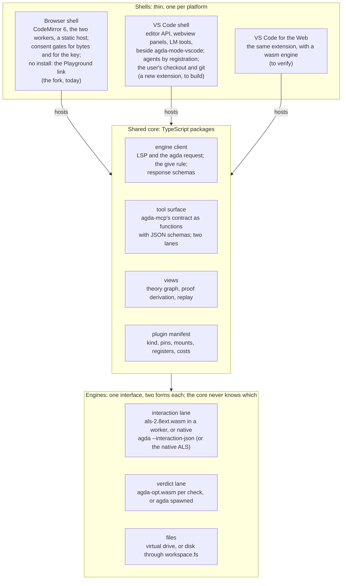
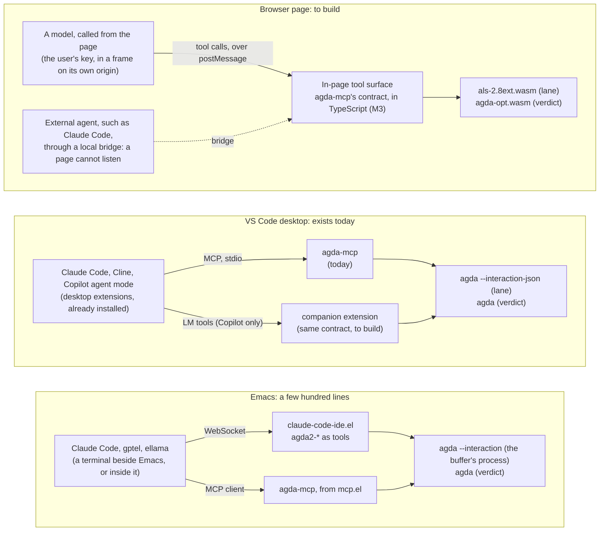
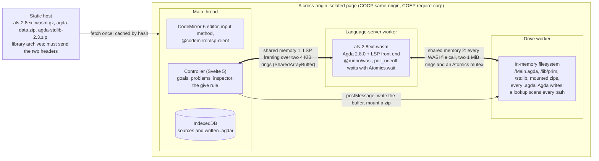

<!-- File: docs/notes/platform-brief-2026-10-05.md -->
<!-- Carried from the platform brief "Where the Agda Workbench Lives",
     written for this project on 2026-10-05 by Claude Fable 5.1 and
     published as a claude.ai artifact
     (https://claude.ai/artifact/H6YSvrjaNSx9ay1idMMorc, version 4,
     2026-10-05), which is shared within William's organization only;
     nothing in this repository depends on it.  The text is the brief's, in
     Markdown.  The comparison matrix gives each verdict in words; three of
     its eight diagrams are re-drawn in mermaid and the other five are
     described in a sentence; and what changed or was found wrong after the
     brief is corrected in place, each correction dated and listed under
     "Corrections".  -->

# Where the Agda workbench lives

This note is the platform brief of 2026-10-05, carried into the repository as
the companion of [ADR 0002][adr], which records the decision it argued for.
The brief asked whether the IDE that the [proposal] describes (agents, corpus
search, natural-deduction diagrams) should live in a browser tab, as the plan
had assumed, or in a VS Code extension, or in Emacs, and it answered from the
infrastructure up.  It recommended two platforms with different jobs, the
browser for the reader and VS Code for the author, sharing one core, and
nothing built for Emacs.  William decided the same day to go further: all three
platforms, sharing one core, on Agda 2.9.0, with a small Emacs milestone.  The
note explains; the ADR decides, and where the two differ (on Emacs, and on
anything corrected below) the ADR is the record.

The brief is written in five levels, each readable on its own: Depth 0 is the
answer, Depth 1 what is being built, Depth 2 the three directions compared,
Depth 3 how each platform works, and Depth 4 what a developer would have to
learn and the numbers the argument rests on.  The terms it uses are defined in
the [glossary](#glossary) at the end.

## Corrections

The brief's own version 4 carried three corrections, all of 2026-10-05.

+  **The reactor's scope**.  The language server's reactor build removes the
   shared memory of the server's input and output only; the fork's drive worker
   shares memory with the server's worker too, so the page needs no isolation
   only once the drive moves into the server's worker as well ([#59]).
+  **Memory units**.  Peak memory is restated in MiB: GNU `time` reports peak
   resident memory in KiB, so the native runs peaked at about 146 MiB and 750
   MiB, not 149 MB and 767 MB.
+  **Agda's wasm CI history**.  Agda's wasm workflow built the wasm `agda`
   every week through 2026-09-27; what failed after 2026-09-06 was the native
   build its test suites need, and on 2026-10-04 the workflow's setup.

These were made on 2026-10-06, when the brief was carried here, each marked in
place.

+  **Facts re-checked on the day**, each against its source (the
   [sources](#sources) give the URLs): Agda 2.9.0 is still unreleased, and its
   `nightly` prerelease moved from `da66a8c` to `835beac`; no run of Agda's
   wasm workflow has executed since 2026-10-04, so its last full pass is still
   2026-09-06; the language server still has no Agda 2.9 target;
   agda-mode-vscode is still 0.10.4, a git tag with no GitHub release, at
   19,552 installs; no standard-library release has followed v2.4; and the Agda
   MCP servers are six, not four, two of which run Agda inside their own
   process rather than through `agda --interaction-json`, and two quoted
   phrases had the wrong source (§ "Agents: where the field has settled").
+  **The matrix**.  The paragraph under the comparison matrix said the reader
   was the browser column's only green cell; the views and privacy are rated
   good there too (§ "Side by side").
+  **The agent survey**.  "Every proof-assistant agent integration shipped in
   2025 and 2026, for Lean, Rocq, Isabelle and Agda, is a local MCP process
   beside the editor" is too strong: the brief's own survey lists LeanCopilot,
   LLMLean and CoqPilot, which call a model from inside the prover or from an
   editor extension.  What holds is that every integration through which an
   external agent drives a prover is a local MCP server beside the editor, and
   none is a web page (§ "Depth 0", § "Agents: where the field has settled").
+  **The numbers**.  Two browser figures are plfa-playground's undated claims,
   not archived runs; the native give figure was a lane query, now replaced by
   a measured native give; "two to five times slower" is stated as the measured
   ratios; the HSP closure is not shown to be agda-algebras' largest; the
   native runs are cited to their archive on [#60]; and the table's preamble no
   longer claims a dated run for every figure, since its byte counts and
   records are not runs (§ "The numbers the argument rests on").
+  **The fork's lanes**.  The workbench diagram's caption said both lanes exist
   today; the fork has the interaction lane only, and the batch lane is [#30].
+  **The fork's seam**.  The brief said the fork's controller "never touches
   the wasm"; it fetches the compiler, starts the workers and owns the
   shared-memory rings, and only its command path is already behind an
   interface (§ "Could we do both?").
+  **`agda-mcp`'s tool count**.  The brief said fourteen tools;
   agda-native-air's ADR 0002 counts thirteen by default, a fourteenth on
   request and a fifteenth (`auto`) behind a flag.

## Depth 0: the answer in brief

**Everything in the proposal is possible on both platforms**.  Nothing in the
proposal needs a capability a browser lacks, and nothing in it needs one VS
Code lacks.  The engine is the same in either case: Agda's interaction
protocol, either in a native process or in a WebAssembly worker, and the same
interfaces.

**They are not the same IDE, because they serve different people**.  For the
author with a library checkout, VS Code is better on all three axes asked
about.

+  **Performance**: native Agda loads the `Setoid.Varieties.HSP` closure in 5
   seconds where the browser takes 11 to 22 after the planned fix, and 0.7
   seconds against 2 to 4 for `Overture.Basic` ([#60]'s findings; [#50]).
+  **Capabilities**: real files, git, a terminal, and every agent the user
   already runs, reachable today through `agda-mcp`.
+  **Usability**: agda-mode-vscode has 77 commands and the input method, and
   downloads the language server itself, which removes the installation pain
   Agda is known for.

For the reader who installs nothing, only a browser works, and that reader is
who Milestone 1 is for.

**Recommendation: both, with different jobs, sharing one core**.  Keep the
browser IDE as the playground a documentation site links to (Milestones 0 to
2), and build the three new things as platform-neutral packages: the tool
surface, the two views, the plugin manifest.  Then host the views in a VS Code
webview beside agda-mode-vscode, where the agents already are.  Emacs needs
nothing built: `agda-mcp` and the claude-code-ide.el pattern serve it, and it
cannot draw the diagrams anyway.  (William's decision of 2026-10-05 went
further than this recommendation and gave Emacs a milestone of its own, the
agent half and a corpus picker; [ADR 0002][adr] records it.)

**What to stop doing first**.  Do not build a model loop inside the page
(Milestone 4's key isolation, provider frame and in-page agent) before the
views exist.  Every integration through which an external agent drives a proof
assistant, shipped in 2025 and 2026 for Lean, Rocq, Isabelle and Agda, is a
local MCP server beside the editor, and a browser page cannot be one.
(Corrected 2026-10-06: the brief said every proof-assistant agent integration
is a local MCP process; LeanCopilot, LLMLean and CoqPilot, in its own survey,
call a model from inside the prover or an editor extension instead.)  The
browser's agent story should be the local bridge the plan already lists last
([#38]), and the in-page model a demo after that.

**What changed under the plan since it was written**.

+  Agda's own repository builds for wasm since December 2025, so release 2.9.0
   will need no patch.
+  The language server gained a build in September 2026 whose input and output
   need no shared memory, and with the drive moved into its worker the page
   needs none at all, so the cross-origin-isolation constraint the fork is
   designed around can go away.
+  JavaScript Promise Integration shipped in all three browser engines.
+  The group that wrote the fork's engine (agda-web, at Academia Sinica, which
   also maintains agda-mode-vscode) is deploying it inside VS Code for the Web,
   where PLFA type-checks today.

The browser engine is becoming a commodity; the views and the contract are
where this project is alone.

## Depth 1: what we are trying to build

The [proposal] that started this project (agda-native-air's
`browser-ide-proposal.md`, 2026-09-23) begins from a diagnosis, not from a
platform.  Agda is a good instrument for one theorem at a time and a poor one
for holding a development of many lemmas across several theories in one mind,
and its editors give a person and a model no shared surface to work on
together.  The workbench is meant to fix those two things, and a third follows
from the second.

+  **Agda, with pluggable resources**.  The type-checker is loaded by default
   and everything else is a plugin: libraries with their prebuilt interfaces,
   corpora with their search indices, models, and tools.  A plugin is a
   manifest that says what it is, what it is pinned to, what it mounts, what it
   registers, and what it costs in bytes.
+  **A tool surface a model can work in**.  The tools of `agda-mcp`
   (agda-native-air's [ADR 0002][air-adr-0002]: thirteen by default, a
   fourteenth on request and a fifteenth, `auto`, behind a flag; the brief said
   fourteen, corrected 2026-10-06), under one contract: a verdict is an exit
   code and never a reading of diagnostics text; every answer names the tree it
   checked; an answer from the fast interaction lane carries no verdict.  A
   model's suggestion is a candidate until Agda says otherwise.
+  **The development as a diagram**.  Two views, one source.  The theory view
   draws definitions as nodes and "uses" as edges, from exported data, with no
   Agda running.  The proof view draws one definition's term as a
   natural-deduction derivation (an application is an elimination, a lambda an
   introduction, an open hole an open leaf), with the judgment at each node,
   and edits it through Agda's own commands: refine at a leaf, split a case,
   give.  Solid for checked structure, dashed for the text inside a hole, and
   nothing drawn that is not in the file.

The brief drew the workbench as the proposal describes it, in four layers:
people and models at the top; then the surfaces (the editor, the theory view,
the proof view and the tool surface); then the engine (the interaction lane,
the batch lane, and the exports cut from the sources and interfaces); and the
plugins (libraries, corpora, models, tools) at the bottom.  Only the editor and
the interaction lane exist today, in the fork, and the batch lane is [#30]
(corrected 2026-10-06: the brief's caption said both lanes exist).  The views
are drawn from exported data and never from a model's description; every edit
they make goes through the editor's own interaction commands; and a model's
suggestion becomes a verdict only when a lane says so.  Nothing in this picture
says "browser": that is the point of the question.

The first deliverable is small and concrete: the agda-algebras site's
"Playground" link opens an IDE in a new tab with every module of that library
in an Explorer, a `Main.agda` buffer over the standard library and
agda-algebras, and Agda's goals and errors in an info pane.  That reader has
installed nothing, and that is the requirement the browser was chosen for.

### Four rules the plan never relaxes

1.  The model's claims are never the verdict; Agda's are.
2.  A diagram renders only from the checked source, never from a model's
    description.
3.  Every number the workbench states about itself comes from an archived run.
4.  Nothing leaves the reader's tab without consent: no analytics, no request
    the page has not stated.

Rules 1 and 2 are platform-independent.  Rule 3 is harder in a browser than
natively, because the instrument (a headless browser with the right headers) is
harder to drive.  Rule 4 is where the browser is strongest: a static page with
no server has nowhere to send anything.

### The plan as it stood on 2026-10-05

| Milestone | What it delivers | Where it stood (2026-10-05) |
|---|---|---|
| M0 Foundations | The fork imported as a recorded snapshot, binaries pinned by hash, a Nix build, CI with a real check in headless Chromium, hosting with cross-origin isolation, ADR 0001, the notice | PR 52 merged (the import, pins, notice, ADR 0001); PR 54 open (Nix package, browser CI); hosting ([#6]), stale builtins ([#49]) and the license review ([#53]) open |
| M1 The agda-algebras IDE | A library Explorer, a `Main` buffer over stdlib and agda-algebras, per-closure interface archives verified against Agda's own dependency graph, the drive indexed | Not started; the measurements that shape it are on [#13] and [#50] |
| M2 Plugins | The manifest and loader, the install consent gate, a third library by manifest alone, multi-file user projects | Not started |
| M3 The browser as a tool server | `agda-mcp`'s tools answered in the page; the batch lane (`agda-opt.wasm`) as the verdict of record; corpus and full-text search; archived agent sessions replayed through the surface | Not started; the batch lane is recorded, not adopted ([ADR 0001][adr-0001] § 5) |
| M4 Models in the loop | Key isolation and the consent gate, a frontier model on the user's key, sessions in the replay format, an external agent over a local bridge, a local model labeled unmeasured | Not started |
| M5 The theory view | The agda-algebras definition graph with every edge labeled by provenance; a node opens its source | Not started; needs only a corpus plugin, no Agda |
| M6 The proof view | A proof-term export (in agda-native-air), one gold as a derivation, the elision rules, then editing at a leaf | Not started; the export does not exist yet |

M0 and M1 are the reader-facing deliverable.  M3 and M4 are where the browser
choice costs the most, and M5 and M6 are where it matters least, because a
diagram is a diagram wherever it is drawn.  That asymmetry is the shape of the
recommendation below.

Since then: the plan was revised to the decision on 2026-10-06 (PR [#75]),
which renamed Milestones 3 and 4 ("The tool surface, in the page and in the
editor" and "Agents in the browser") and added Milestones 7 ("The VS Code
companion") and 8 ("Emacs"); and PR [#54] merged on 2026-10-06.

## Depth 2: three directions

Each direction below says what the platform gives for free, what it makes
expensive, and who it serves.  (The brief colored its diagrams by platform:
browser, VS Code, Emacs, and "shared" for what is the same everywhere.)

### A page: the fork, continued

+  **Gives** the following:
   +  a reader with nothing installed, from a link on a documentation site; it
      works on a tablet;
   +  privacy by construction: no server, nothing leaves the tab;
   +  total control of the surface: the Explorer, the goals pane, the views and
      the editor are one design;
   +  a working editor today: goals, give, refine, case split, 20 to 60 ms per
      goal edit (upstream's claim; see the numbers), persistence.
+  **Costs** the following:
   +  two to five times slower than native after the drive is indexed
      (measured: 2.1 to 4.3 times on the HSP closure, 2.6 to 5.5 on
      `Overture.Basic`; [#60]); interfaces downloaded per reader (54 MB for the
      HSP closure); a 4 GiB ceiling;
   +  no agent can call into a page: the loop, the key isolation and the bridge
      must be built;
   +  no local folder (Chromium only), no git, no terminal; multi-file projects
      are work;
   +  a bespoke plugin model and a hosting constraint (removable: the reactor
      build, with the drive moved into its worker).
+  **Serves**: readers, students, demos, and the views' first home.

### An extension: beside agda-mode-vscode

+  **Gives** the following:
   +  native Agda on the user's real checkout: 5 s for the HSP closure, 0.7 s
      for `Overture.Basic`, no memory ceiling that matters;
   +  agents by registration: Claude Code, Cline and Copilot speak MCP, and
      `agda-mcp` serves them today;
   +  a maintained Agda mode (v0.10.4 of 2026-10-05; 19,536 installs that day
      and 19,552 on 2026-10-06; 77 commands; the server auto-downloaded) and a
      web build that type-checks PLFA in vscode.dev;
   +  webviews for the views, settings, themes, git, a terminal, a marketplace.
+  **Costs** the following:
   +  installation: VS Code plus two extensions; not a link from a web page
      (vscode.dev comes close, with prompts);
   +  no agents on the web: Copilot Chat, Claude Code and Cline are
      desktop-only extensions, and the LM API is absent from vscode.dev;
   +  agda-mode-vscode is ReScript with no public API; a companion drives it
      through its commands or asks upstream for an export;
   +  views live behind a webview boundary and a message channel.
+  **Serves**: authors, and the agent-in-the-loop research.

### agda2-mode, extended

+  **Gives** the following:
   +  the reference implementation, maintained in Agda's repository, where most
      Agda is still written;
   +  agents nearly free: gptel or ellama as MCP clients of `agda-mcp`;
      claude-code-ide.el to expose `agda2-*` commands to Claude Code;
   +  corpus search as a picker over a local index.
+  **Costs** the following:
   +  diagrams: an SVG is one image with clickable hot-spots, and the embedded
      WebKit widget is build-dependent and uneven;
   +  no reach: Emacs, Agda, interfaces and setup on the reader's machine;
   +  Elisp, and a shrinking pool of people who will maintain it.
+  **Serves**: the people already there, for the agent half only.  (The plan,
   after William's decision, gives Emacs a corpus picker too: Milestone 8.)

### Side by side

The brief's matrix rated each cell by color alone; here each rated cell begins
with its verdict in words: **good** (the brief's green), **fair** (amber), or
**poor** (red).  The last two rows were not rated.

| Criterion | Browser page | VS Code desktop | VS Code for the Web | Emacs |
|---|---|---|---|---|
| A reader with nothing installed | **good**: yes, one link | **poor**: no | **fair**: nearly: a vscode.dev link, then two extension prompts; Chrome preferred | **poor**: no |
| Load of a 314-module closure, interfaces accepted | **fair**: 11 to 22 s (indexed drive) | **good**: 5.1 s | **fair**: wasm: same order as the page; not measured | **good**: 5.1 s |
| Memory ceiling | **fair**: 4 GiB (wasm32) | **good**: the machine's | **fair**: 4 GiB | **good**: the machine's |
| The user's own files, git, a terminal | **poor**: virtual drive; folders in Chromium only | **good**: yes | **fair**: GitHub repos; local folders in Chromium; no terminal | **good**: yes |
| Agents calling the tool contract | **poor**: build the loop and a bridge | **good**: MCP today (`agda-mcp`); LM tools for Copilot | **poor**: none: no chat extension runs on the web | **good**: MCP clients exist; claude-code-ide.el pattern |
| Corpus and full-text search | **fair**: download the index first (13 MB gz for stdlib) | **good**: local files; native search | **fair**: download first | **good**: pickers over local files |
| Theory and proof views | **good**: native to the page | **good**: a webview; Paperproof's shape | **good**: a webview | **poor**: static SVG with hot-spots |
| Privacy, nothing leaves by default | **good**: by construction | **good**: by configuration | **fair**: Microsoft's service, GitHub's files | **good**: by configuration |
| Hosting and isolation constraints | **fair**: COOP+COEP for the server lane, until the reactor build and an in-worker drive | **good**: none | **fair**: vscode.dev sends the headers; every fetch then needs CORS | **good**: none |
| Who maintains the chassis | **fair**: this project (a fork of a two-person lineage) | **good**: Microsoft; banacorn for the mode | **fair**: Microsoft; a pre-release WASI bridge | **good**: the Agda developers |
| What exists today | the editor and lanes (fork); nothing above them | the mode, the server, `agda-mcp`, the agents | the mode and the loader; PLFA type-checks | the mode; MCP clients |
| What this project would build | plugins, tool surface, agent loop, key isolation, views, hosting | a companion extension: views, corpus search, LM tools; an upstream ask | the same companion, web-built; no agents to attach | a few hundred lines of Elisp, optionally |

Read down the VS Code desktop column and every rated cell is good except the
first, the reader with nothing installed, which is poor.  Read down the browser
page column and the first cell is good, and so are two others, the views
(native to the page) and privacy (by construction); of its other seven, five
are fair (load time, memory, search, hosting and who maintains the chassis) and
two are poor (the user's files and agents).  (Corrected 2026-10-06: the brief
said the first cell was the browser column's only unambiguous green.  The two
other good cells do not change the reading, since the views are good in a VS
Code webview too and VS Code's privacy is good by configuration.)  That is the
whole decision: the first row is the reader, the rest is the author, and the
two are different people with different machines.

For the other two columns: VS Code for the Web is fair on the reader and on
nearly everything else, good only on the views and poor on agents; Emacs is
good on everything an author with a checkout needs except the views, and poor,
like VS Code desktop, on the reader.

### Could we do both?

Yes, and at less than twice the cost, on one condition: the three new things
are written as packages with an engine interface, not as routes in the
SvelteKit app.  The fork's own code already leans this way.  Its controller
speaks the Language Server Protocol to a worker through a transport object and
never touches the wasm; swap the transport for a native process and the
controller would not know.  (Corrected 2026-10-06: the controller does touch
the wasm.  It fetches the compiler, starts both workers and owns the
shared-memory rings (`src/lib/controller.svelte.ts`); what already sits behind
an interface is the command path, `ALSMessageRouter` in
`src/lib/agda/transport.js`, which implements CodeMirror's LSP `Transport` and
knows nothing of wasm.  So a native implementation replaces the startup and the
rings and keeps the command path; [#62] is that refactoring.)  agda-mode-vscode
makes the same move from the other side: its ALS connection is "via pipe", "via
TCP" or "via WASM", behind one interface.

The diagram above is the brief's, except that its native interaction lane said
only "native als"; the plan's engine allows a native `agda --interaction-json`
or the native language server ([#62], [#64]; corrected 2026-10-06).  The three
things the proposal adds (the tool surface, the views, the plugin model) are
platform-neutral if they are written against an engine interface with two
implementations.  Each shell is then thin: editor glue, hosting, and consent.
The fork's own code already splits this way in part: its controller speaks LSP
to a worker and does not care that the worker is wasm.  (The plan builds this
core as [#62].)

What each shell then owns is small.  The browser shell owns CodeMirror, the
workers, the static host, and the consent gates for bytes and for a key.  The
VS Code shell owns a webview panel, a LanguageClient or a child process for its
own lane, and the registrations: MCP server definitions for the agents that
speak MCP, LM tools for Copilot.  The views, the tool surface and the manifest
are imported by both.

### Where agents attach

Where agents attach differs most, and is the clearest reason to let VS Code
carry that half.

The contract is the same in all three columns.  Only the VS Code column has an
agent on the other end today, because agents are MCP clients and `agda-mcp` is
an MCP server; the page has to build both the loop and a bridge, and the web
build of VS Code has no agent at all (no chat extension runs in vscode.dev, and
MCP over stdio needs Node).  Emacs has agents but no diagrams: one image per
SVG, and WebKit widgets that are uneven.

### A sequencing that keeps the committed deliverable and moves the expensive part

1.  **Finish M0 and M1 as planned**.  The agda-algebras playground is the thing
    a reader can use, it is nearly working, and the measurements that shape it
    are done.  Adopt the drive index ([#50]) and plan for the language server's
    reactor build with the drive moved into its worker, which together remove
    the isolation headers and the service-worker race from the hosting decision
    ([#6]).
2.  **Build M5 and M6 as components**.  The theory view needs only a corpus;
    the proof view needs the export in agda-native-air ([#43]).  Both render in
    the page first because the page is where the data already loads, but
    neither imports anything from the page.  This is the project's own
    contribution and the part nobody else is building.
3.  **Scope M3 to what the views and the replay need**.  The in-page tool
    surface is worth having for parity replays ([#31]) and for the batch lane,
    but it does not need an agent behind it to be useful.
4.  **Move the agent work to where agents are**.  The research agenda (a model
    proving obligations through the contract) runs today in VS Code or a
    terminal with `agda-mcp`; it does not wait on a browser.  Re-order M4: the
    local bridge ([#38]) first, since it is the pattern every other prover
    converged on; the in-page model behind a key gate ([#35], [#36]) last, as a
    demo for readers.
5.  **Add a VS Code companion milestone after M5**.  A TypeScript extension
    hosting the views in a webview beside agda-mode-vscode, with corpus search
    and MCP or LM-tool registrations; first through agda-mode's own commands,
    then through an exported API if banacorn agrees to one (the Lean extension
    exports its client this way, and Paperproof depends on it).
6.  **Record the decision as ADR 0002** of this repository, with these
    measurements as its evidence, and copy the proposal into `docs/notes/` so
    the record is self-contained.

The plan took all six (PR [#75]; the proposal arrived as PR 57, [#56]) and
added a seventh, the Emacs milestone.

### Alternatives worth naming, and why they are not the answer

+  **Extend Emacs's agda2-mode**.  The agent half is nearly free (gptel or
   ellama as the client of `agda-mcp`; claude-code-ide.el to expose `agda2-*`
   commands to Claude Code) and would serve the people who already live in
   Emacs, William among them.  Corpus search is a picker.  The diagrams are the
   wall: an SVG in Emacs is one image with clickable hot-spots, and the
   embedded WebKit widget is build-dependent and uneven across platforms.  And
   no reader arrives from a web page.  Verdict: a cheap second front end for
   the agent features, never the IDE.
+  **A server behind the page** (lean4web's model; agdapad's, which runs Emacs
   itself in a container and streams it to the browser).  It removes every wasm
   limit at once: native Agda, real memory, any library.  It also removes the
   two properties the project chose the browser for: nothing leaves the tab,
   and nothing costs anyone money per reader.  The Lean web editor is explicit
   that "serious development" is out of scope for it.  Verdict: a fallback for
   a demo, not a design.
+  **A hosted VS Code** (GitHub Codespaces, or a self-hosted code-server with
   native Agda).  Zero local install, full native power, the whole extension
   ecosystem.  It needs an account and a running machine per reader, and the
   "Playground" link becomes "sign in and wait for a container".  Verdict: the
   right thing for a course or a sprint; wrong for a link on a documentation
   page.
+  **A desktop shell around the web IDE** (Electron or Tauri wrapping the
   SvelteKit app, spawning native Agda).  Native speed with the fork's UI.  But
   a shell that spawns processes, opens folders and runs git is an editor, and
   VS Code already is that editor, with a marketplace, agents and a web build.
   Verdict: rebuilding VS Code's chassis to keep CodeMirror; not worth it.
+  **Neovim, Zed, Helix**.  Cornelis gives Neovim a real agda-mode (Haskell,
   one `--interaction-json` process per buffer, pinned to the Agda version,
   changing maintainers).  Zed and Helix get highlighting and the language
   server's hover, and the server's interactive commands travel over its
   private `agda` method, so each editor would implement agda-mode's command
   set itself.  Verdict: clients of `agda-mcp`, like Emacs; not hosts for the
   views.

The pattern across all five is the same one the agent precedents show: the Agda
engine and the agent contract are editor-independent and already exist
natively; the three new surfaces (tool surface in a page, theory view, proof
view) are web components; and the only question with teeth is which chassis
holds the editor for the reader who installs nothing, and which for the author
who has everything.

## Depth 3: the infrastructures, and how they work

This level is for the reader who will have to build or supervise the thing.  It
starts with what every option shares, because that is most of the engine, and
then takes each platform in turn: how it runs Agda, where its costs are, and
what a developer has to learn before the first feature.

### What every option shares: Agda's interaction protocol and its interfaces

There is exactly one way to make Agda interactive, and every editor uses it.
Agda started with `--interaction` (or `--interaction-json`) reads one command
per line from standard input and writes responses to standard output.  A
command is an IOTCM envelope naming the file and a constructor of Agda's
`Interaction` type: `Cmd_load`, `Cmd_give`, `Cmd_refine`, `Cmd_make_case`,
`Cmd_goal_type_context`, `Cmd_infer`, `Cmd_compute`, `Cmd_why_in_scope`,
`Cmd_show_module_contents`, about forty in all.  Responses are highlighting
ranges, goal lists, the text of a give or the clauses of a case split, errors,
and running information such as `Checking Main (/Main.agda)`.  The grammar has
no documentation worth the name; the source
(`src/full/Agda/Interaction/Base.hs`, `InteractionTop.hs`, `JSONTop.hs`) is the
reference, and the project's `scripting-agda-interaction` skill records what
was learned driving it.

The Agda Language Server wraps this protocol in the Language Server Protocol
rather than replacing it.  Its only standard request is `textDocument/hover`;
the document-change notifications are no-ops; and every interactive command
rides in a custom request named `agda` whose payload is the IOTCM string, with
Agda's responses streamed back as server-to-client requests of the same name
(verified in its `Switchboard.hs` and `Server.hs`, release v8, 2026-09-22).  So
a generic LSP client (eglot, Zed, Helix) connecting to it gets hover and
nothing else; a real Agda client still implements agda-mode's command set.  The
fork does: its controller sends
`{tag: "CmdReq", contents: 'IOTCM "/Main.agda" NonInteractive Direct (Cmd_give …)'}`
and routes the answers to handlers for highlighting, goals, gives and case
splits ([`runtime.md`][runtime], "The transport").  agda-mode-vscode does the
same against the native server, or parses Lisp forms from a plain
`agda --interaction`.

The interface is the other shared fact.  Agda type-checks a module from source
unless a `.agdai` for it is accepted, and acceptance requires the same Agda,
the same source hash, the same options and the same hashes for every import; a
rejected interface is silently checked again.  Two things follow for any
platform.  A library's interfaces must be built by the Agda that will read
them, under the argv that will be used, which is why the plan's library
archives are "proved under the shipped compiler"; and the cost of a check with
everything accepted is the cost of reading the import closure's interfaces (54
MB gzipped for `Setoid.Varieties.HSP`, 314 modules), which is 5 seconds
natively and tens of seconds in the fork.  The interface format is
architecture-independent: native x86-64 interfaces are accepted unchanged by
the wasm Agda ([#13]), which is what lets the browser ship interfaces a CI
machine built.

Finally, the two lanes.  Interaction-mode Agda is tolerant by design: it loads
a file with open holes and answers questions about it.  Batch Agda exits 42 on
the same file.  agda-native-air's rule ([ADR 0002][air-adr-0002]) is that only
the batch exit code is a verdict, and the lane informs.  Natively this is two
processes; in the browser it is two wasm binaries, one of which the fork does
not carry yet ([#30]).  agda-native-air's [issue 163][air-163] measured the two
lanes' agreement on 80 distinct candidate pairs (zero disagreements on the
committed ones, 2026-09-21), which is what permits the browser to judge a
candidate in milliseconds without lying.

The brief drew one edit as a sequence between the editor buffer, the
controller, Agda and the files.  An edit wholly inside one goal's braces is
sent as `Cmd_give` and answered in milliseconds, and the given text becomes the
checked snapshot; anything else (a declaration, an import, an edit across two
goals) writes `Main.agda` and sends a full `Cmd_load`, which reads every
imported interface (about 130 file lookups per imported module) and takes
seconds.  The protocol is Agda's own, the same one Emacs sends, so this
sequence is identical in the browser, in VS Code, and in Emacs; what differs is
who plays "Files" and how long the load takes.  The give rule is conservative
on purpose: a stale result can never stand for a changed declaration
([`runtime.md`][runtime], "A check, and the give rule").

### The browser: Agda compiled to WebAssembly, in a worker

The fork's runtime is the Agda Language Server compiled to wasm32-wasi by GHC's
WebAssembly backend, loaded in a web worker, with a second worker holding the
files.  The architecture is a consequence of one fact: GHC's runtime, as
compiled, is a blocking program (it waits on standard input and makes
synchronous file calls), and a browser's main thread cannot block.  So Agda
runs in a worker, and the worker blocks on shared memory that another thread
fills.

The runtime as forked from plfa-playground ([`runtime.md`][runtime]).  Agda is
a blocking program that waits on standard input, so it lives in a worker, and
the worker blocks on shared memory, which is why the page must be cross-origin
isolated.  The memory is shared in two places, drawn as the two thick edges:
the server's standard input and output, and every file call the server makes to
the drive worker.  The language server's reactor build replaces the first and
not the second ([#59]).  The planned batch lane needs none of that: a batch
process reads its input to the end and exits.  The brief's drawing also placed
the two planned pieces beside the workers: the batch lane, `agda-opt.wasm`
(31.5 MB, one process per check, exit 42 for a type error or an open hole, no
shared memory; [#30]), and the provider frame that holds a model's key on its
own origin ([#35]).

#### What the measurements already say about this design

+  **Startup is fine**.  A fresh profile has "Agda ready" in about a second and
   the default `Main.agda` checked in about two, after downloading 15.6 MB
   ([ADR 0001][adr-0001] § 3).  A warm reload downloads nothing.
+  **Goal edits are fast**.  A give inside one hole takes 20 to 60 ms through
   the lane by upstream's account (its README's undated claim; this project has
   not yet measured it), which is the experience agda2-mode gives.
+  **Loads are slow, for a fixable reason and a fixed one**.  80 to 99 % of a
   check's time in the fork is the in-memory filesystem, whose lookup scans
   every path and builds a regular expression per path; an index brings a check
   of the HSP closure from 79 to 104 s down to 11 to 22 s ([#50]).  The
   remaining factor of two to five over native (2.1 to 4.3 on the HSP closure,
   2.6 to 5.5 on `Overture.Basic`; [#60]) is the price of wasm32 and of a
   single-threaded runtime; it does not go away.
+  **Interfaces are the scaling wall**.  Each reader downloads the closure of
   what they open: 54 MB gzipped for HSP, against 9 MB for all 26 PLFA
   chapters.  The plan's answer is per-closure archives chosen by a verified
   dependency index, mounted on demand, with the bytes stated before the fetch
   ([#12], [#14]).  It works; it is simply a cost a disk never has.
+  **Memory is not the wall for this library**.  The HSP check peaks at about
   750 MiB of resident memory natively ([#60]), under the 4 GiB a 32-bit wasm
   memory can address.  A library whose modules need several gigabytes (some
   cubical developments do) would not fit.
+  **Isolation is the interactive lane's requirement, not the IDE's**.  Only
   the language server's shared memory needs the two headers.  The plain
   checker runs without them, one process per command, and JSPI (JavaScript
   Promise Integration, which lets wasm suspend on a promise) kept one such
   process alive across commands in Chromium: 1.45 s per reload and 45 to 55 ms
   per goal query on a 244-module image, measured once, as a probe
   (agda-algebras PR [585][pr-585], [ADR-011][adr-011], 2026-10-04).

#### What the browser cannot do, or not yet

+  **The user's own files**.  A development lives in a git checkout on a disk,
   with a `.agda-lib`, a build directory and a terminal beside it.  The
   browser's filesystem is virtual; the File System Access API can open a local
   folder in Chromium-based browsers only, and there is no git, no shell and no
   other tool.  Multi-file projects with their own `.agda-lib` are a Milestone
   2 item for a reason ([#28]).
+  **A long session on a big library**.  Every page load re-instantiates a 33
   MB module and refills a drive; IndexedDB persistence softens this, but a
   native process that stays warm for a day does not have the problem.
+  **An agent, without building the agent**.  No agent can call into a page, so
   Milestone 4 builds the loop itself, isolates the key on a second origin, and
   writes a bridge for external agents (§ "Where agents attach").
+  **A host that does not set headers**.  GitHub Pages cannot send the
   isolation headers; the service-worker fallback works after one reload and
   had a race that two independent guards fix ([#6]).  Cloudflare Pages sends
   them from a file.  (Since then, [#6] found that the organization's free plan
   serves GitHub Pages only from public repositories, so while this repository
   is private, Pages is not available at all.)

The brief drew the browser engine's supply chain as a stack: Agda 2.8.0 with
agda-web's patch (in agda/agda itself for 2.9.0) and the language server, built
with ghc-wasm-meta's GHC 9.10 wasm32-wasi backend against wasi-libc,
compiler-rt, libc++, GMP 6.3.0 and libffi-wasm, into two binaries
(`als-2.8ext.wasm`, 33.0 MB and 10.2 MB gzipped; `agda-opt.wasm`, 31.5 MB), run
by a WASI shim (`@runno/wasi`) or a hand-written WASI host (24 imports).  Two
binaries, one toolchain, and a one-person upstream (agda-web) for the patched
sources.  What a developer must understand to change anything in it (Haskell
and cabal and Agda's interaction modules; Nix, pins and the wasm backend's
limits; fixed-output fetches and host file-size limits; WASI's calls,
`SharedArrayBuffer`, JSPI) is none of it Agda, and all of it is needed before
the first Agda-level feature.  Every stage is pinned by hash, and the build
refuses a file that differs from its pin ([ADR 0001][adr-0001] § 3).

#### What moved upstream in 2025 and 2026, and what it changes

The fork was built against a patched Agda and a patched language server from
the agda-web organization.  That organization is not a hobby: its homepage says
it is funded by the Institute of Information Science, Academia Sinica, led by
Liang-Ting Chen, with Ting-Gian Lua (banacorn, the author of agda-mode-vscode
and the language server) and Andy Pan (the author of the wasm builds and of
als-demo, the fork's ancestor) as developers.  Four of its results matter here.

+  **Agda itself builds for wasm now**.  agda/agda PR [8205][agda-8205] (Andy
   Pan, merged 2025-12-07) added a Nix flake with the wasm toolchain and a CI
   workflow that builds Agda for wasm32-wasi and runs the Succeed and Fail
   suites under wasmtime weekly.  Its wasm build passed every week through
   2026-09-27; from 2026-09-13 the runs failed afterward, at the native build
   the test suites need (agda/agda issue [8756][agda-8756]), and on 2026-10-04
   at setup, because the flake stopped evaluating, which agda/agda PR
   [8809][agda-8809] fixed on 2026-10-05.  (Checked 2026-10-06: no run has
   executed since 2026-10-04, since the workflow runs only on its weekly
   schedule, on a manual dispatch, or for a commit or pull request tagged
   `[wasm]`, and none has come; the next scheduled run is 2026-10-11;
   agda/agda#8756 is still open; so the last full pass is still 2026-09-06, at
   `28cbf0e6`.)  The patch is 87 lines over four files (the lock file,
   `-threaded`, non-blocking stdin).  None of it is in the 2.8.0.x releases
   (checked 2026-10-06: v2.8.0.2, of 2026-09-13, does not contain PR 8205's
   merge); 2.9.0 will be the first release that compiles to wasm unpatched.
   The agda-web language-server fork is fully upstreamed (zero commits ahead);
   upstream builds its wasm in CI since July 2025 and release v8 (2026-09-22)
   ships it.
+  **The isolation requirement is being removed at the source**.
   Language-server PR [48][als-48] (merged 2026-09-13) adds a reactor build
   flag, with the justification that the stdin and stdout design "relies on
   `SharedArrayBuffer`", so that "the web page has to be cross-origin isloated"
   (sic), which "is proven to be a very unusual requirement and has prevented
   wider adoption".  (Corrected 2026-10-06: the brief quoted it with the typo
   silently fixed.)  A reactor exposes create and teardown functions and
   message channels to JavaScript instead of blocking on standard input.  That
   removes the shared memory of the server's input and output, and only that:
   the fork's drive worker shares memory with the server's worker too, since
   every WASI file call goes through a lock and two rings, and a reactor still
   makes its file calls synchronously.  With the drive moved into the server's
   worker as well, a page would need neither the two headers nor the
   service-worker fallback.  A reactor cannot run under a standalone wasm
   runtime, which is a cost for measurement, and the fork does not use it yet.
+  **JSPI shipped everywhere**.  Browser compatibility data records JavaScript
   Promise Integration in Chrome 137, Firefox 153 and Safari 27, without flags
   (checked 2026-10-06; those versions were released on 2025-05-27, 2026-07-21
   and 2026-09-14).  PR 585's probe (one plain-checker process kept alive
   across commands with no shared memory) therefore no longer depends on one
   browser.  GHC's own asynchronous foreign interface does not use JSPI; it
   suspends only Haskell threads entered from the event loop, which is what the
   reactor flag builds on.
+  **The group's own front end is VS Code for the Web**.  agda-web's [PLFA
   fork][agda-web-plfa] is a VS Code for the Web workflow using banacorn's
   agda-mode together with Pan's "Agda Language Server WASM Loader" extension
   ([v0.8.5][als-loader], 2026-05-19); Pan's notes say basic interaction
   commands work, library management arrived in April 2026, and the project "is
   expected to stabilize around mid-2026".  The people who built the fork's
   engine are putting it inside VS Code's web build, not inside a bespoke page.

#### The limits that do not move

+  **GHC's wasm backend is still "a tech preview"** in the 9.14.1 user guide:
   wasm32-wasi only, no wasm64, a single-threaded runtime (one core, no
   parallel garbage collection).  The one published measurement (Serrano and
   Findler, MPLR 2025, on GHC 9.6.6) puts GHC's wasm output at 4.5 to 11.7
   times slower than native across twenty benchmarks, the worst of six
   languages studied; newer GHCs are better, and Agda's workload is interface
   deserialization rather than compute, which is why this project sees two to
   five times rather than eight.  It will not reach native.
+  **Four gigabytes**.  A 32-bit wasm memory addresses 4 GiB, and Chrome and
   Firefox allow that much.  agda-stdlib's CI runs Agda with a 5 GB heap limit
   and cubical's with 6 GB; pathological modules have needed 8 GB.  Memory64
   exists in Chrome 133 and Firefox 134 but GHC cannot target it, and
   SpiderMonkey measured 10 to over 100 % slowdowns from 64-bit addressing.  So
   whole-library checks of the big libraries sit at or above the ceiling, and
   agda-algebras' HSP closure (about 0.8 GB natively, [#60]) sits well below
   it.  (Corrected 2026-10-06: the brief called it agda-algebras' largest
   closure, which was not measured.)
+  **The platform's gaps**: local folders only in Chromium (the File System
   Access API), no git without a proxy (isomorphic-git cannot clone from GitHub
   directly for lack of CORS), module workers only from Firefox 114, and
   storage that a browser may evict (Safari after seven days without
   interaction).  OPFS with synchronous access handles (Chrome 102, Firefox
   111, Safari 15.2) is the faster filesystem the drive worker could move to,
   and it needs no isolation headers.
+  **Models in the tab**.  WebGPU is in every engine except Firefox on Linux;
   WebLLM's 1 B to 4 B models need 0.9 to 3.7 GB of video memory, an 8 B model
   5 GB.  Calling a frontier model directly from a page is supported by both
   Anthropic (since 2024-08-23, behind a header whose name says "dangerous")
   and OpenAI, for bring-your-own-key tools exactly like this one; the danger
   is the key's exposure to the page, which is what [#35] isolates.

### VS Code: an extension host, a language client, and a webview

VS Code is three processes.  The window draws the editor and owns the text; the
extension host, a Node.js process (on the web, a worker), runs every
extension's code against the `vscode` API, with no access to the window's DOM;
and whatever language servers or tools an extension spawns run beside it.  An
extension contributes commands, settings and views in its `package.json`, is
activated on an event (a language, a command), and from then on reads and edits
documents, decorates ranges, answers hovers, and opens panels.  A webview is
such a panel: a sandboxed browser frame on its own origin that renders HTML the
extension supplies and talks to it by `postMessage` in both directions.  Lean's
infoview, Paperproof's tree and agda-mode-vscode's goals panel are all
webviews; a Svelte component with inline SVG is exactly what one is for.

The brief drew the VS Code shape: the window (the editor, agda-mode-vscode's
goals panel, and a webview panel running the same Svelte components as the
browser IDE for the proof view, the theory view and replay); the extension host
(agda-mode-vscode, the workbench extension with the tool surface, the views'
host, corpus search and plugin manifests, and the agent extensions); and native
processes beside them (the language server or `agda --interaction` as the
interaction lane, a batch `agda` per check as the verdict lane, and `agda-mcp`
as a stdio MCP server), all over the real files: the checkout and its `_build`,
the standard library, the libraries registry, and the corpus.  The two lanes
are native processes, so they run at native speed on the user's real checkout,
and agent integration is a registration rather than a build: `agda-mcp` already
serves Claude Code this way.  The views would live in a webview, which is a
browser; the same components the browser IDE draws would render there
unchanged.

#### agda-mode-vscode, as it is

+  **ReScript, with a React panel**.  The extension is written in ReScript (a
   typed language compiling to JavaScript), its goals panel is a React 18 app
   in a webview, and webpack builds two bundles: one for Node (desktop) and one
   for a web worker (the browser entry).  Version 0.10.4 was published on
   2026-10-05 (checked 2026-10-06: still the latest, as a git tag and on the
   Marketplace, with no GitHub release; 19,552 installs against the brief's
   19,536); nine releases in 2026; one principal author (banacorn, 2,211
   commits) with Andy Pan and Fredrik Bakke the next contributors.
+  **Three ways to reach Agda**.  Spawn `agda --interaction` and parse Emacs's
   S-expressions; or connect to the Agda Language Server over LSP, by pipe (a
   child process), by TCP, or "via WASM" through the companion loader
   extension.  The interaction commands are tunneled as the custom `agda`
   request either way.  The extension computes go-to-definition, semantic
   tokens and hover itself from Agda's highlighting output, because the server
   offers only hover.
+  **77 commands under `agda-mode.*`**: load, give, refine, elaborate-and-give,
   auto, case, goal type and context in four normalization variants, module
   contents, compute, why-in-scope, constraints, next and previous goal,
   search-about, the input method, lookup-symbol.  These are what a companion
   extension can invoke with `vscode.commands.executeCommand`, since the
   extension exports no public API (its `activate` returns test hooks) and its
   issue tracker has nothing on LLMs, MCP or agents.
+  **The install story is solved here**.  On desktop the extension downloads a
   prebuilt language server for the user's platform (built for Agda 2.8.0,
   2.7.0.1 and 2.6.4.3), with a native-to-WASM fallback since 0.9.0; on the web
   it fetches the wasm from unpkg (GitHub release assets fail the browser's
   CORS preflight) and the standard library from a proxy.  A reader needs VS
   Code and two extensions, and no Agda.

#### The agent surfaces, and where they run

+  **LM tools** (`vscode.lm.registerTool`, finalized in 1.95, October 2024) are
   "equivalent to MCP tools, but they run inside the extension host"; Copilot's
   agent mode calls them.  Chat participants add a `@name` in Copilot Chat.
   Bring your own key (the chat provider API, 1.104, August 2025) lets an
   extension contribute models, but only for users on individual Copilot plans.
+  **MCP** has full-specification support since June 2025: servers from
   `.vscode/mcp.json`, from `vscode:mcp/install` links, or contributed by an
   extension through `registerMcpServerDefinitionProvider`, over stdio or
   streamable HTTP.  Third-party agents (Claude Code's extension at 27 million
   installs, Cline, Continue) consume MCP servers and not LM tools; Roo Code's
   request to read `lm.tools` was declined.  So an Agda tool that should reach
   every agent is an MCP server, which `agda-mcp` is; LM tools reach Copilot
   alone.
+  **All of it is desktop**.  Copilot Chat, Claude Code and Cline are
   "workspace" extensions that do not load in vscode.dev; a September 2026
   issue records the LM API as unsupported there; MCP over stdio needs Node.
   The web build edits and type-checks, and that is all.

The brief drew VS Code for the Web as agda-web deploys it: a vscode.dev tab
served with COOP and COEP, so shared memory works and every fetch needs CORS;
Monaco, the goals panel and a possible views panel in the window;
agda-mode-vscode's browser entry and the loader (a patched `wasm-wasi-core`) in
an extension host that is a web worker, with no Node, so no child processes and
no stdio MCP; the language server (`als.wasm`, 28.9 MB from unpkg) in its own
worker over an in-memory filesystem; and the files from a GitHub repository
(`vscode.dev/github/owner/repo`) or a local folder in Chromium.  This is the
fork's engine inside Microsoft's chassis: the same wasm server in a worker, the
same shared memory, the same in-memory filesystem.  It reaches a reader without
an install prompt for Agda, but not without two extension prompts, and it has
no agent to offer.

#### What the web variant rests on

The loader extension bundles a patched copy of Microsoft's WASM WASI Core
extension (fixes for Haskell modules' `fd_prestat_get` and `fd_write`), runs
the server in a worker, and serves its WASI calls synchronously over shared
memory with `Atomics.wait`, the same mechanism the fork uses.  vscode.dev now
sends the two isolation headers itself (verified with `curl -I` on 2026-10-05,
and again on 2026-10-06), which is why this works without a service worker; the
price is that `require-corp` makes every cross-origin fetch carry CORS, hence
unpkg.  Microsoft's packages are maintained but not advancing: `wasm-wasi-core`
1.0.2 is from September 2024, and `@vscode/wasm-wasi-lsp` is still a
pre-release after two years.  rocq-lsp runs a waCoq worker in the browser this
way and is the closest analogue; ShellCheck (Haskell) shipped the same route on
2026-09-30.

#### What a companion extension would be

A TypeScript extension beside agda-mode-vscode, in the shape Paperproof takes
beside the Lean extension: it opens a webview hosting the views, watches the
cursor, and drives edits through the mode's commands (or through an exported
client if upstream adds one, as Lean's `clientProvider` export does;
Paperproof's error page is a warning about how such an export can break).  It
registers the tool contract as an MCP server definition for the agents that
speak MCP and as LM tools for Copilot, reads the corpus from disk, and runs its
own `agda --interaction-json` lane for queries the mode does not expose.
Native speed, real files, and the agents already there; the cost is the webview
boundary, a message protocol between the views and the editor, and a dependency
on a mode with one maintainer and no API.  (The plan builds it as Milestone 7,
[#63] to [#70].)

### Emacs: the reference implementation, and its ceiling

agda2-mode is the editor the Agda developers maintain in Agda's own repository
(`src/data/emacs-mode/`, about 5,000 lines of Elisp across `agda2-mode.el`,
`agda2-highlight.el`, `agda-input.el` and `annotation.el`), and the
installation docs still call it the most tested of the four supported editors.
It is alive: commits in 2026 from Reed Mullanix (goal detection, a restart
race), Andreas Abel and Fredrik Bakke.  How it works is the template every
other client copies.

+  **One process per buffer**.  Emacs starts `agda --interaction` and sends
   IOTCM lines; Agda answers with Lisp forms (`agda2-info-action`,
   `agda2-goals-action`, `agda2-give-action`, `agda2-make-case-action`), which
   the mode applies only through functions marked safe, so a response cannot
   run arbitrary code.
+  **Goals are overlays** carrying the goal number; highlighting arrives as a
   file of annotations that `annotation.el` turns into text properties and
   go-to-definition links.
+  **The input method** is a Quail package built from TeX-style translations
   (`\lambda` gives λ); the fork's CodeMirror symbol input and
   agda-mode-vscode's both reimplement its table.

Could the three features be added here instead?  The honest answer is one yes,
one shrug and one no.

+  **Agents: yes, and partly done**.  gptel and ellama give Emacs tool-calling
   clients with MCP support through mcp.el, so `agda-mcp` is reachable from
   inside Emacs today.  The other direction exists too: claude-code-ide.el runs
   a WebSocket MCP server inside Emacs, writes the lock file Anthropic's own
   IDE plugins write to `~/.claude/ide/`, and lets any Elisp function be
   registered as a tool, so goals, give, refine and case split could be exposed
   to a Claude Code session by wrapping the `agda2-*` functions.  That is the
   strongest point in Emacs's favor, and it costs a few hundred lines.
+  **Corpus search: adequate**.  `completing-read` pickers (vertico, consult,
   helm) over a local index are what Emacs does best; nothing graphical, no
   type-shaped rendering beyond text.
+  **Diagrams: no**.  Emacs can display an SVG as a single image with clickable
   hot-spots (the image `:map` property) and rescale it, but every change
   re-rasterizes the whole picture, there is no DOM, no text selection and no
   incremental layout, and panning is buffer scrolling.  A static derivation
   with clickable leaves is possible; a live, zoomable, editable proof view is
   not.  The escape hatch, xwidget-webkit (an embedded WebKit frame), depends
   on how Emacs was built, was disabled in nixpkgs until April 2026 because
   newer WebKit crashed it, shows a blank page on PGTK until nudged, is
   experimental on macOS and absent on Windows.

And Emacs cannot reach the reader the first deliverable is for.  Someone who
clicks "Playground" on the agda-algebras site needs Emacs, a matching Agda, the
library's interfaces and agda-mode setup.  Emacs can only ever be a second
front end for the people who already live in it; for them, the agent half is a
weekend's work on top of `agda-mcp`, and nothing in this project needs to be
built for it.  (William decided otherwise on 2026-10-05: Milestone 8 builds the
agent half and the picker, and measures the static derivation, [#71] to [#74];
[ADR 0002][adr] records why.)

The other editors do not change this picture.  Cornelis (Neovim) is a Haskell
plugin with one `agda --interaction-json` process per buffer, pinned to the
Agda version and "switching maintainers".  Zed's Agda extension and Helix give
highlighting and, through the language server, hover: the server's interactive
features travel over its private `agda` method, so every editor must still
implement agda-mode's command set itself.  The language server unifies
installation, not features.

### Agents: where the field has settled

Every integration through which an external agent drives a proof assistant,
shipped in 2025 and 2026, has the same shape, and it is worth seeing how
uniform the convergence is before deciding to build something different.
(Corrected 2026-10-06: the brief said every proof-assistant agent integration;
the integrations that put a model inside the prover, LeanCopilot and LLMLean,
and CoqPilot's extension, are the exceptions its own survey names.)

+  **Lean**.  lean-lsp-mcp (v0.31.0, 2026-09-30) puts goals, diagnostics,
   hover, the search engines and a build behind MCP, over stdio, streamable
   HTTP or SSE; Mistral trained Leanstral against it.  The Lean FRO's roadmap
   for September 2026 to February 2027 says that "lean-beam is how AI agents
   interact with Lean, and it is strategically important", and plans to
   distribute it with Lean; lean-beam's README describes it as "new Lean LSP
   extensions with a thin local broker", which it exposes through a CLI and an
   MCP server.  (Corrected 2026-10-06: the brief attributed that last phrase to
   the roadmap.)  LeanCopilot and LLMLean run models as tactics inside the
   prover; Paperproof draws proof trees in a VS Code webview from a server-side
   RPC method.
+  **Rocq**.  rocq-lsp ships pétanque (`pet`), a JSON-RPC interaction protocol,
   and rocq-mcp puts thirteen tools over it, over stdio, with staged
   verification of admits and axioms; CoqPilot (JetBrains Research) fills
   `admit.` holes with LLM candidates checked by coq-lsp.
+  **Isabelle**.  isabelle-pide-mcp (2026) is "a customisable Model Context
   Protocol server managing a headless PIDE session" (its preprint's abstract,
   2026-09-12), editor-agnostic, beside jEdit or VS Code, over stdio.
+  **Agda**.  Besides agda-native-air's `agda-mcp`, six small MCP servers
   appeared in 2025 and 2026, one of them a copy of another, all local
   processes in front of Agda.  DreamLinuxer's, InvariantHoldings' and
   peterthiemann's spawn `agda --interaction-json` and speak MCP over stdio
   (and cliu238's is a copy of InvariantHoldings'); faezs's and broughjt's link
   Agda as a Haskell library and run its interaction layer in the server's own
   process, faezs's over HTTP on localhost and broughjt's over stdio.
   (Corrected 2026-10-06: the brief named four, "each wrapping
   `agda --interaction-json`"; broughjt's server, created 2026-07-07, was
   missed.)  No Agda-specific LLM tooling beyond these was found; Agda's own
   automation is Mimer (`C-c C-a`), which replaced Agsy in 2.7.0 and does not
   case split or refine.
+  **The IDE vendors**.  Claude Code's VS Code and JetBrains plugins run a
   local MCP server on a random loopback port with a lock file for discovery;
   Cursor, Windsurf, Zed and VS Code's Copilot are MCP clients over stdio and
   Streamable HTTP.  The MCP specification itself (revision 2026-07-28, the
   current one on 2026-10-06) defines two transports, stdio to a
   client-launched subprocess and Streamable HTTP to an endpoint, so it assumes
   a server that listens on a socket or on stdio.

Two consequences for this decision.  First, the "agent plugin" is not a thing
an IDE has to build; it is a registration against a protocol every agent
already speaks, and `agda-mcp` is that registration for Agda, usable from VS
Code, Emacs, Neovim and a terminal today.  Second, a browser page cannot be an
MCP server: it cannot listen on a socket, and the agent's default transport is
stdio.  The proposal's Milestone 4 therefore has to build its own agent loop (a
model called from the page with the tool schemas, the key held in a frame on
another origin) and a "local bridge" process for external agents; WebMCP,
Chrome's early preview of page-registered tools, exposes them to the browser's
own agent, not to a process outside it.  Both are buildable; neither exists
anywhere yet as a product, and both are what the browser choice adds to the
bill.

### Diagrams: the precedents, and where they run

The proof view has precedents, and none of them is tied to a bare browser tab.

+  **Paperproof** (v2.10.0, 2026-04-08) is the closest: a Lean file declares a
   server RPC method that extracts the proof tree, a VS Code extension tracks
   the cursor and calls it, and a React app in a webview draws hypotheses,
   tactics and goals.  Three parts, one of them inside the prover.
+  **ProofWidgets4** is Lean's general mechanism: React components compiled by
   Lake and spliced into Lean modules, rendered by the infoview in VS Code and,
   through the shared infoview package, in lean4web.  The widget is written
   once; the host is whatever shows the infoview.
+  **The Incredible Proof Machine** (ITP 2016) and **Carnap** are browser tools
   for building natural-deduction proofs graphically; the Incredible Proof
   Machine's core is Haskell compiled to JavaScript with a drag-and-drop
   port-graph front end.  **Logitext** drives Coq from a web front end.
+  **Agda has nothing of the kind**: `agda --html` emits hyperlinked pages per
   module, and no proof-tree viewer was found.

The lesson Paperproof teaches is that the hard part is the extraction inside
the prover, not the drawing.  For Agda that is the proof-term export the plan
already names ([#43], in agda-native-air): clause bodies through the encoder
the type already uses, with a judgment at each node.  Once that export exists,
the renderer is a web component, and a web component runs in a page, in a VS
Code webview and in a documentation site alike.  This is the one feature where
the platform question nearly dissolves, provided the component is built as a
component and not as a route in the SvelteKit app.

## Depth 4: what we would have to learn, by path

The project's own notes say William knows what the IDE should do and little
about the machinery under it.  This is the machinery, listed as things to
understand rather than things to install, in the order they bite.  The shared
column comes first because it is most of the work on any path and all of the
work that is Agda.

**Shared, on every path**.

+  Agda's interaction protocol: the IOTCM envelope, the forty commands, the
   response shapes, interaction-point numbering, the `Checking` lines.  Source:
   `Agda/Interaction/{Base,InteractionTop,JSONTop}.hs`; the project's
   `scripting-agda-interaction` skill.
+  Interfaces: when one is accepted, where Agda writes it, why options are part
   of the hash, how to count acceptance.  The `measuring-agda-under-wasi`
   skill.
+  The two-lane contract (agda-native-air's ADR 0002) and the parity evidence
   (its issue 163).
+  The corpus format (agda-strux JSONL: `typeAst`, dependencies, `bodyRefs`)
   and the proof-term export still to write, which needs Agda's internal syntax
   (`Agda.Syntax.Internal`) and the type-checking monad.
+  TypeScript packaging: a monorepo of packages consumed by two shells; zod
   schemas for responses (the fork has them).
+  Svelte 5 and inline SVG for the views; graph layout for the theory view (a
   layered or force layout, and elision rules settled on the 55 golds).
+  The measurement discipline: headless Chromium through the DevTools protocol,
   dated archives, the counting rule.

**The browser path**.

+  WebAssembly and WASI: modules, linear memory, the preview-1 imports
   (`fd_read`, `poll_oneoff`, `path_open`), shims (`@runno/wasi`,
   `browser_wasi_shim`), and the three ways a blocked guest waits: shared
   memory with Atomics, JSPI, or a reactor's exported functions.
+  GHC's wasm backend and ghc-wasm-meta: flavours, the single-threaded runtime,
   `-V1`, the JS FFI, cabal flags like `use-xdg-data-home`; enough Haskell and
   Nix to rebuild the two binaries and pin them.
+  Workers and the drive: module workers, transferable buffers, IndexedDB and
   OPFS, zip archives, the lookup index.
+  Hosting: COOP and COEP, CORP on assets, Cloudflare Pages' `_headers` and 25
   MiB file limit, caching by content hash, what GitHub Pages cannot do.
+  CodeMirror 6: state and view, decorations, the LSP client package, the
   symbol input method.
+  SvelteKit with the static adapter and Vite; the build's post-step.
+  Browser security: origins, CSP, sandboxed frames, how to hold a key the page
   cannot read; consent gates.
+  Compatibility: Firefox 114 for module workers, 113 for
   `DecompressionStream`, Safari 16.4; JSPI from Chrome 137, Firefox 153,
   Safari 27.

**The VS Code path**.

+  The extension API: activation events, `package.json` contributions,
   commands, `TextEditor` decorations, `workspace.fs`, settings, output
   channels.
+  Webviews: `createWebviewPanel`, the content security policy, `asWebviewUri`,
   message passing, state serialization; custom editors if a view should own a
   document.
+  `vscode-languageclient` and custom requests; or driving
   `agda --interaction-json` as a child process with Node's `child_process`.
+  The agent APIs: `vscode.lm.registerTool` and tool schemas, chat
   participants, `registerMcpServerDefinitionProvider`; MCP's stdio and
   streamable HTTP transports.
+  agda-mode-vscode's commands and settings, and enough ReScript to read its
   source and propose an export upstream.
+  Packaging: bundling with esbuild or webpack, `vsce`, the Marketplace and
   Open VSX, a web build tested with `@vscode/test-web`.
+  If the web build matters: `wasm-wasi-core`'s process model, mount points,
   and the CORS consequence of `require-corp`.

**The Emacs path, if taken at all**.

+  Elisp and agda2-mode's internals: the process filter, the safe-function
   table, overlays for goals, `annotation.el`.
+  claude-code-ide.el's tool registration and lock-file discovery; mcp.el for
   the other direction.
+  The image API and its limits, should anyone try a static derivation view.
+  The harness in the `testing-agda-mode-in-batch-emacs` skill, for proving any
   of it in `emacs --batch`.

The asymmetry is plain.  The browser path's list is mostly platform knowledge
that no other project of William's needs and that an Agda developer never
otherwise acquires; the VS Code path's list is the standard extension
curriculum, documented by Microsoft, with a working Agda mode to read.  The
shared list is where the mathematics is.

## Depth 4: the numbers the argument rests on

Every figure below is cited to the record it comes from, as the project's
working rules require: each timing and the drive's share of a check to a dated
run; each byte count to the file it measures ([ADR 0001][adr-0001], [#30],
[#60], agda-native-air's corpus cards); and the tool contract's figures to
agda-native-air's own records.  Two browser figures are upstream's undated
claims and are marked so.  (Corrected 2026-10-06: the brief said every figure
was from an archived run with its date and machine, which the byte counts and
the records are not, and listed the two upstream claims as archived.)
"Browser" means the fork as imported, in headless Chromium 153 on William's
workstation, unless the row says otherwise.  "Native" means Agda 2.8.0 from the
agda-algebras dev shell on the same machine (20 cores, 64 GB), measured for the
brief on 2026-10-05, three runs each, interfaces accepted on every run (one
`Checking` line); those runs are archived in [#60]'s findings.

| Measurement | Browser | Native | Source |
|---|---|---|---|
| **Interaction** | | | |
| A give inside one goal | 20 to 60 ms, upstream's undated claim | 1.8 to 4.2 ms, `Cmd_give` on the lane | plfa-playground's README at `ae0aa84c`; agda-native-air [issue 163][air-163], 2026-09-21 |
| A warm declaration edit, average over PLFA's 25 chapters | 3.01 s, upstream's undated claim | n/a | plfa-playground's README at `ae0aa84c` |
| Goal query on a loaded 244-module image, one process kept alive (JSPI) | 45 to 55 ms | n/a | agda-algebras PR [585][pr-585], [ADR-011][adr-011], 2026-10-04, one run |
| Reload on that image: first load / each later reload | 12.9 s / 1.45 s | n/a | the same |
| **A check with every interface accepted** | | | |
| `Main` importing `Overture.Basic` (66 modules) | 13.6 to 18.5 s; 1.8 to 3.7 s with the drive indexed | 0.67 to 0.69 s; about 146 MiB peak RSS | [#50], 2026-10-04; [#60], 2026-10-05 |
| `Main` importing `Setoid.Varieties.HSP` (314 modules) | 79 to 104 s; 11 to 22 s with the drive indexed | 5.10 to 5.23 s; about 750 MiB peak RSS, 432 MB maximum residency | [#50], 2026-10-04; [#60], 2026-10-05 |
| Share of a check spent in the drive's lookups, 1,361 to 5,361 files | 80 to 99 % | n/a | [#50] |
| **Bytes a reader downloads** | | | |
| The language server, `als-2.8ext.wasm` | 33.0 MB; 10.2 MB gzipped | n/a | [ADR 0001][adr-0001] § 3 |
| The plain checker, `agda-opt.wasm` | 31.5 MB; 9.7 MB gzipped | n/a | [#30] |
| A first visit to the PLFA site, 25 requests | 15.6 MB | n/a | [ADR 0001][adr-0001] § 3 |
| Interfaces of the HSP import closure (92 agda-algebras, 212 stdlib, 9 builtin modules, and `Main`) | 63.7 MB; 54.3 MB gzipped | on disk already | [#60], 2026-10-05 |
| The whole agda-algebras `_build` / the whole stdlib `_build` | 73.8 MB / 194.3 MB | n/a | [#60], 2026-10-05 |
| The stdlib corpus, 55,576 rows / the agda-algebras corpus, 13,123 rows | 462.9 MB (13.2 MB gz) / 224.6 MB (5.7 MB gz) | n/a | agda-native-air's corpus cards ([agda-stdlib v0][card-stdlib], [agda-algebras v0.1][card-algebras]) |
| **The tool contract, measured natively** | | | |
| A batch verdict (`check_file`) on a stdlib fixture / a lane question | n/a | about 2.6 s / 1 to 3 ms | agda-native-air [ADR 0002][air-adr-0002] § 2 |
| Warm `check_file` rounds in nine field sessions, against the shell equivalents | n/a | 2 to 35 s, against 20 s to 10 min | agda-native-air [ADR 0002][air-adr-0002] § 12 |
| `Cmd_give` on the lane against batch `fill_hole`, 80 candidate pairs | n/a | 0 disagreements on committed candidates | agda-native-air [issue 163][air-163], 2026-09-21 |

Corrected 2026-10-06: the brief's native give was "1 to 3 ms (lane query)",
which is a lane question, not a give; the native give row now cites [issue
163][air-163]'s measured `Cmd_give` (its run of 2026-09-21, on two benchmark
obligations).

Two readings.  First, with the drive indexed the browser's Agda is two to five
times slower than the native one on the same closure (2.1 to 4.3 times on the
HSP closure and 2.6 to 5.5 on `Overture.Basic`, the ratios of the ranges' ends,
from runs a day apart), and the interface bytes for a large module are tens of
megabytes per reader rather than a one-time cost on a disk.  Second, the HSP
closure's native check fits in about 0.8 GB (767,756 KiB at most), well under
the 4 GiB a 32-bit WebAssembly memory can address, so memory is not what rules
the browser out for this library; it would be for libraries whose modules need
several gigabytes.

## Glossary

+  **Interaction protocol**: Agda's editor command language: one IOTCM command
   per line (`Cmd_load`, `Cmd_give`, `Cmd_refine`, `Cmd_make_case`,
   `Cmd_goal_type_context`, and so on), answered as Lisp forms for Emacs or as
   JSON with `--interaction-json`.  Every Agda editor, in any environment,
   speaks it.
+  **Interface**: a `.agdai` file, the checked result of one module, accepted
   on a later load only if the same Agda built it from the same source under
   the same options against imports with the same hashes.  A rejected interface
   is silently type-checked again, so acceptance is counted (one `Checking`
   line), never inferred from speed.
+  **Import closure**: every module a given module transitively imports; the
   set of interfaces a check must read.  Its size in bytes is what a browser
   reader downloads.
+  **Interaction lane, batch lane**: agda-native-air's two ways of running
   Agda: a long-lived `agda --interaction` process that answers questions about
   a loaded file in milliseconds but tolerates open holes, and a fresh batch
   process whose exit code (0, or 42 for a type error or an open hole) is the
   verdict of record.
+  **ALS**: the Agda Language Server (agda/agda-language-server): Agda with a
   Language Server Protocol front end, which carries the interaction protocol
   inside a custom request.  The fork runs a WASI build of it in a worker.
+  **LSP**: the Language Server Protocol, the JSON-RPC protocol by which
   editors ask a separate process for hovers, completions and diagnostics.
   Editors speak it generically; Agda's own commands ride in an extension to
   it.
+  **WebAssembly, WASI**: a portable binary format browsers execute at
   near-native speed, and the POSIX-like set of imports (files, streams,
   clocks) a program compiled to it uses to reach the outside world.  GHC can
   compile Haskell to wasm32-wasi; the host (a browser page, wasmtime, node)
   supplies the imports.
+  **Reactor**: a WebAssembly module built to be called rather than run: it
   initializes once and then exports functions the host calls (for the language
   server, create a server, send a message, receive one), instead of running a
   `main` that blocks reading standard input.
+  **Cross-origin isolation**: a page served with the headers
   `Cross-Origin-Opener-Policy: same-origin` and
   `Cross-Origin-Embedder-Policy: require-corp` (or `credentialless`).  Only
   such a page gets `SharedArrayBuffer`, the shared memory a blocked worker can
   wait on.
+  **JSPI**: JavaScript Promise Integration, which lets a WebAssembly program
   suspend on a JavaScript promise instead of blocking a thread, so a blocking
   program can wait for input without shared memory.
+  **MCP**: the Model Context Protocol, how an agent discovers and calls a
   server's tools, over stdio or HTTP.  `agda-mcp` is such a server; VS Code,
   Claude Code and most agents are clients.
+  **Extension host**: the Node.js process in which VS Code runs extensions,
   separate from the window that draws the editor; on the web it is a worker
   with no Node APIs.
+  **Webview**: a sandboxed browser frame an extension can open beside the
   editor and talk to by message passing: in effect a web page inside VS Code.
+  **Corpus**: agda-native-air's exported dataset of a library: one JSONL row
   per definition with its type as an AST, its dependencies, and its body as
   text; the data the theory view and the search tools read.

(The reactor entry, and `credentialless` under cross-origin isolation, were
added on 2026-10-06; the rest is the brief's.)

## Sources

Read on 2026-10-05 unless dated otherwise, by the brief's three surveys.
Project records first, then the external sources.  The facts re-checked on
2026-10-06 have their URL in the last group.

1.  agda-native-air: the proposal (`docs/notes/browser-ide-proposal.md`,
    2026-09-23, carried here as [`browser-ide-proposal.md`][proposal]) and [ADR
    0002][air-adr-0002], agda-mcp; its corpus cards for agda-stdlib v0 and
    agda-algebras v0.1; issues 162 and [163][air-163].
2.  agda-native-ide: [ADR 0001][adr-0001], [`runtime.md`][runtime], the [plan];
    issues [#6], [#13], [#30], [#49], [#50]; agda-algebras PR [585][pr-585] and
    its [ADR-011][adr-011] (the JSPI probe, 2026-10-04).
3.  The native baselines: Agda 2.8.0 from the agda-algebras dev shell, worktree
    513 (agda-algebras `570187bc`), three runs each, 2026-10-05; the method,
    the per-run lines, GHC's runtime statistics and the closure's sizes are
    archived in [#60]'s findings and its comment of 2026-10-06.
4.  Upstream Agda: agda/agda PR [8205][agda-8205] (wasm flake and CI, merged
    2025-12-07), PRs 7559, 7561, 8356, 8723; the emacs-mode sources under
    `src/data/emacs-mode/`; the installation page.
5.  The Agda Language Server: agda/agda-language-server (release [v8][als-v8],
    2026-09-22; `src/Switchboard.hs`, `src/Server.hs`, `app/Reactor.hs`; PRs
    32, 37, 39, [48][als-48]; issues 13, 35).
6.  agda-mode-vscode: banacorn/agda-mode-vscode (`package.json`,
    `CHANGELOG.md`, `src/Connection/`, `src/Main/Web.res`; v0.10.4, 2026-10-05)
    and its [Marketplace record][amv-marketplace];
    andy0130tw/vscode-als-wasm-loader ([v0.8.5][als-loader], README and
    manifest); agda-web.github.io; [agda-web/plfa.github.io][agda-web-plfa];
    Andy Pan's HackMD notes on Agda in WebAssembly and on Agda mode for the
    web.
7.  GHC: the 9.14.1 user guide's WebAssembly chapter; ghc-wasm-meta; Serrano
    and Findler, "A Snapshot of the Performance of Wasm Backends for Managed
    Languages", MPLR 2025.
8.  Browsers: MDN browser-compat-data (JSPI, `SharedArrayBuffer`, module
    workers, `DecompressionStream`, OPFS, WebGPU); v8.dev on 4 GiB wasm
    memories; SpiderMonkey on Memory64 (2025-01-15); the coi-serviceworker
    issues 14 and 31; GitHub community discussion 13309 (no custom headers on
    Pages); Cloudflare Pages and Netlify headers documentation; agda-stdlib and
    agda/cubical CI workflows (heap limits).
9.  VS Code: the web-extensions, webview, custom-editor, LM tools, chat,
    chat-provider and MCP extension guides; release notes 1.95, 1.101, 1.104;
    the 2023 and 2024 WASI blog posts; microsoft/vscode-wasm; npm records for
    `@vscode/wasm-wasi` and `@vscode/wasm-wasi-lsp`; microsoft/vscode issue
    336813; Roo Code issue 3811; Claude Code's VS Code documentation; response
    headers of vscode.dev.
10. Precedents: vscode-lean4 (`lean4-infoview-api`, `exports.ts`); Paperproof
    (v2.10.0 and v3.0.0); ProofWidgets4; lean4web; cauli/lean4-wasm-in-browser;
    rocq-lsp and vsrocq; isabelle-pide-mcp; lean-lsp-mcp (v0.31.0); the Lean
    FRO roadmap Y4-1; lean-beam; LeanCopilot; LLMLean; CoqPilot; jsCoq and
    wacoq-bin; agdapad; the Incredible Proof Machine; Carnap; Logitext.
11. Emacs: the Elisp manual on image descriptors and xwidgets; GNU ELPA svg;
    claude-code-ide.el, gptel, ellama, mcp.el, copilot.el; the NixOS Discourse
    thread on xwidgets (April 2026); Jon Sterling's 2025-04-08 Mathstodon post;
    agda/cornelis; haohanyang/agda-zed; Helix's language table.
12. MCP: the specification's transports (revision 2026-07-28); the WebMCP early
    preview; mcp-proxy.
13. Re-checked on 2026-10-06, each at its source, were the following:
    +  Agda's releases ([agda-releases]): the latest is v2.8.0.2 (2026-09-13);
       master's `Agda.cabal` declares 2.9.0; the `nightly` prerelease is
       `835beac` (committed 2026-10-05, published 2026-10-06), after `da66a8c`
       on 2026-10-05.
    +  Agda's wasm workflow ([agda-wasm-yml]): its runs of 2026-09-06
       ([pass][agda-run-0906]), 2026-09-13, 09-20 and 09-27 (the wasm build
       passed, the native build failed; [the last][agda-run-0927]) and
       2026-10-04 ([setup failed][agda-run-1004]), and no run executed since;
       agda/agda issue [8756][agda-8756] open; PR [8809][agda-8809] merged
       2026-10-05T16:39Z.
    +  The language server's [`package.yaml`][als-package-yaml] (flags for Agda
       2.6.4.3, 2.7.0.1 and 2.8.0, and `reactor`), its branches, and its issues
       and pull requests: nothing targets 2.9; release [v8][als-v8]'s wasm
       assets are 85,073,978 to 91,844,163 bytes;
       [`app/Reactor.hs`][als-reactor] exports the six functions [#59] names.
    +  agda-mode-vscode: [v0.10.4][amv-tag] is a tag (no GitHub release), its
       `package.json` contributes 77 commands, all under `agda-mode.`, and the
       [Marketplace][amv-marketplace] reports 19,552 installs.
    +  agda-stdlib: the latest release is [v2.4][stdlib-v24] (2026-06-17);
       `agda-master` is at [`1b7f26af`][stdlib-1b7f26af] (2026-09-11) and
       master at `2ffa8b7d`, both `standard-library-3.0`; agda/agda's `std-lib`
       submodule points at `1b7f26af` at both nightlies.
    +  vscode.dev sends `cross-origin-opener-policy: same-origin` and
       `cross-origin-embedder-policy: require-corp`
       (`curl -sI https://vscode.dev/`).
    +  The Agda MCP servers, in order of first commit:
       [faezs/agda-mcp][mcp-faezs] (2025-09-27; the repository created
       2025-10-13), [DreamLinuxer/agda-mcp][mcp-dreamlinuxer] (2026-03-12),
       [InvariantHoldings/agda-mcp-server][mcp-invariant] (2026-03-22),
       [cliu238/agda-mcp-server][mcp-cliu238] (created 2026-07-03, a copy of
       the last), [broughjt/agda-mcp][mcp-broughjt] (2026-07-04; created
       2026-07-07) and [peterthiemann/agda-mcp][mcp-thiemann] (2026-07-18),
       each read at its source for how it reaches Agda.
    +  lean-lsp-mcp [v0.31.0][lean-lsp-mcp] (2026-09-30);
       [lean-beam][lean-beam]'s README; the Lean FRO's [roadmap][fro-roadmap]
       for September 2026 to February 2027; [rocq-mcp][rocq-mcp];
       [isabelle-pide-mcp][pide-mcp] and its [preprint][pide-preprint].
    +  JSPI in MDN's [browser-compat-data][bcd-jspi]: Chrome 137, Firefox 153
       and Safari 27, with no flags.
    +  The MCP specification, [revision 2026-07-28][mcp-spec], and its
       transports.

Written 2026-10-05 for the agda-native-ide project, as a recommendation and not
a decision: the decision was William's, recorded in the plan (PR [#75]) and in
[ADR 0002][adr].  Carried here and corrected on 2026-10-06.

[adr]: ../adr/0002-where-the-workbench-lives.md
[adr-0001]: ../adr/0001-runtime.md
[runtime]: runtime.md
[proposal]: browser-ide-proposal.md
[plan]: ../GITHUB_PROJECT.md
[#6]: https://github.com/formalverification/agda-native-ide/issues/6
[#12]: https://github.com/formalverification/agda-native-ide/issues/12
[#13]: https://github.com/formalverification/agda-native-ide/issues/13
[#14]: https://github.com/formalverification/agda-native-ide/issues/14
[#28]: https://github.com/formalverification/agda-native-ide/issues/28
[#30]: https://github.com/formalverification/agda-native-ide/issues/30
[#31]: https://github.com/formalverification/agda-native-ide/issues/31
[#35]: https://github.com/formalverification/agda-native-ide/issues/35
[#36]: https://github.com/formalverification/agda-native-ide/issues/36
[#38]: https://github.com/formalverification/agda-native-ide/issues/38
[#43]: https://github.com/formalverification/agda-native-ide/issues/43
[#49]: https://github.com/formalverification/agda-native-ide/issues/49
[#50]: https://github.com/formalverification/agda-native-ide/issues/50
[#53]: https://github.com/formalverification/agda-native-ide/issues/53
[#54]: https://github.com/formalverification/agda-native-ide/pull/54
[#56]: https://github.com/formalverification/agda-native-ide/issues/56
[#59]: https://github.com/formalverification/agda-native-ide/issues/59
[#60]: https://github.com/formalverification/agda-native-ide/issues/60
[#62]: https://github.com/formalverification/agda-native-ide/issues/62
[#63]: https://github.com/formalverification/agda-native-ide/issues/63
[#64]: https://github.com/formalverification/agda-native-ide/issues/64
[#70]: https://github.com/formalverification/agda-native-ide/issues/70
[#71]: https://github.com/formalverification/agda-native-ide/issues/71
[#74]: https://github.com/formalverification/agda-native-ide/issues/74
[#75]: https://github.com/formalverification/agda-native-ide/pull/75
[air-adr-0002]: https://github.com/formalverification/agda-native-air/blob/7a05012794b604bcd8ad3995930ab7993e7f9588/docs/adr/0002-agda-mcp.md
[air-163]: https://github.com/formalverification/agda-native-air/issues/163
[card-stdlib]: https://github.com/formalverification/agda-native-air/blob/7a05012794b604bcd8ad3995930ab7993e7f9588/docs/corpora/agda-stdlib-v0.md
[card-algebras]: https://github.com/formalverification/agda-native-air/blob/7a05012794b604bcd8ad3995930ab7993e7f9588/docs/corpora/agda-algebras-v0.1.md
[pr-585]: https://github.com/ualib/agda-algebras/pull/585
[adr-011]: https://github.com/ualib/agda-algebras/blob/577-an-interactive-agda-proof-environment/docs/adr/011-interactive-playground.md
[agda-releases]: https://github.com/agda/agda/releases
[agda-8205]: https://github.com/agda/agda/pull/8205
[agda-8756]: https://github.com/agda/agda/issues/8756
[agda-8809]: https://github.com/agda/agda/pull/8809
[agda-wasm-yml]: https://github.com/agda/agda/blob/master/.github/workflows/wasm.yml
[agda-run-0906]: https://github.com/agda/agda/actions/runs/34001666617
[agda-run-0927]: https://github.com/agda/agda/actions/runs/36283005764
[agda-run-1004]: https://github.com/agda/agda/actions/runs/37167222096
[als-v8]: https://github.com/agda/agda-language-server/releases/tag/v8
[als-48]: https://github.com/agda/agda-language-server/pull/48
[als-package-yaml]: https://github.com/agda/agda-language-server/blob/master/package.yaml
[als-reactor]: https://github.com/agda/agda-language-server/blob/master/app/Reactor.hs
[amv-tag]: https://github.com/banacorn/agda-mode-vscode/tree/v0.10.4
[amv-marketplace]: https://marketplace.visualstudio.com/items?itemName=banacorn.agda-mode
[als-loader]: https://github.com/andy0130tw/vscode-als-wasm-loader/releases/tag/v0.8.5
[agda-web-plfa]: https://github.com/agda-web/plfa.github.io
[stdlib-v24]: https://github.com/agda/agda-stdlib/releases/tag/v2.4
[stdlib-1b7f26af]: https://github.com/agda/agda-stdlib/commit/1b7f26af455caa57e9372cef50b4f4118a92bf81
[mcp-faezs]: https://github.com/faezs/agda-mcp
[mcp-dreamlinuxer]: https://github.com/DreamLinuxer/agda-mcp
[mcp-invariant]: https://github.com/InvariantHoldings/agda-mcp-server
[mcp-cliu238]: https://github.com/cliu238/agda-mcp-server
[mcp-broughjt]: https://github.com/broughjt/agda-mcp
[mcp-thiemann]: https://github.com/peterthiemann/agda-mcp
[lean-lsp-mcp]: https://github.com/oOo0oOo/lean-lsp-mcp/releases/tag/v0.31.0
[lean-beam]: https://github.com/leanprover/lean-beam
[fro-roadmap]: https://lean-lang.org/fro/roadmap/y4-1/
[rocq-mcp]: https://github.com/LLM4Rocq/rocq-mcp
[pide-mcp]: https://github.com/kappelmann/isabelle-pide-mcp
[pide-preprint]: https://doi.org/10.5281/zenodo.21519364
[bcd-jspi]: https://github.com/mdn/browser-compat-data/blob/main/webassembly/jspi.json
[mcp-spec]: https://modelcontextprotocol.io/specification/2026-07-28/basic/transports
