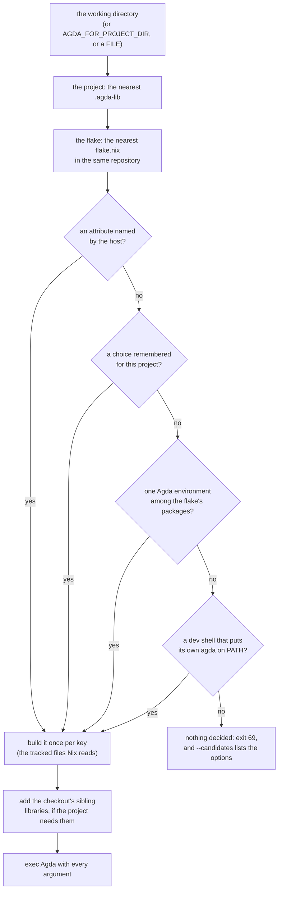

<!-- File: docs/notes/project-agda.md -->

# Each project's own Agda

This note explains `agda-for-project`, the program that lets an editor
check a file of any Agda project with that project's own Agda and
libraries.  [ADR 0004][adr-0004] records the decisions and the evidence
behind them; this note says how the program works and how to use it.

## The problem

An editor starts one Agda for every file it is given: agda2-mode in Emacs
runs `agda2-program-name`, and agda-mode-vscode runs the last entry of
`agdaMode.connection.paths`.  That works while every file you open belongs
to projects on the same Agda with the same libraries.  It stops working the
day you have two, as anyone who checks a library of their own beside a
project of their employer's soon does, and the errors read as broken code
rather than as the wrong Agda.  Both of the following were met on
2026-11-07:

+  A file of formal-ledger-specifications (Agda 2.8.0, five libraries)
   opened while the editor's Agda was agda-algebras' (Agda 2.9.0, the
   standard library alone):

        error: [LibraryError]
        Library 'standard-library-classes' not found.

+  A worktree of formal-ledger-specifications pinned to an older lock,
   checked with the environment built from the master checkout's lock
   (whose library had since absorbed a definition the old code still makes):

        Multiple definitions of _≢ᵐ_.

The usual fixes do not last.  A hand-built pin (`nix build .#env -o
~/some-agda`) matches one lock and goes stale in silence when the lock
moves; a table of projects in the editor's configuration must be kept by
hand for every checkout and every worktree; and switching Agdas by hand
before every file is the chore this program exists to end.

## The idea

A project worth checking usually pins its Agda and its libraries already,
in a Nix flake: its `flake.lock` names every input by hash.  So the answer
to "which Agda for this file" is written down, and a program can read it.
`agda-for-project` is a program an editor runs where it would run `agda`.
It finds the file's project and the project's flake, decides which Agda
the flake names, builds it the first time, and then runs it with every
argument the editor passed, so the editor cannot tell it from `agda`.

## How it decides

+  **The project** is the directory of the nearest `.agda-lib` at or above
   the file, as Agda itself finds a file's library.  **The flake** is the
   nearest `flake.nix` at or above the project, without leaving its
   repository.
+  **An attribute the host names** wins: `AGDA_FLAKE_ATTR=NAME` in the
   environment, or `--flake-attr NAME` first on the command line.  This is
   how a configuration says "this project's Agda is that output", and it is
   the interface of agda-native-air's `agda-for-flake.sh`, so a
   registration written for that script works here.
+  **A choice you made** for the project comes next (see "Choosing" below).
+  **The flake's one Agda environment**: a package named `default`, or with
   `agda` in its name, that is an `agda.withPackages` (its `pname` is
   `agdaWithPackages`).  The program evaluates the candidates rather than
   trusting their names: formal-ledger-specifications has four packages
   with `agda` in the name and one environment among them.  With several
   environments, `default` decides if it is one.
+  **The flake's default dev shell**, when entering it puts an `agda` of its
   own on PATH, in the Nix store or in the checkout.  agda-algebras'
   downstream projects work this way: their shell writes
   `.agda/bin/agda`, a wrapper with the project's libraries.  The program
   enters the shell once, notes the `agda` and the `AGDA_DIR` it set, and
   runs that `agda` directly afterward.
+  **Otherwise nothing is decided**, and the program says so and exits 69
   without running any Agda.  It never runs some other Agda instead.

The environment is tried before the dev shell because evaluating a package
runs nothing and builds only Agda and its libraries, while entering a dev
shell runs the project's hook and builds every tool its developers use.
For a project whose dev shell gives more (agda-algebras' wrapper makes the
standard library and agda-algebras visible to a scratch file outside every
library), choose the dev shell.

## Building once, and only when it matters

The first time a project's Agda is needed, the program builds it with
`nix build` (usually a download from a cache) and keeps the result as a
gc root under `~/.cache/agda-for-project/`.  Later starts reuse it until
the **key** changes: a hash of every file of the checkout that Nix reads
(every tracked file except Agda sources).  So a moved lock, an edited
`flake.nix`, or a branch that changes a build tool gets its own build, and
editing proofs never triggers one.  Worktrees on the same lock share one
build; a worktree on another lock gets its own.  On the machine measured,
a warm start adds 0.2 s to Agda's own.

## Sibling libraries

An Agda environment cannot contain the project's own library, and a
project may depend on another library in the same checkout:
formal-ledger-specifications' test library, formal-ledger-test, depends on
formal-ledger.  When the project's `.agda-lib` depends on a library the
environment does not provide, the program writes a libraries file with the
environment's entries plus the checkout's `.agda-lib` files that provide
the missing names, and passes it to Agda.  Without it, the test library's
modules fail with `Library 'formal-ledger' not found`; with it, they check.

## Using it

From a shell, with nothing installed but Nix:

    nix run github:formalverification/agda-native-ide#agda-for-project -- --explain path/to/File.agda

Or install it into your profile, so that editors find `agda-for-project`
on PATH:

    nix profile install github:formalverification/agda-native-ide#agda-for-project

`--explain` shows what it decided, building first if needed (`--no-build`
to only look).  For a module of formal-ledger-test, on 2026-11-07:

    project    ~/git/IO/fls/master/formal-ledger-test (formal-ledger-test.agda-lib)
    flake      ~/git/IO/fls/master
    decided by discovery in the flake, for x86_64-linux
    agda       package: fls-agdaWithPackages
    program    ~/.cache/agda-for-project/package/fls-agdaWithPackages/fd3559bd…/bin/agda --library-file=~/.cache/agda-for-project/registries/11c5b481….libraries
    version    2.8.0
    libraries  /nix/store/6qscaqml…-libraries (the environment's)
    libraries  ~/.cache/agda-for-project/registries/11c5b481….libraries (with ~/git/IO/fls/master/formal-ledger.agda-lib)

With `--json` the same answer is one JSON object, which is what the editor
integrations read.

+  **Emacs**: an agda2-mode package that starts each buffer's project's
   Agda through this program, restarting Agda when you switch projects, is
   [#98].
+  **VS Code**: agda-mode-vscode and this repository's companion running
   each project's Agda through it are [#99].
+  **agda-mcp** (agda-native-air's tool server for agents): name the
   program as `--agda-bin`; set `AGDA_FLAKE_ATTR` in the registration's
   environment only if discovery would not find the right output.
+  **Any other tool** that runs `agda` can run `agda-for-project` instead,
   from the file's directory or with `AGDA_FOR_PROJECT_DIR` set to it.

## Choosing

When nothing decides (a project without a flake, a flake with several
environments and no `default`, or a dev shell with no Agda), or when you
want another answer than discovery gives:

    agda-for-project --candidates path/to/File.agda
    agda-for-project --choose package:fls-agdaWithPackages path/to/File.agda
    agda-for-project --choose devshell:default path/to/File.agda
    agda-for-project --choose path:/some/agda path/to/File.agda
    agda-for-project --forget path/to/File.agda

`--candidates` lists the flake's environments and dev shells, the Agdas
the program has already built for any project, and `agda` on PATH, each
with an ID for `--choose`.  A choice is kept in
`~/.local/state/agda-for-project/`, never in the checkout, and applies to
every worktree of the project's repository.

## Making a project easy to find

A project is found without any choice if its flake exports either of the
following:

+  **An Agda environment** among its packages, ideally as `default` or as a
   name containing `agda`:

        packages.${system}.default = pkgs.agda.withPackages (p: [ p.standard-library ]);

+  **A default dev shell** that puts its own `agda` on PATH, as a wrapper
   in the checkout or as a store path.

## Limits

+  **One Agda per editor process**: agda2-mode keeps one Agda process, so a
   switch of project restarts it (the [#98] package does this), and the
   other project's buffer needs a load again.
+  **The first build can take minutes** on a machine without the project's
   store paths, and nothing is shown in the editor until it ends; build it
   first from a shell with `agda-for-project --explain FILE`.
+  **`legacyPackages` is not searched**, and a flake outside git is
   evaluated on every start.
+  **Linux and macOS** with bash and Nix; Windows is untested.
+  **The cache is never cleaned**: delete old roots in
   `~/.cache/agda-for-project/` (`ls -lt` shows the newest first), then run
   `nix store gc`.

[adr-0004]: ../adr/0004-each-projects-own-agda.md
[#98]: https://github.com/formalverification/agda-native-ide/issues/98
[#99]: https://github.com/formalverification/agda-native-ide/issues/99
